*Dealing with Waves of Unstructured and Disconnected Data*

A.I. has changed how we need to learn. Early on in our software engineering careers we realize that in order to keep working we need to learn how to learn — to teach ourselves new skills.

### Learning can’t happen in a vacuum.

But what skills are going to be important in this new paradigm? We need to make some predictions on how things might change. I actually decided to ask A.I. what engineers might focus on. It gave some pretty decent advice around embracing lifelong learning, creativity and leadership.

AI excels at tasks with clear rules and patterns but struggles with novel, undefined problems. Human creativity and innovation are distinct advantages in conceptualizing new solutions and applications. So…

### We need data. We need information. We need tools and processes to gain knowledge and insights, and to develop our wisdom and intuition as we code, and A.I. has changed the priority of learning.

We have to increase the depth of our understanding and observation of how things work. And, honestly, we can use A.I. to help us connect the dots.

## Building Foundations — DIKW Pyramid

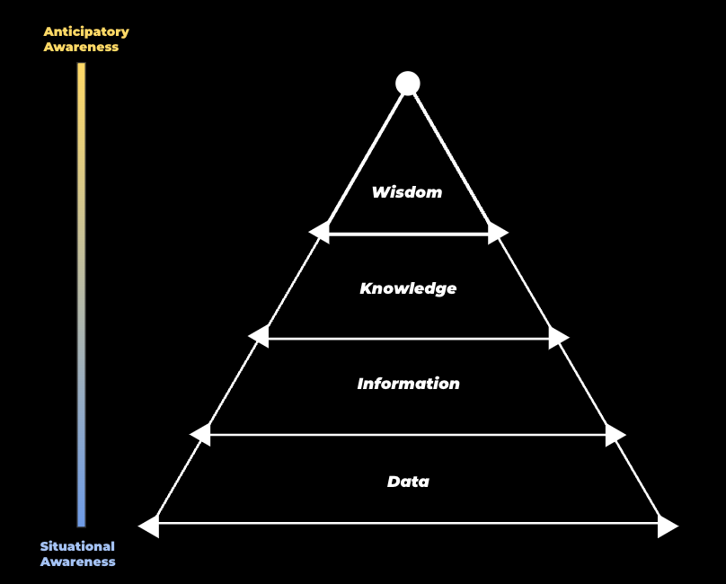
*DIKW Pyramid*

*The DIKW pyramid is a model of human understanding that helps us make predictions and create insights about the future. It also is a general heuristic for the evolution of behavioral awareness over time.*

This pyramid is the conceptual essence behind some pretty foundational ancient beliefs. You probably didn’t know that Egyptian temples back in the Old Kingdom contained a [sacred library](https://www.ucl.ac.uk/museums-static/digitalegypt/museum/museum2.html) and [architectural workshop](https://www.ucl.ac.uk/museums-static/digitalegypt/amarna/perankh.html) within them dedicated to Thoth, Seshat, and Khnum. They are the gods and goddess of magic, writing, words, and architecture — spirit into form, which back then were essentially all the same. Essentially the Libraries of Alexandria evolved from those smaller libraries and were and organized around the value of knowledge and wisdom.

The flow of learning and conceptual wisdom is represented in the [DIKW Pyramid](https://en.wikipedia.org/wiki/DIKW_pyramid). All systems are conceptual first. They hold certain values and help transform processes that are grounded in facts. Its what Aristotle and Pythagoras taught their students, and it is the playground of systems theorists and engineers today. The future of AI, data, cognitive and computer science is moving quickly. These foundations have practical implications today for how we build our future.

We can use the [DIKW pyramid](https://en.wikipedia.org/wiki/DIKW_pyramid) as a pathway to lead ourselves on knowledge adventures, to find the AI castle and rescue the data dragons from the princesses that are attempting to model them.

*Wielding a software sword is hard m’kay*

As an engineer, it’s up to you to find the dragons and create castles to contain them. It’s up to you to observe the world around you, to put events in context with other information, to build and experiment, to create knowledge processes, and to find patterns that develop your wisdom and intuition to flush out bad code and designs — to reduce hallucinations in the narrative of your life and your business.

## Evolutionary Learning

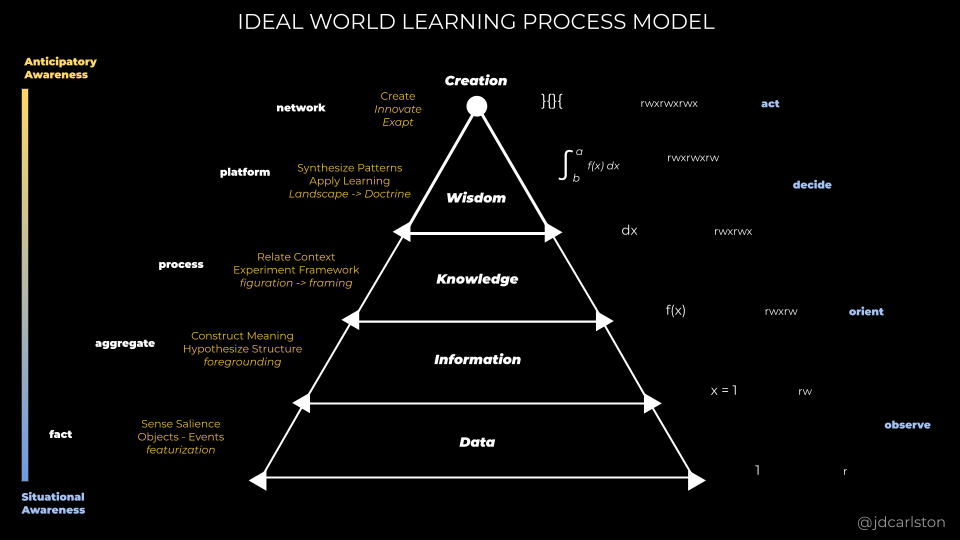
*DIKW Process Model*

Putting understanding into practice means relating what you *know* to what you are learning by *realizing it*. That includes getting paid. But in order to get paid you might need to chase some rabbits — to experiment, consult with experts, test out new tools, consume online courses, write tests, build prototypes, read websites and books, and practice. It also includes spending time in nature away from technology. Yeah, that’s a lot. Focus and time management becomes really important.

## Tech Radar & Concept Mapping

A [Tech Radar](https://miro.com/miroverse/technology-radar/) as well as a Concept Map can help. I’ve actually been building my own personal Tech Radar and a few [Wardley Maps](https://learnwardleymapping.com/) to help me prioritize.

Tech Radars have four quadrants and can help you (or a team or an org) focus and constrain tools, platforms, frameworks, practices, and languages. It helps you answer what you might want to use and where you might want to [focus your collective efforts](https://docs.google.com/presentation/d/1UeNNIb97VOWElaseja6XOWJJdkavPSdSgyV6Uwj1IrQ/edit?usp=sharing). Tech Radar helps you prioritize tools and needed skills. We need diverse (yet still constrained) sets of tools and people to maintain abundance in complex systems.

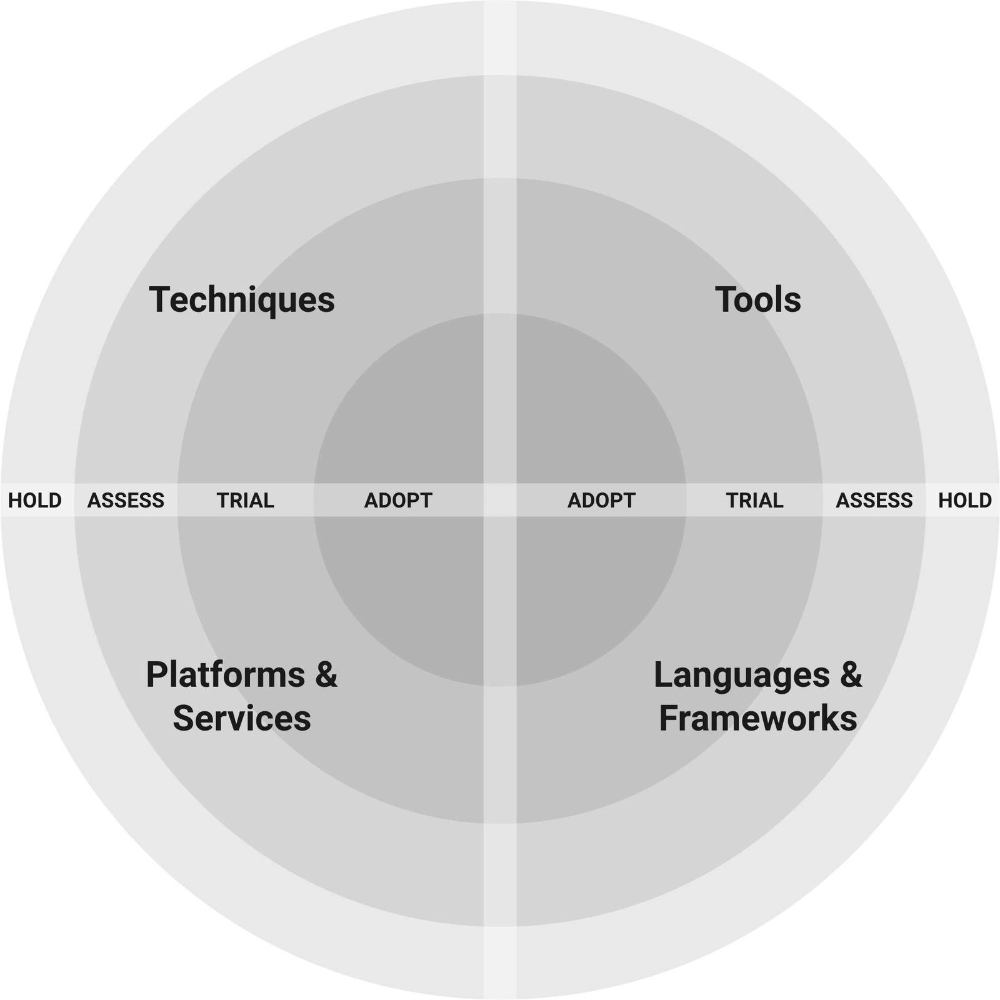
*Tech Radar Template*

[Concept Maps](https://miro.com/concept-map/) can help you understand a new domain or just organize your thoughts. I find them useful to create when learning new skills or understanding a domain.

[Wardley Maps](https://en.wikipedia.org/wiki/Wardley_map) are great for helping your prioritize and strategize based on value and evolution. If you want to make money, use a Wardley Map to help you figure out what will drive the most value into to your pocketbook.

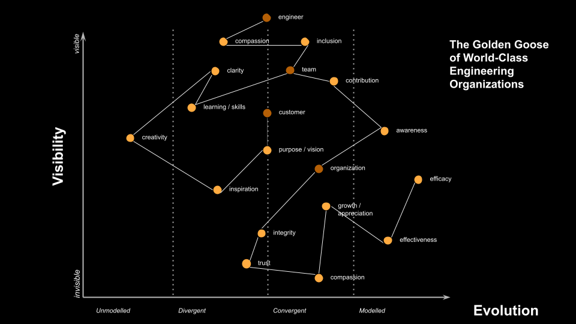
*Wardley Map of how engineers drive value for customers and organizations*

## Stages of Learning

As you’re learning you might find yourself moving through various stages. You might get frustrated. You might find evidence that you didn’t take important factors into account. You might need to fine-tune and recontextualize relevant data. You might need to slow down and focus, or speed up and zoom out to transform your models. You gain a feel for where you sit in the [*zones of learning*](https://www.mindtools.com/a0bop9z/the-learning-zone-model)*.*

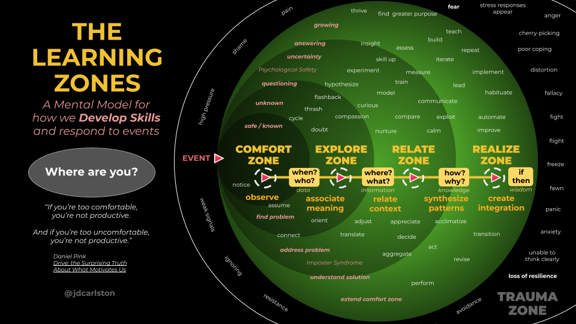
*The Learning Zones, a mental model for how we develop skills and respond to events*

*I use different emotional states and behaviors as wayfinding tools within the learning zones as I build and consult with others. I created this model based on others to help me pinpoint and progress from wherever I’m looping within the spheres.*

Ultimately, we can’t really teach ourselves without learning from those who came before us. We need to make sense of the world - with the help of AI source information — from authors, colleagues, and domain experts. Using their knowledge and wisdom can help us acquire depth in what we need to practice more effectively.

[Learning How to Learn as a Software Developer.](https://docs.google.com/presentation/d/1Y1yV2xodc-lLqG7b6nh4Lx6mSz82shgF2f4hN5ClnWg/edit)

## We have to change ourselves in order to change our systems

We learn to curate our own skills based on the goals we’ve set for ourselves and for our communities. As we move through different stages of understanding we change and transform ourselves. It’s powerful to remember that we have to change ourselves in order to change our systems.

We live in so much Abundance. Our culture doesn’t like us to think about that though. [Need is what drives capital.](/essays/what-in-the-world-is-world-class-engineering-part-2/) So, to think differently you need to go slow, to be thoughtful and to [develop an Abundance Mindset](https://docs.google.com/presentation/d/13y-41pLsCn0KsxcztFxhZZKx1yZrLuMLA88Z6Zz6i6M/edit?usp=sharing). Go through this [linked deck](https://docs.google.com/presentation/d/13y-41pLsCn0KsxcztFxhZZKx1yZrLuMLA88Z6Zz6i6M/edit?usp=sharing). We have to become the power lead.

## Leadership and Storytelling

I believe all humans can see themselves as leaders in their own areas of expertise. We need to lead ourselves as we refactor our systems — to define the critical factors and to focus our actions. This attitude can have a transformational effect on your career and your life.

The [Narrative Collapse](https://www.tiktok.com/t/ZT8Gkx21G/) brought on by [neoliberalism](https://docs.google.com/presentation/d/1JQ0si6-FD02f1wSCFc6diqbtZEYm1FZbFoJP4eBhSqM/edit#slide=id.p)is real, and it impacts all of us. People are telling more and more stories that don’t make sense, that fly in the face of reality. *Its vitally important to check their sources, their biases, and their motivations.*

Metamodern philosophy can help us escape the conceptual black hole of fantastical time binding it creates. Its up to leaders to tell the stories that help us create a vision for a more compassionate world. I’ve been thinking a lot about U[rsula K. LeGuin](https://youtu.be/vRC0cK_MSA0?si=gQbj_DUrL0RiH-Ze) lately. She was such a visionary trying to help us build that better world. We need to become [better engineers leading to our future](/essays/what-in-the-world-is-world-class-engineering/).

I know there are a lot of engineers that are looking at how AI will and might change their jobs. Machine Learning, transformers, copilots, finetuning, generative AI, GPT integrations... all good things to get your hands dirty on.

Times are a changing, and will continue to change. BUT there is still a great need for humans to tell stories, turn them into processes by building systems, and to learn through observation.

AI is very hungry for the data and information that we create as we work, for what isn’t readily available on the internet, for the hidden gems found in every struggle and every experience. We’re just beginning to scratch the surface of its hunger, its potential, and its tradeoffs.

*Feed Me, See More*

So that leads us back to data that isn’t readily available. To the slow observers, to the focused flow of attention. To the love and compassion and care we can give in [intersubjective relationship](https://docs.google.com/presentation/d/1UeNNIb97VOWElaseja6XOWJJdkavPSdSgyV6Uwj1IrQ/edit) with the world.

## Community Involvement

Another way to learn quickly is to get involved in communities and actually talk to people. I know how strange this can be in a post-COVID world, but events like [Boston Software Crafters](https://www.meetup.com/boston-software-crafters/events/) that a friend of mine runs, and other meetups make it pretty easy. The [Lean](https://www.lean.org/), [Agile](https://www.agilealliance.org/), [Wardley Mapping](https://community.wardleymapsforbusiness.com/home) and [DDD](https://www.dddcommunity.org/) communities are still thriving and growing today, as are many others around the world.

* * *

## Book Learnin’

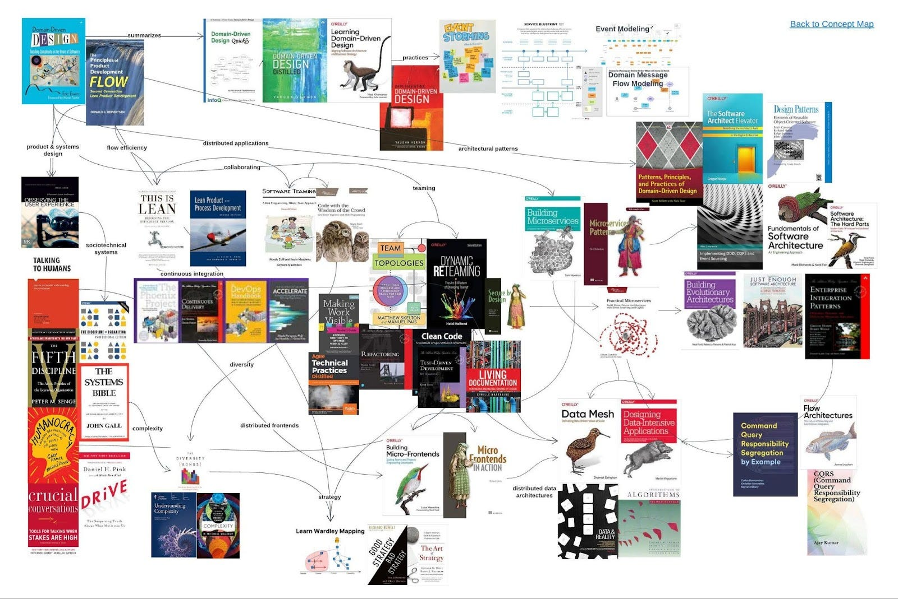
*Connecting the Dots*

Over the years I’ve read a LOT of different books and worked to study many different concepts in software engineering and architecture. I’ve gone on a lot of different software engineering adventures. These books reflect some aspects of my path as I built my own curriculum and try to develop skills that cause me to think differently.

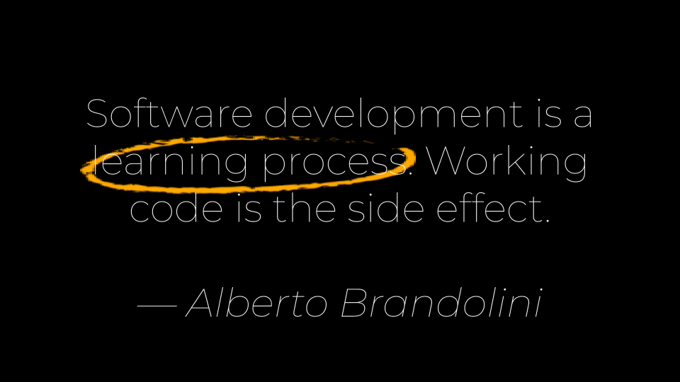
*Software development is a learning process. Working code is the side effect. — Alberto Brandolini*

This list is a compilation of some of what I’ve read along the way and found to be helpful. It’s not exhaustive, and I’m sure it will be overwhelming to many. I know there are books I’ve left off that are valuable. In writing this piece I continually remembered other books that have helped me, but I can say I look to these for certain foundations and am often reminded of them in conversations with other engineers. Reading these books is, and was, an iterative journey with a deepening understanding.

The books contain key information necessary for a broad understanding of software engineering, design & architecture, sociotechnical organization, strategy, and product development. It’s a list based on my experience and adopted principles that have been, in no small part, informed by the authors that wrote and researched these books. I’ve returned to them time and again for the information, practices, and wisdom that is contained within their pages. The list is domain-driven and architecture-heavy because that’s where I’ve placed my focus for quite some time.

Its a tough road to go down when systems don’t have a strong connection to their values, their customers, or their strategic narrative. The [Game of Life](https://playgameoflife.com/) starts to fall apart. The last few years I have been working with engineering teams to break down how [Domain Driven Design](https://lucid.app/lucidchart/0746ae76-b847-42f0-afe2-763044df501f/edit?viewport_loc=110%2C485%2C2484%2C1402%2CBT1sL_OZ41a2&invitationId=inv_0ce750c8-2a20-4400-8691-f95cde28ff0f) can help improve resilience, software value, architecture and functionality of their systems. Square one can be hard to focus on when you think you’re at square ten.

If teams aren’t working on improving things that the customers find frustrating, or that they find enough value in to outweigh the drawbacks of a system built for another purpose, then what’s the point?

## Domain Driven Design Theory & Practices

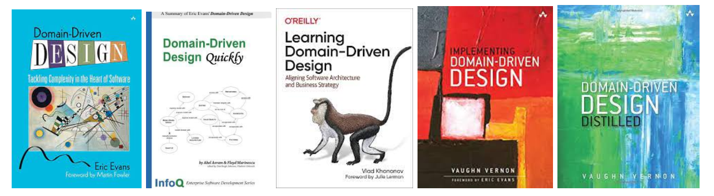

1. [Domain-Driven Design](https://www.domainlanguage.com/ddd/)
2. [Domain-Driven Design Quickly](https://www.infoq.com/minibooks/domain-driven-design-quickly/) (free from InfoQ)
3. [Learning Domain-Driven Design](https://vladikk.com/)
4. [Implementing Domain-Driven Design](https://vaughnvernon.com/)
5. [Domain-Driven Design Distilled](https://vaughnvernon.com/)

[Domain-Driven Design](https://www.domainlanguage.com/ddd/) (DDD) stands as a foundational book in the world of software engineering. It has helped me to understand essential components of software development from very early on in my career. I quote from it quite often and can see how it has been informed from and by other books in this list. [C*ontext maps*](https://github.com/ddd-crew/context-mapping) and [*Service Blueprints*](https://docs.google.com/presentation/d/1Ysm6K0d2R0tjW2aVUqyqvgzisd9z707SMPz2L25L_Ps/edit) are an invaluable engineering and architecture tool, as are all the patterns the book lays out. I started with DDD because I wanted others to be able to appreciate how this work influences and affects the design of software systems today.

DDD models how important it is to conceptualize and organize software with the domain experts and across teams. Building systems and processes around people, with the primary focus on delivering value to who is using them, helps us create great software. DDD emphasizes the importance of understanding and modeling the business domain within software systems. It advocates for collaboration with domain experts to ensure that the software reflects the real-world concepts and requirements of the problem domain.

The other books on DDD such as “[Domain-Driven Design Quickly](https://www.infoq.com/minibooks/domain-driven-design-quickly/)”, “[Domain-Driven Design Distilled](https://vaughnvernon.com/),” and “[Implementing Domain-Driven Design](https://vaughnvernon.com/),” delve into the core concepts and techniques of DDD, serving as essential references for engineers looking to build software systems that align closely with the problem domain and build on those foundations.

## Flow Efficiency

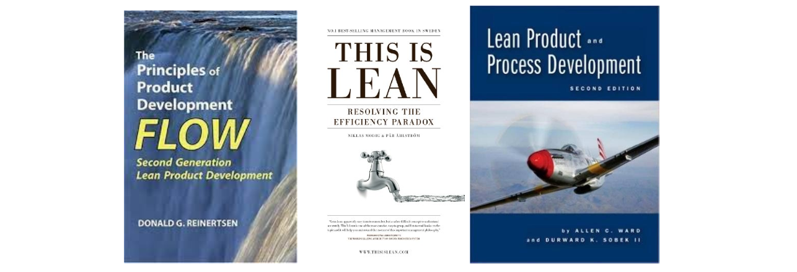

1. [Principles of Product Development Flow](http://lpd2.com/)
2. [This is Lean](https://thisislean.com/)
3. [Lean Product Process Development](https://www.lean.org/store/book/lean-product-and-process-development-2nd-edition/)

[Flow Efficiency](https://www.pluralsight.com/tech-blog/why-we-optimize-for-flow-efficiency/) is to product creation in the last half of the 20th & 21st centuries what manufacturing is to the 19th and 20th. There is strong evidence that focusing our health, education, business and engineering systems on flow efficiency creates significant gains for our entire economy — public and private sectors alike.

The books “[Principles of Product Development Flow](http://lpd2.com/),” “[This is Lean](https://thisislean.com/),” and “[Lean Product Process Development](https://www.lean.org/store/book/lean-product-and-process-development-2nd-edition/)” are interconnected and provide valuable insights into the principles and practices of flow efficiency and lean thinking in the context of product development. They collectively contribute to a holistic understanding of Lean methodologies and their application to streamline and optimize product and business development processes. My copy of “This Is Lean” is dogeared and “Principles of Product Development Flow” has many colors of highlights.

“Principles of Product Development Flow” lays the foundation by exploring the fundamental principles and metrics that drive efficiency and productivity in product development. “This is Lean” expands the scope of lean thinking and demonstrates its applicability across various domains, including product development. “Lean Product Process Development” provides a more focused approach to applying Lean principles specifically in the product development lifecycle. Lean flow efficiency and DDD combine together quite effectively and elegantly to help engineers build iteratively for what matters.

## DevOps & Continuous Improvement

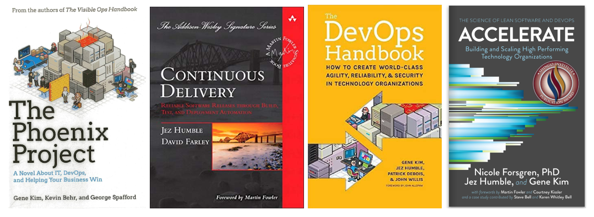

1. [The Phoenix Project](https://itrevolution.com/product/the-phoenix-project/)
2. [Continuous Delivery](https://martinfowler.com/books/continuousDelivery.html)
3. [DevOps Handbook](https://www.goodreads.com/en/book/show/26083308)
4. [Accelerate](https://en.wikipedia.org/wiki/Accelerate_%28book%29)

These books are interconnected in their focus on DevOps principles, practices, and cultural aspects. They build on lean principles as well. “[The Phoenix Project](https://www.goodreads.com/en/book/show/17255186)” sets the stage by illustrating the need for collaboration and alignment between teams. (I’m looking forward to reading [The Unicorn Project](https://itrevolution.com/product/the-unicorn-project/) asap). “[Continuous Delivery](https://martinfowler.com/books/continuousDelivery.html)” delves into the technical practices and automation required for continuous delivery. The “[DevOps Handbook](https://www.goodreads.com/en/book/show/26083308)” expands on the cultural and organizational aspects of DevOps, while “[Accelerate](https://en.wikipedia.org/wiki/Accelerate_%28book%29)” presents empirical evidence and metrics that measure the impact of DevOps practices on software delivery performance.

They cover the basics of DevOps, from its foundational concepts to the basic implementation of DevOps pipelines. They emphasize the importance of collaboration, automation, continuous improvement, and feedback loops in achieving high-performance software delivery. They also build on practices from DDD as well as flow efficiency. The [DORA metrics](https://cloud.google.com/blog/products/devops-sre/using-the-four-keys-to-measure-your-devops-performance) from Accelerate are particularly helpful for judging organizational health.

## Collaboration & Clean Coding

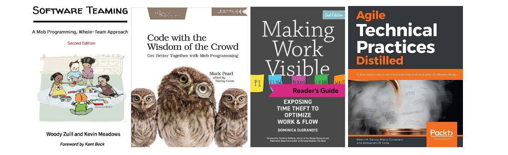

1. [Software Teaming](https://softwareteaming.com/)
2. [Code with the Wisdom of the Crowd](https://pragprog.com/titles/mpmob/code-with-the-wisdom-of-the-crowd/)
3. [Making Work Visible](https://www.productthinking.cc/p/making-work-visible-exposing-time)
4. [Agile Technical Practices Distilled](https://leanpub.com/agiletechnicalpracticesdistilled)

“[Software Teaming](https://softwareteaming.com/)” lays the foundation for collaborative coding by exploring the dynamics of effective ways for teams to work together. The authors changed how people code into a more dynamic and effective process with these practices. “[Code with the Wisdom of the Crowd](https://pragprog.com/titles/mpmob/code-with-the-wisdom-of-the-crowd/)” builds upon this foundation by[highlighting the benefits of collaborative coding practices.](https://www.productthinking.cc/p/making-work-visible-exposing-time) “[Making Work Visible](https://itrevolution.com/product/making-work-visible/)” complements these books by providing techniques to visualize, build dashboards, and manage work effectively, enhancing collaboration and transparency. “[Agile Technical Practices Distilled](https://leanpub.com/agiletechnicalpracticesdistilled)” is a great practical book that focuses on helping teams work together to implement skills that support agility, testing, and collaboration, ensuring the delivery of high-quality software.

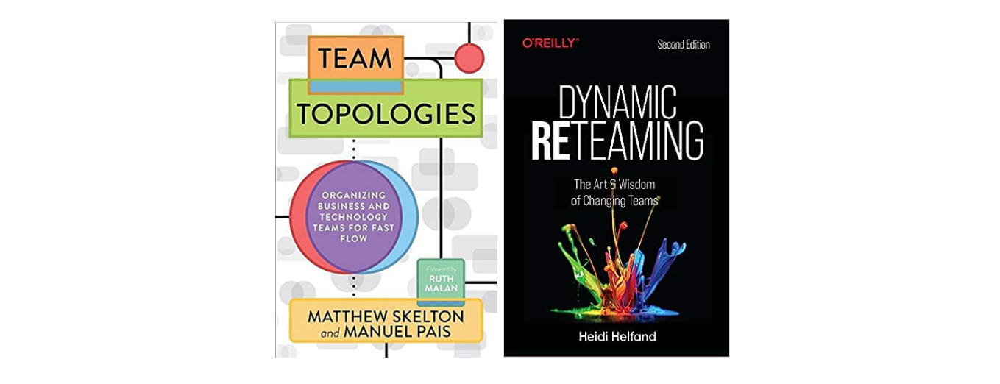

1. [Team Topologies](https://teamtopologies.com/)
2. [Dynamic Reteaming](https://www.heidihelfand.com/dynamic-reteaming/)

These two books are interconnected in their exploration of team organization, adaptability, and dynamics. “[Team Topologies](https://teamtopologies.com/)” focuses on designing and optimizing team structures to align with the needs of the software system — focusing particularly on Conway’s Law and how to organize work through it more effectively, while “[Dynamic Reteamin](https://www.heidihelfand.com/dynamic-reteaming/)g” addresses the practicalities and benefits of team change and adaptability.

All these books offer insights into creating and evolving teams in the context of software development. They acknowledge [Conway’s Law](https://en.wikipedia.org/wiki/Conway%27s_law), provide guidance on how to structure teams effectively, optimize communication and collaboration, and embrace change and adaptability. By studying and applying the knowledge and practices presented in these books, organizations can create resilient and high-performing teams that are able to adapt to changing circumstances and deliver successful software outcomes.

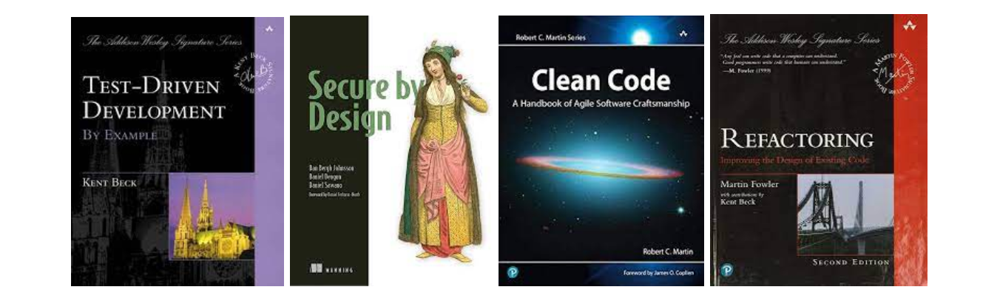

1. [Test Driven Development](https://martinfowler.com/bliki/TestDrivenDevelopment.html)
2. [Secure By Design](https://www.manning.com/books/secure-by-design)
3. [Clean Code](https://medium.com/javarevisited/clean-code-a-must-read-coding-book-for-programmers-9dc80494d27c)
4. [Refactoring](https://martinfowler.com/books/refactoring.html)

These books emphasize good software development practices and code quality. “[Test Driven Development](https://martinfowler.com/bliki/TestDrivenDevelopment.html)” by [Kent Beck](https://www.kentbeck.com/), promotes a disciplined approach to writing tests and developing code incrementally. TDD turns writing code right-side up. “[Secure By Design](https://www.manning.com/books/secure-by-design)” highlights the importance of incorporating security considerations into the software development process and builds on the premise of DDD. “[Clean Code](https://medium.com/javarevisited/clean-code-a-must-read-coding-book-for-programmers-9dc80494d27c)” might be getting a bit long in the tooth, but it’s generalizable and, to my knowledge, there’s nothing else quite like it available. It provides guidelines for writing code that is readable, maintainable, and adheres to best practices. “[Refactoring](https://martinfowler.com/books/refactoring.html)” focuses on improving the design and structure of existing code while preserving its functionality.

## Designing Amazing User Experiences

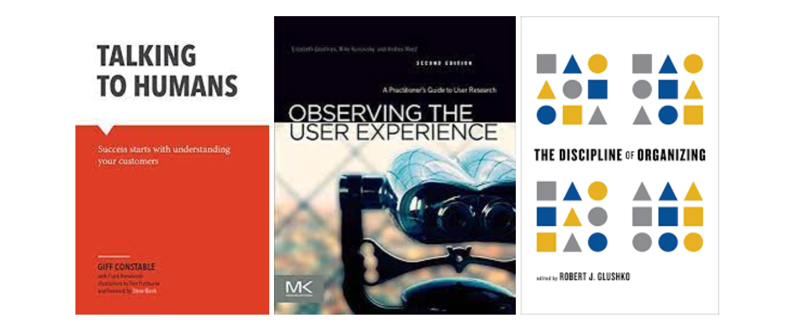

1. [Talking to Humans](https://www.talkingtohumans.com/)
2. [Observing the User Experience](https://www.sciencedirect.com/book/9780123848697/observing-the-user-experience)
3. [The Discipline of Organizing](https://open.umn.edu/opentextbooks/textbooks/913)

[“Talking to Humans](https://www.talkingtohumans.com/)” serves as a foundation for designing amazing user experiences by emphasizing the significance of engaging in meaningful conversations with users to uncover valuable insights and understand their needs and behaviors. It provides techniques for conducting effective user interviews and explores the importance of empathy and active listening.

Building upon this foundation, “[Observing the User Experience](https://www.sciencedirect.com/book/9780123848697/observing-the-user-experience)” introduces methods for directly observing users in their natural environments, gathering qualitative and quantitative data to inform the design process. It emphasizes the value of user research and understanding user behaviors.

Finally, “[The Discipline of Organizing](https://open.umn.edu/opentextbooks/textbooks/913)” is another seminal work that takes a broader perspective and explores principles and techniques for organizing complex information, ensuring that experiences are intuitive and facilitate findability and is the grounding basis for improving AI systems. This book underpins much of software development and is a cornerstone in the DIKW pyramid.

Together, these books provide a comprehensive approach to designing user experiences by combining the power of conversations, observation, and effective information organization, ultimately enabling engineers, product managers, architects, and designers to create engaging and user-centered experiences.

## Social & Organizational Motivation

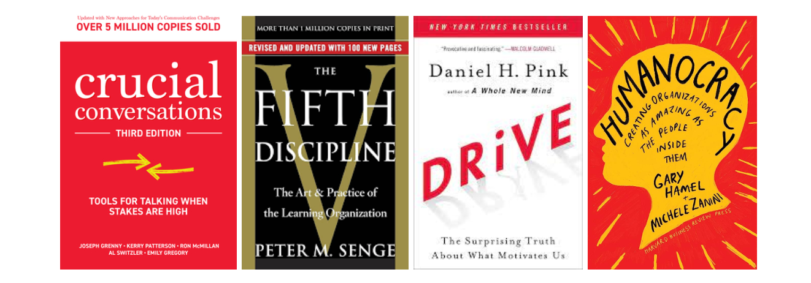

1. [Crucial Conversations](https://cruciallearning.com/crucial-conversations-book/)
2. [The Fifth Discipline](https://thesystemsthinker.com/the-fifth-discipline-fieldbook-a-guide-to-the-learning-organization/)
3. [Drive](https://www.danpink.com/books/drive/)
4. [Humanocracy](https://www.humanocracy.com/)

[“Crucial Conversations](https://cruciallearning.com/crucial-conversations-book/)” highlights important techniques for effective communication and dialogue in resolving conflicts and achieving positive outcomes. It provides techniques for navigating difficult conversations and fostering a culture of open and honest communication. Building upon this foundation, “[The Fifth Discipline](https://thesystemsthinker.com/the-fifth-discipline-fieldbook-a-guide-to-the-learning-organization/)” explores the concept of a learning organization and emphasizes the value of systems thinking, shared vision, and personal mastery in motivating individuals and fostering collective learning. “[Drive](https://www.danpink.com/books/drive/)” delves into the factors that truly motivate individuals, shifting the focus from traditional carrot-and-stick approaches to intrinsic motivation, autonomy, mastery, and purpose.

“[Humanocracy](https://www.humanocracy.com/)” includes case studies and the need for radical organizational change in framing them as [complex adaptive systems](https://medium.com/10x-curiosity/complex-adaptive-systems-simple-rules-unpredictable-outcomes-e85d2f5230a5). It advocates for principles such as empowerment, decentralization, and meritocracy to drive motivation and unleash the potential of individuals within an organization. Together, these books provide a comprehensive understanding of social and organizational motivation by addressing effective communication, creating a learning culture, empowering individuals, and understanding intrinsic drivers. Engineers can use these books foster motivation and learning.

## Systems Theory & Complexity

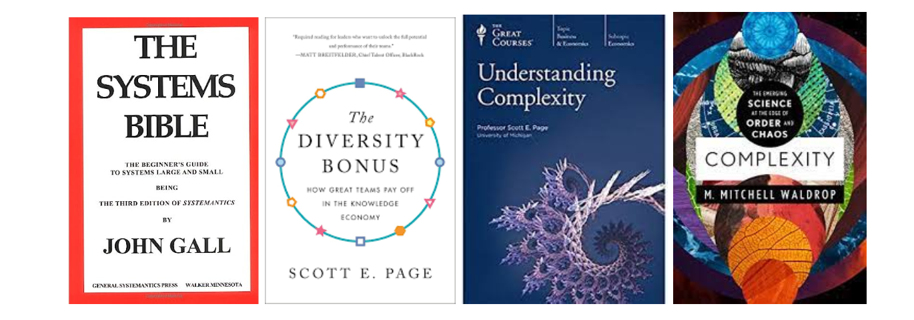

1. [The Systems Bible](https://verraes.net/2013/08/john-gall-systemantics-the-systems-bible/)
2. [The Diversity Bonus](https://sites.lsa.umich.edu/scottepage/home/the-diversity-bonus/)
3. [Understanding Complexity](https://sites.lsa.umich.edu/scottepage/)
4. [Complexity: The Emerging Science at the Edge of Order and Chaos](https://commoncog.com/learning-from-waldrop-complexity/)

[“The Systems Bible](https://verraes.net/2013/08/john-gall-systemantics-the-systems-bible/)” introduces the fundamental principles of systems thinking in a snarky and humorous way, while “[The Diversity Bonus](https://sites.lsa.umich.edu/scottepage/home/the-diversity-bonus/)” highlights the role of diversity in addressing complexity. “[Understanding Complexity](https://sites.lsa.umich.edu/scottepage/)” provides a theoretical foundation for studying complex systems, and “[Complexity: The Emerging Science at the Edge of Order and Chaos](https://commoncog.com/learning-from-waldrop-complexity/)” further explores the history of the study of complex systems across different domains. We can use the knowledge and principles presented in these books to develop a holistic perspective on systems and complexity, enabling us to better understand and navigate complex challenges in various contexts.

## Microservices — Distributed Application Dynamics

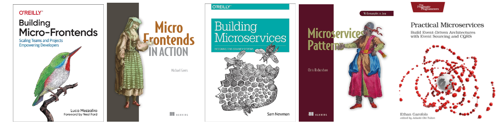

1. [Building Micro-Frontends](https://www.buildingmicrofrontends.com/)
2. [Micro Frontends In Action](https://www.manning.com/books/micro-frontends-in-action?new=true)
3. [Building Microservices](https://samnewman.io/books/building_microservices_2nd_edition/)
4. [Microservices Patterns](https://microservices.io/book)
5. [Practical Microservices](https://pragprog.com/titles/egmicro/practical-microservices/)

These five books cover various aspects of microservices architectures from the foundational concepts to implementation techniques. “[Building Microservices](https://samnewman.io/books/building_microservices_2nd_edition/)” introduces the core principles, “[Microservices Patterns](https://microservices.io/book)” offers a catalog of patterns for designing scalable and resilient microservices, “[Practical Microservices](https://pragprog.com/titles/egmicro/practical-microservices/)” provides insights into real-world implementation considerations, and “[Micro Frontends In Action](https://www.manning.com/books/micro-frontends-in-action?new=true)” and “[Building Micro-Frontends](https://www.manning.com/books/micro-frontends-in-action?new=true)” extends the microservices concept to the frontend layer. People can use these books to design, build, and deploy microservices-based systems that are scalable, maintainable, and adaptable to changing requirements.

I feel pretty strongly at this point that microservices should be very carefully and mindfully created, and that it is better to evolve them out of the monolith than build them from scratch.

## Distributed Data Systems — Understanding Data

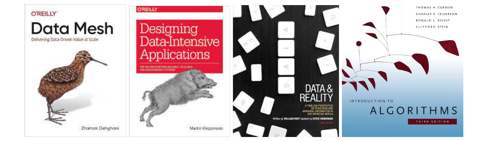

1. [Data Mesh](https://www.datamesh-architecture.com/)
2. [Designing Data-Intensive Applications](https://dataintensive.net/)
3. [Data & Reality](https://www.bkent.net/Doc/darxrp.htm)
4. [Introduction to Algorithms](http://mitpress.mit.edu/9780262046305/introduction-to-algorithms/)

Modernizing data architecture, engineering, and algorithms is essential. (BTW I’m excited to read [Nick Tune](https://nick-tune.me/)’s book [Architecture Modernization](https://www.manning.com/books/architecture-modernization), but haven’t yet.) “[Data Mesh](https://www.datamesh-architecture.com/)” introduces a new approach to data architecture and builds on “Team Topologies” and “Domain-Driven Design”, while “[Designing Data-Intensive Applications](https://dataintensive.net/)” and “[Data & Reality](https://www.bkent.net/Doc/darxrp.htm)” delve into the principles, practices, and technologies for building scalable data systems. “[Introduction to Algorithms](http://mitpress.mit.edu/9780262046305/introduction-to-algorithms/)” provides a solid foundation in algorithms and data structures, which are essential for efficient data processing and manipulation. By studying and applying the knowledge and practices presented in these books, engineers and data professionals can design and build architectures that are scalable, resilient, and capable of handling complex data challenges.

## Event-Driven Systems — Engineering for Flow

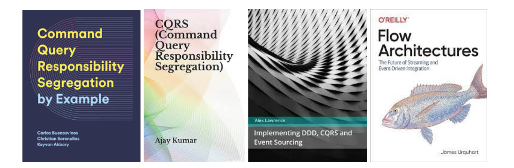

1. [Command Query Responsibility Segregation by Example](https://leanpub.com/cqrs-by-example/)
2. [CQRS (Command Query Responsibility Segregation)](https://www.amazon.com/CQRS-Command-Query-Responsibility-Segregation/dp/1795874775)
3. [Implementing DDD, CQRS, and Event Sourcing](https://leanpub.com/implementing-ddd-cqrs-and-event-sourcing)
4. [Flow Architectures](https://www.oreilly.com/library/view/flow-architectures/9781492075882/)

These four books are interconnected in their exploration of event-driven architectural patterns, with specific emphasis on Command Query Responsibility Segregation (CQRS) and event sourcing. “[Command Query Responsibility Segregation by Example](https://leanpub.com/cqrs-by-example/)” provides practical guidance on implementing CQRS by separating the command and query operations in an application, enabling scalability, and optimizing performance. “[CQRS (Command Query Responsibility Segregation)](https://www.amazon.com/CQRS-Command-Query-Responsibility-Segregation/dp/1795874775)” goes into the principles and practices of CQRS, emphasizing the benefits of segregating read and write operations, event sourcing, and eventual consistency. “[Implementing DDD, CQRS, and Event Sourcing](https://leanpub.com/implementing-ddd-cqrs-and-event-sourcing)” explores the integration of CQRS, event sourcing, and domain-driven design (DDD) to build scalable and resilient systems. “[Flow Architectures](https://www.oreilly.com/library/view/flow-architectures/9781492075882/)” expands upon the concept of event-driven systems by presenting flow-based architectures that enable the orchestration and coordination of events for complex business processes. These books collectively provide insights into the design principles, patterns, and implementation techniques necessary for building event-driven architectures using CQRS and event sourcing.

By studying and applying the knowledge from these books, software architects and developers can understand when to leverage distributed, event-driven patterns to create data and systems that are flexible, scalable, and capable of handling complex business processes.

## Technology Architecture & Architectural Patterns

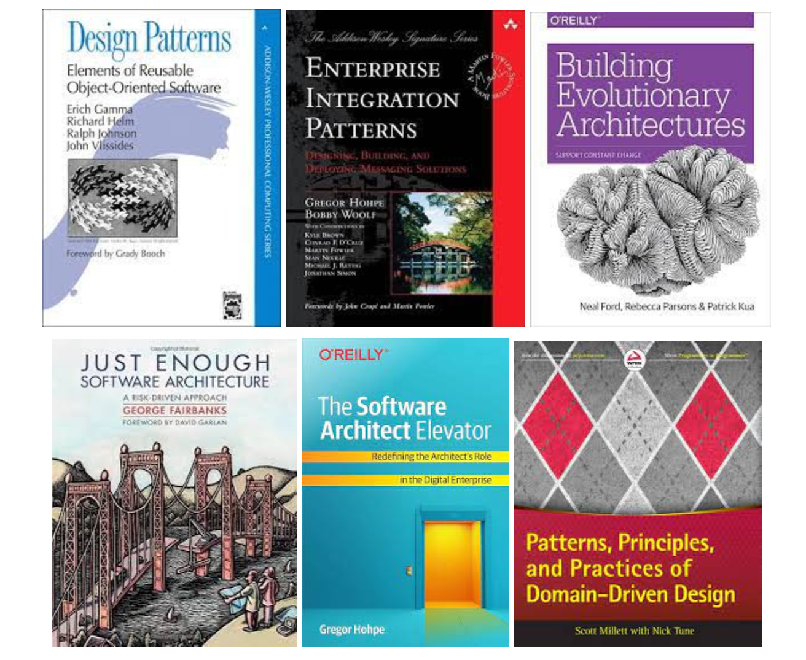

1. [Design Patterns](https://en.wikipedia.org/wiki/Design_Patterns)
2. [Enterprise Integration Patterns](https://www.enterpriseintegrationpatterns.com/)
3. [Building Evolutionary Architectures](https://evolutionaryarchitecture.com/)
4. [Just Enough Software Architecture](https://www.georgefairbanks.com/book/)
5. [Software Architect Elevator](https://architectelevator.com/)
6. [Patterns Principles, and Practices of Domain Driven Design](https://www.oreilly.com/library/view/patterns-principles-and/9781118714706/)

These books provide a solid understanding of technology architecture and architectural patterns, covering various aspects of software architecture design and best practices. “[Design Patterns](https://en.wikipedia.org/wiki/Design_Patterns)” and “[Enterprise Integration Patterns](https://www.enterpriseintegrationpatterns.com/)” focus on established patterns that address common design problems in software development, offering reusable solutions and promoting modular and maintainable code. “[Building Evolutionary Architectures](https://evolutionaryarchitecture.com/)” explores techniques for designing systems that can evolve and adapt over time, emphasizing principles such as evolutionary change, fitness functions, and emergent design. “[Just Enough Software Architecture](https://www.georgefairbanks.com/book/)” provides practical guidance on how to effectively communicate and document architectural decisions. “[The Software Architect Elevator](https://architectelevator.com/)” presents practical scenarios and challenges that software architects face, offering guidance on decision-making, communication, and career development. “[Patterns, Principles, and Practices of Domain-Driven Design](https://www.oreilly.com/library/view/patterns-principles-and/9781118714706/)” combines the principles of domain-driven design (DDD) with architectural patterns, providing insights into designing scalable, maintainable, and flexible architectures aligned with business domains.

Using the set of knowledge, techniques, and best practices in these books can help software architects and engineers create robust, scalable, and maintainable technologies. We can make informed decisions, effectively communicate our architectural vision, and design systems that meet the desired functional and non-functional requirements.

## Strategy

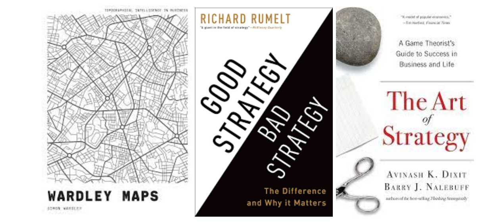

1. [Learn Wardley Mapping](https://learnwardleymapping.com/book/)
2. [Good Strategy Bad Strategy](https://www.penguinrandomhouse.ca/books/208668/good-strategy-bad-strategy-by-richard-rumelt/9780307886231)
3. [The Art of Strategy](https://wwnorton.com/books/9780393337174)

Strategy is a larger part of software development than many people realize. Connecting tactical processes to strategic imperatives is key for organizational success. As leaders, we need to be able to apply practices to help engineers code what matters and connect directly to value. When customers, leaders and engineers speak the same language good things happen.

These three strategy books focus on strategic thinking, decision-making, and planning. “[Learn Wardley Mapping](https://learnwardleymapping.com/book/)” is an online book that introduces the concept of Wardley maps, enabling organizations to visualize their landscape, identify value chains, and anticipate future developments. It provides a practical framework for making informed decisions about technology and business strategies. “[Good Strategy Bad Strategy](https://www.penguinrandomhouse.ca/books/208668/good-strategy-bad-strategy-by-richard-rumelt/9780307886231)” delves into a comparative essence of effective strategy formulation, emphasizing the importance of addressing core challenges and developing coherent, actionable strategies. It provides insights into identifying competitive advantages and leveraging resources effectively. “[The Art of Strategy](https://wwnorton.com/books/9780393337174)” expands the discussion by exploring game theory and its application to business strategy. It provides frameworks for understanding competitive interactions, bargaining power, and cooperation. By combining the knowledge and techniques from these books, people can gain a deeper understanding of their landscape, develop sound strategies, and make informed decisions that lead to successful outcomes refining the goals of the systems being built.

* * *

## Summing it Up…

AI is changing the landscape as well as the climate of our careers. My personal career path has wound through the wild domains of the Internet, through the fields of software engineering, to seek the foundations of wisdom within design, business, strategy, data and architectural patterns and practices. This approach has supported me in multiple engineering, architecture and leadership roles and will lead me through to improving A.I. tech and social dynamics. The expertise held by my colleagues and within these books helped me get there. At the same time, I use certain mental models to make sense of what I’m learning to scaffold upon what I’ve already built.

To that end I created the maps I mentioned above and try to stay involved in communities that help me grow. They help me better understand myself and remind me where I’m at at any given point. I use them to discover where I want to go when I’m trying to learn, code, and improve systems. If they’re helpful to you as well, then awesome!

My career has evolved into working to make the world a bit more efficient each day. I work to simplify systems and the ecology of engineering. I strive to be able to say to them “Here Be Data Dragons” and “This way to the AI Castle.” The books I’ve listed, along with these models of understanding, have helped me do that.

*Here Be Data Dragons*

Wherever you find yourself along the learning path, there are guideposts to help you live in abundance, lead with power, and address the narrative collapse — by making meaningful contributions toward the future we collectively want to live in.

## Consider the Source

Essentially, observation is showing us that we need more aggregate reconciliation and recontextualization of data stored within and across information systems. Evaluate them for *realized value in terms of quality of life*. We have to look at what we value and then work backwards from there. Essentially, we have to follow that old adage “Consider the source.”

The waypoints can be found with your colleagues, in these books (and many others), and within the platforms we work on. Collectively, as engineers, as humans, we have enabled creators to build better systems, iterated upon tools and built resources dedicated to help you learn, test, organize, and build the future.

Perhaps one day AI systems will build all our killer apps, but we’re still quite a ways off from that — and the sources are relatively obfuscated which causes all sorts of absurdity issues. AI, just like the Internet, is quite shallow and there’s more to be observed within this reality.

More likely we will use AI systems to innovate with more resilience and connectedness. In the meantime businesses need engineers and architects to learn, test, design, build, assess, and refactor code fit for meaningful purpose.

