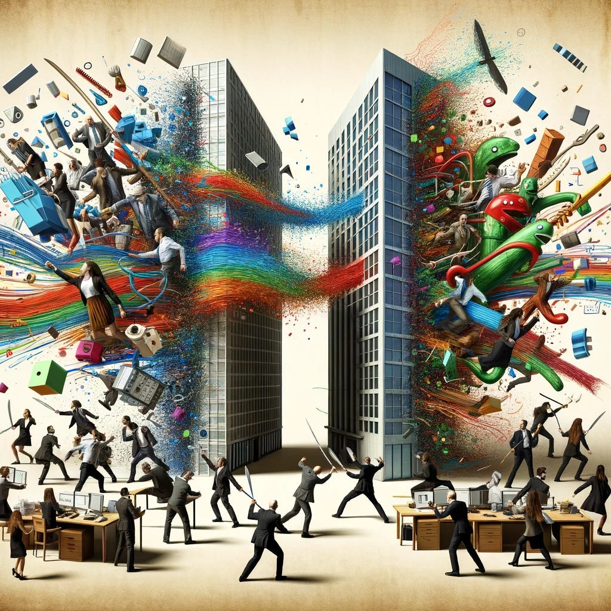
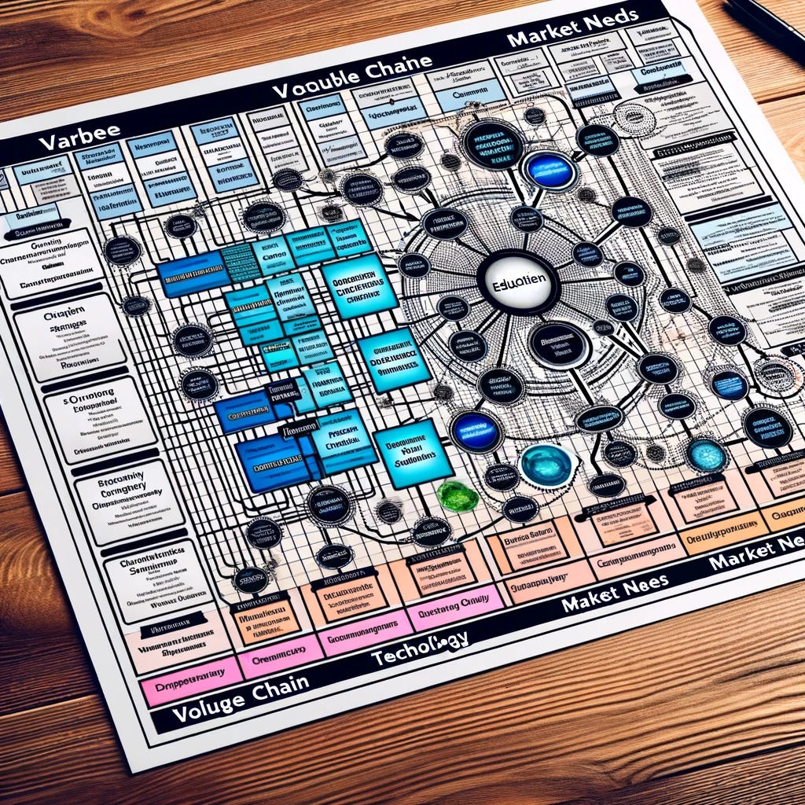
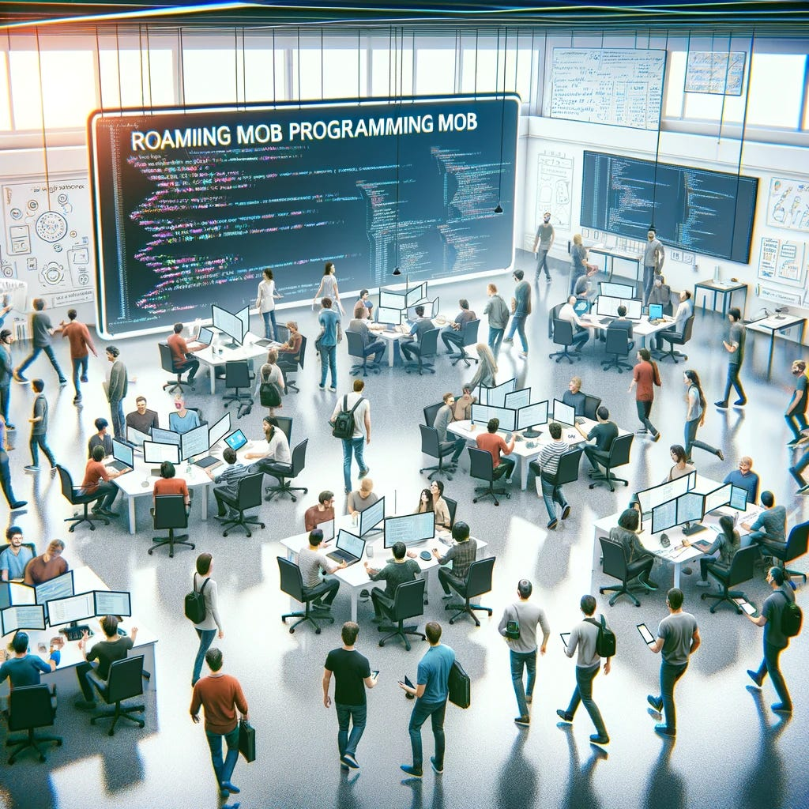

*An image of the aftermath of many hypothetical Mergers and Acquisitions*

* * *

## Common Scenarios

1. Keep them operating separately *evolve iteratively, over time taking the smallest possible steps toward successful integration*
2. Try to merge similar operations  *“similarity” varies according to the level of understanding*
3. Rush things, slash and burn, have a knock down boss fight *leaders work to “come to agreement” or they leave, individual contributors are left trying to integrate things that may be equivocated and conceptually dissimilar*

* * *

[https://youtu.be/Q8oCilY4szc?si=UmPYtz3pBgHNj5mi](https://youtu.be/Q8oCilY4szc?si=UmPYtz3pBgHNj5mi)

* * *

Before we really dive in lets get out terms worked out.

### What kind of integration are we talking about here?

Hopefully we want to build something [anti-fragile](https://en.wikipedia.org/wiki/Antifragile_%28book%29), something stable and sustainable. Something that takes the [Seventh Generation Principle](https://www.ictinc.ca/blog/seventh-generation-principle) into account. Something that will help us [steward](https://en.wikipedia.org/wiki/Seven_generation_sustainability) a bit more of paradise to the planet and [better understand ourselves](https://www.youtube.com/watch?v=MBRqu0YOH14&ab_channel=Kurzgesagt%E2%80%93InaNutshell) and our place in the universe at large.

Or, at the very least, help people save a bit of money and get excited about something, right?

### If its not worth doing right, its not worth doing?

That is, unless you’re an unfettered capitalist. Yes, we can iterate into better, but only if you’re grounded in value and principle. (Just ask Adam Smith in prequel to the Wealth of Nations, the [Theory of Moral Sentiments](https://en.wikipedia.org/wiki/The_Theory_of_Moral_Sentiments).)

**Are you?**

*Depending on your answer Adam Smith and John Locke might be rolling over in their graves.*

* * *

I have so many thoughts on this that I’m not sure they will fit into a blog post, but I want to capture some of them.

Good thing [Jabe Bloom has been thinking](https://blog.jabebloom.com/2012/02/10/the-management-interaction-gap/) about similar things.

And Donna Haraway in her book [Staying with the Trouble](https://en.wikipedia.org/wiki/Staying_with_the_Trouble).

Knowing what you want to create and why is key — especially when you account for the big picture and continuing life on the planet.

## A Few Somewhat Unorganized Thoughts

- Understand what values and principles made each organization successful and what tradeoffs were made, and why
- Start applying comparative thinking and performing evaluations.  *This is one of the few times its going to be useful in your life.*
- Make sure you understand your current situation and strategy
- Make sure you understand the current situation and strategy of the other company
- Identify common and disparate user needs. *Know your users and your differentiators*
- Create glossaries and thesauri of terms and concepts.  *You can’t crosswalk between systems without identifying loops and clashes.*
- [**Wardley Map**](https://mapkeep.com/) major strategic components and see where they align. *Identify what shared, similar, and dissimilar base components there are.*
- Use the maps to tell the story of the vision, connecting waypoints in an ocean of meaning over time.
- Keep building maps. Have other people map too and then merge them. *Don’t do this in a vacuum. This is not the kind of work that leaders should be doing without input. If you can’t map the merger you can’t merge.*
- Combine the maps and communicate about them incessantly.  *Show them to people and get their feedback.*
- Keep telling and adjusting the story of how two becomes one strategically, as you go along.
- Build [**system blueprints**](https://servicedesigntools.org/tools/service-blueprint#:~:text=what%20is%20it,by%20the%20different%20roles%20involved.) for key components. This requires a discovery process that is different from the mapping process. *(I’ll be running a workshop on this at* [*DDDEu*](https://2024.dddeurope.com/) *in May 2024).*
- Use the blueprints to identify gaps and holes and to align the business operations.
- Work with teams to start identifying tasks and subtasks to implement technological solutions to changing processes.

Depending on the merger there could be a LOT of people involved. Collaboration sessions, Roaming Mobs, Maps and blueprints are some of the most helpful tools we found when performing a large integration.

### Roaming Mob FTW

***Roaming Mob*** is a newish concept that I’d like to elaborate on at some point. It proved to be one of the more effective uses of my time as a chief architect in trying to create broad alignment across disparate teams.

**Breaking Down the Steps**

- Basically, decide on an issue to tackle or a problem to solve
- Schedule some time on a group calendar
- Announce the intention and the priority of the issue. Let people know that they might be called on within a certain window to quickly work with people to answer questions and help to solve the problem
- Call a core group together
- Begin conducting interviews and build an event model, map, or blueprint of the affected systems.
- Invite people ad hoc to the meeting. Ask them questions and then release them as you build.
- You may find out from one person that you need to interview another to solve the problem. This gets at the roaming part. Your core group is continuously interviewing and moving on to solve one particular pain point until it is complete.
- Different people might break off and diverge to do separate lines of discovery, but will regroup (converge) at a predetermined time.
- Do this as often as necessary to complete the work. Limit your company WIP to two of these system issues at time.

* * *

### Creating your Ideal Future State

[https://www.youtube.com/live/de69D4jfxbM?si=EhFPOW37pwGr5U0P](https://www.youtube.com/live/de69D4jfxbM?si=EhFPOW37pwGr5U0P)

Curious if anyone finds this interesting or would like me to share other thoughts and resources. Reach out to me on [linkedin.com/jennifer-carlston](https://www.linkedin.com/in/jennifer-carlston/) to start a conversation.
