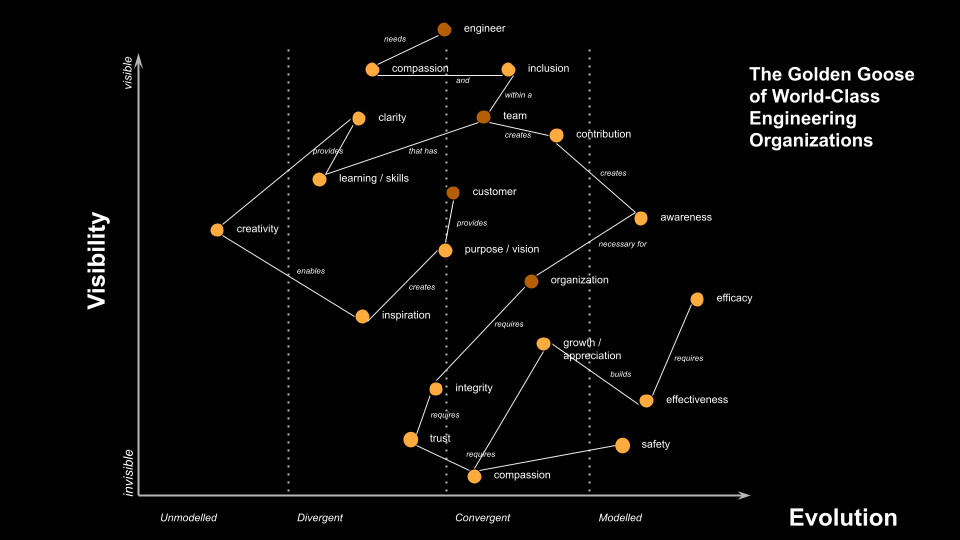
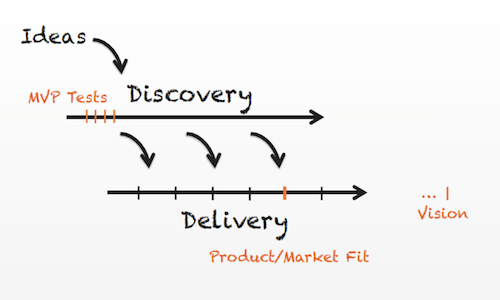
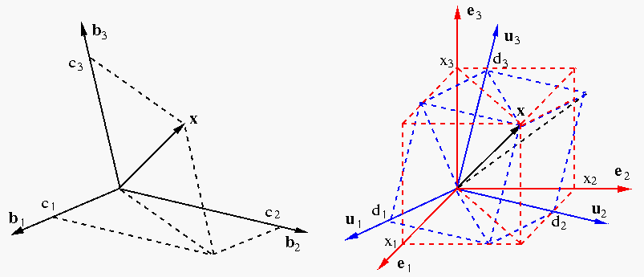
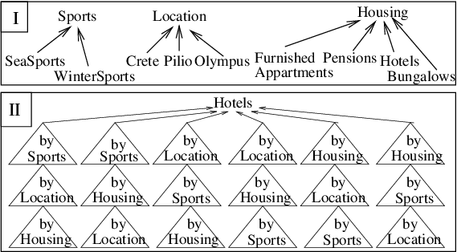

*Leaning Towers are common in business software systems*

### Businesses start to topple over when their foundations are not Conceptually Sound.

There are a lot of factors that contribute to software soundness and system resilience. To be resilient systems must be well-founded, logical, and internally consistent. The underlying principles, assumptions, and reasoning must be valid, feasible, and effective.

* * *

*Essential components of World-Class Engineering Organizations [https://docs.google.com/presentation/d/1zturYs\_IeqHXeEwFAxTkqpLq8BTU\_YRlpkmhnlA-Fz0/edit?usp=sharing](https://docs.google.com/presentation/d/1zturYs_IeqHXeEwFAxTkqpLq8BTU_YRlpkmhnlA-Fz0/edit?usp=sharing)*

Teams that are burned out and rushed creating tech debt might factor in. Its teams that are not, for whatever reason, acting on good data or integrating changing market and behavioral forces into a system. Cracks start forming in the foundations of systems. Those cracks ultimately show up in the user experience to create frustrated and distraught users. This lowers retention.

## What Do I Mean by “Conceptually Sound?”

The dictionary definition is “something that is well-thought-out or based on a sound premise.” I want to characterize it more for all of us, with an emphasis on software and tech. I’m bone-tired of dysfunctional systems and truly want us to find ways to fundamentally fix and maintain more resilience and sustainability.

Lets talk about what I don’t mean a bit. There are factors and structures, as well as behaviors, that contribute to collapse.

### Leadership Error — Make it So #1

Unless you’re conning a starship enterprise with push-button efficiency, expecting a system with thousands of components and people to change on a dime can create enough turbulence to fling off the crown jewels.

Misalignment is created when leaders believe “because they’ve said it then it must be done already,” especially if there’s no real plan and they haven’t invested the resources to make it happen. And when you’re dealing with a large organization there are as many interpretations of what leaders mean as there are people.

Leadership, done right, points to a clear goal at a low enough level of abstraction for people to connect the dots. It repeatedly focuses everyone on that goal ***until its achieved***.

> BTW Making money isn’t a goal — its a result of meeting needs and providing different types of value. It pays to know where you’re playing in the market to know what kind of value you’re delivering.

This means leading the charge and removing blockers to get there by helping employees acquire the skills, practices, processes and tools necessary to innovate.

### Dispersion

[Embedded media](https://www.youtube.com/embed/SfM17XlIuvQ?feature=oembed)

The exploration, exploitation trade-off is a dilemma humans face in choosing between options. Should you choose what you know and get something close to what you expect (‘***exploit***’) or choose something you aren’t sure about and possibly learn more (‘***explore***’)?

The thing is, we’re hard-wired for exploration and it takes a LOT more effort and awareness to reap the compounding benefits of choosing to harvest from what you know and expect.

Dispersion happens when people overfocus on exploratory tactics and defocus on the harvesting phase of business. When you invest more than 2/3 of your resources to capitalizing on what you know, you are taking advantage of compounding effects. If you’re a leader, you might even organize your engineering efforts around these ratios using [dual-track development](https://jpattonassociates.com/dual-track-development/). *Keep in mind, effective change across teams takes the coordination of principals, staff engineers, leads, and architects.*

### Turbulence — What happens when you really crank the wheel of a complex system?

*Something like this happens.*

[Good leaders](https://www.agilebusiness.org/resource/the-nine-principles-of-agile-leadership.html) don’t generally be telling people what to do. Instead they inspire and empower the kind of change the customers and the market wants. They build business meaning. They do this in part by listening a lot and then telling clear and comprehensive stories, ruthlessly prioritizing value from key business events, and by helping folks allocate funds using distributed economic decision rules that reflect the key priorities.

By listening and then telling a lot of engaging stories and validating those stories with deep facts and key events they’re able to align the narrative and guide change.

When leaders allow the ideas at the IC level to change the system through rewards and collaborative processes you get faster and more innovation in the direction of the goal.

That leads us to implementing…

### Transparent goals and investments at every level of abstraction

When the necessary services and investments are clear things start aligning. Let your employees see your bets and help them hold the company to be accountable to your customers. Remember that conflict at a certain ratio begins creating chaos out of complex stability. When the long-term strategy becomes mid or short-term it further destabilizes those conflicting systems.

This is [Residuality](https://www.youtube.com/watch?v=0wcUG2EV-7E) at work — for good or ill. What’s valuable to one leader is the next leader’s mulch six months later. That’s a lot of wasted effort and money. Changing which customers you focus on, without changing the underlying system, is another huge mistake I’ve seen organizations make.

*Vectors in a simple complex system [https://tex.stackexchange.com/questions/515179/complex-systems-of-spatial-vectors](https://tex.stackexchange.com/questions/515179/complex-systems-of-spatial-vectors)*

> **overcorrection**
> noun [ C or U ] (also over-correction)
> US /ˌoʊ.vɚ.kəˈrek.ʃən/ UK /ˌəʊ.və.kəˈrek.ʃən/
> *the act of changing something too much when you are trying to correct it, or a change like this.*

Objectives are vector forces in many ways. With a change in vector, a lot of things start shifting. You’re going to be left with what is able to recover and what is resilient to change. If you’re making big changes fast you have to build systems to be able to handle those kinds of forces. A race car is not a rocket.

### Change through iterative focus

Innovation only looks like a leap from an external perspective. Going slow and steady, with adjustments over time is what gets you out of icy waters in tact.

We have to go on a controlled diet of concepts. Focus on what logically makes sense. Organizations are often moving so quickly they forget about the process of inquiry, consensus, and change.

- HCD Inquiry
- Scientific Process
- Hegelian Dialectic (thesis antithesis synthesis)
- solve et coagula
- diverge converge
- Cynefin practices

When people rush the process, *synthesizing is generally attenuated*.

I’ve heard time and time again from leaders that need cash flow in order to stay afloat that they have to go faster. That things that are slowing them down are costing the company money.

Honestly, I think they are wrong. This is actually a bit of a distraction that is a common fallacy among leaders. Often those who want to go faster are not looking at what actually matters to the customer. What leaders need to do is to focus on what matters. “*Keep your eye on the ball.”*

- Can customers easily purchase the product?
- Does the product make sense to them?
- Does the functionality satisfy their needs?

*Or are they left frustrated and confused at an experience that doesn’t match the expectation of what was marketed or sold to them?*

### Reducing Circular Reasoning

The layers of complexity that a business is built upon gradually crumble under inconsistencies like this. There are so many “house of cards” analogies I could call upon here. Compound that with a shifting strategy, a few re-orgs that will somehow “fix things,” and you’ve got a recipe for collapse. It sometimes seems as if people think shuffling the deck will build a better house. Its this kind of *circular reasoning* that will tank the ship.

When we code, socially or technically, [circular reasoning](https://en.wikipedia.org/wiki/Circular_dependency) hides in unnecessary and abstracted dependency chains. Just like we can’t implement circular reasoning across tables and services our strategies must not have built-in logical inconsistencies either.

We have to understand the relationships and associations, the capabilities and components in a chain of dependencies, the problem we’re solving for, and the important factors that are driving the users into and through the products being built.

### Creating Logical Consistency

Just like in functional code, our data models need to be constrained and organized in aggregate. What we measure, group, and categorize is going to matter a whole lot more down and up the lines of dependence.

How we organize and assign our data determines our [Organizational Big O](https://web.mit.edu/curhan/www/docs/Articles/15341_Readings/Rqd_rdngs_due_at_first_class/1Heath_Sitkin_Big-B%20vs.%20Big-O.pdf). If we build the product for one customer and then expect to change to an entirely different segment the platform has to change fundamental relations and facets.

*“The challenge nowadays is to build a scalable information infrastructure enabling the effective, accurate content based retrieval of information in a way that adapts to the characteristics and interests of the users” [https://www.researchgate.net/figure/Hierarchical-vs-faceted-organization\_fig10\_32954494](https://www.researchgate.net/figure/Hierarchical-vs-faceted-organization_fig10_32954494)*

You can code all you want, but if your data looks like the sections above you’re in for a pretty major refactor to find the McGuffins customers want. Because you’re not organizing your queries around what matters to the customer.

This sets the basis for poor database functionality, bad API design, all the way up to a blah user experience. Even if you have great designers there’s not much to be done when the functional objective can’t be modeled cleanly. Yeesh.

What’s worse is that it affects DSML models. You might often pair that with unsourced and unclear data documentation. This is the state of many systems that are failing today. If your data doesn’t match reality, and can’t help you reconstruct reality you’re going to get greater levels of hallucination and less accurate predictions and insights within your BI systems. Hallucination is not just something AI does — its an aspect of many different systems.

### Organizing Layers

Maybe this happened because the business objectives changed over time, or code was handed off to a new team, or any number of other possible explanations.

Either way, sediment got layered on top of shifting sands and complex systems will ALWAYS have a few logical inconsistencies that can cause an antithetical collapse if the forces acting upon it change in just the right direction.

Thesis — Antithesis — Synthesis. Hegel and the alchemists were using dialectics to observe and describe meta-patterns of change, collapse and recovery.

*Synthesis* is often overlooked — especially by Product when it comes to engineering, but is an essential component of evolution and resilience. Tech Debt is a measure of how much the change in understanding of the model, represented in code by the devs, has been synthesized into a system.

### Encapsulation

You might still run into an iceberg you didn’t see coming. Software bulkheads make good neighbors. We know that in complex systems there will be things in conflict. In my experience, its best to encapsulate systems of change around serviceable capabilities.

When you encapsulate risk that is posed by change you limit the blast radius and you free people up to experiment with chaos inside each encapsulation.

What do I mean about serviceable capabilities? I’m talking about making it easy to self-serve key business capabilities across an organization. AWS and [Haier](https://www.mckinsey.com/capabilities/people-and-organizational-performance/our-insights/shattering-the-status-quo-a-conversation-with-haiers-zhang-ruimin) do this quite well.

### Organizing for Change — What forces are you withstanding? What change maintains your value and your values?

Create buffers around what changes you want to respond to, or what is likely to shift. This is where analysis, evaluation, and understanding the historic factors of change becomes important. Ruthless prioritization needs to happen with [*iterative budgeting*](https://peritumagri.com/stride/mod/page/view.php?id=5033), before layoffs occur, not after.

### Reducing Tech Debt and Implementing Technical Reviews

Certain tech stacks are worse than others for certain applications. ORMs stacked on top of ORMS with multiple test suites and miles long lists of packages and dependencies. Data models with logical loops built on top of systems that aren’t really fit-for-purpose. Going fast. Breaking things. Layers of abstraction hiding the implementation, because its all so overwhelming and we think it’ll be okay. This logic just doesn’t scale. And it can take a system down with it. Tech debt can be crippling. Its important to conduct regular reviews.

### Addressing Social Debt

Social debt can cause collapse as well.

- Leaders and employees aren’t engaging with and working with the systems.
- People aren’t conducting interviews of ICs or customers to know what’s what happening.
- People aren’t building agreements or consensus and keep changing who they believe their customer.
- People don’t know or can’t agree on what the strategy is, what market factors are at play, or if the strategy isn’t clearly shared.
- Dinner conversations with a SWAT analysis drawn on the back of a napkin and messaging souped up by a designer does not a strategy make.
- Using layoffs as a forcing function to focus teams and “get more for less” with burnout looming large.

Alice never saw that Walrus and Carpenter eat so many sweet little oysters.

## Engineering Standards and Ethical Business Impact

Impact on a crumbling foundation might be perceived as harmful when people start seeing the cracks. People might experience it as a loss of inertia. But that’s exactly what’s needed to slough off what isn’t necessary. Its not the standards and patterns, and its not the principles that are actually causing harm. There’s second order thinking that needs occur in order to see what’s actually going on.

Having high ethical standards and following good principles of leadership and solid engineering philosophies helps counteract these weaknesses. Essentially, they help fill the cracks by giving teams the focus they need to really understand what the people want from all the way through the value stream.

*Organizing for Categorical Need. Customers are looking for a MacGuffin, but they may want to search for them by different categories of interest. Organizing your system by those interests helps make the system more composable.*

## Counteracting the Cracks

Putting in the work early on your data models and communication patterns can save you SO much time and money. Unfortunately, its not easy to tell who has done the work and who hasn’t until you really start diving in deep on the business logic and code.

I have. Sometimes I’ll come across a system, a service, a codebase, or a data model, that makes my heart sing. Other times its a nightmare to even begin to try to pull logic and value from. The teams that are riding on those dark horses need help, or their systems need to be [strangled](https://martinfowler.com/bliki/StranglerFigApplication.html) before its too late.

Often its the oldest systems, the ones that have been key to deliver the business, but are less visible to users that need the most care. The code tells a story, just like the grand canyon. The data is convoluted and muddy because everyone is afraid to change it and break something further down the line.

*Layers of code tell stories to those who are willing to look in a new way*

### VCs and Investment firms generally don’t perform this kind of due diligence, and it costs them $$$ BILLIONS $$$.

And if you asked the lead engineers, who’ve been evaluating the system for years — they could help prioritize risk and save some shirts.

## References

- [https://www.researchgate.net/publication/32954494\_Collaborative\_Ontology\_-\_based\_Information\_Indexing\_and\_Retrieval](https://www.researchgate.net/publication/32954494_Collaborative_Ontology_-_based_Information_Indexing_and_Retrieval)
- [https://onbeing.org/blog/the-disease-of-being-busy/](https://onbeing.org/blog/the-disease-of-being-busy/)
- [https://www.grantthornton.com/insights/articles/banking/2023/how-to-keep-your-models-conceptually-sound](https://www.grantthornton.com/insights/articles/banking/2023/how-to-keep-your-models-conceptually-sound)
- [https://youtu.be/SfM17XlIuvQ?si=Z2WXHSD4kSZ0HjNu](https://youtu.be/SfM17XlIuvQ?si=Z2WXHSD4kSZ0HjNu)
- [https://jpattonassociates.com/dual-track-development/](https://jpattonassociates.com/dual-track-development/)
- [https://www.agilebusiness.org/resource/the-nine-principles-of-agile-leadership.html](https://www.agilebusiness.org/resource/the-nine-principles-of-agile-leadership.html)
- [https://tex.stackexchange.com/questions/515179/complex-systems-of-spatial-vectors](https://tex.stackexchange.com/questions/515179/complex-systems-of-spatial-vectors)
- [https://www.youtube.com/watch?v=0wcUG2EV-7E](https://www.youtube.com/watch?v=0wcUG2EV-7E)
- [https://web.mit.edu/curhan/www/docs/Articles/15341\_Readings/Rqd\_rdngs\_due\_at\_first\_class/1Heath\_Sitkin\_Big-B%20vs.%20Big-O.pdf](https://web.mit.edu/curhan/www/docs/Articles/15341_Readings/Rqd_rdngs_due_at_first_class/1Heath_Sitkin_Big-B%20vs.%20Big-O.pdf)
- [https://www.researchgate.net/figure/Hierarchical-vs-faceted-organization\_fig10\_32954494](https://www.researchgate.net/figure/Hierarchical-vs-faceted-organization_fig10_32954494)
- [https://www.mckinsey.com/capabilities/people-and-organizational-performance/our-insights/shattering-the-status-quo-a-conversation-with-haiers-zhang-ruimin](https://www.mckinsey.com/capabilities/people-and-organizational-performance/our-insights/shattering-the-status-quo-a-conversation-with-haiers-zhang-ruimin)
- [https://peritumagri.com/stride/mod/page/view.php?id=5033](https://peritumagri.com/stride/mod/page/view.php?id=5033)
- [https://martinfowler.com/bliki/StranglerFigApplication.html](https://martinfowler.com/bliki/StranglerFigApplication.html)
