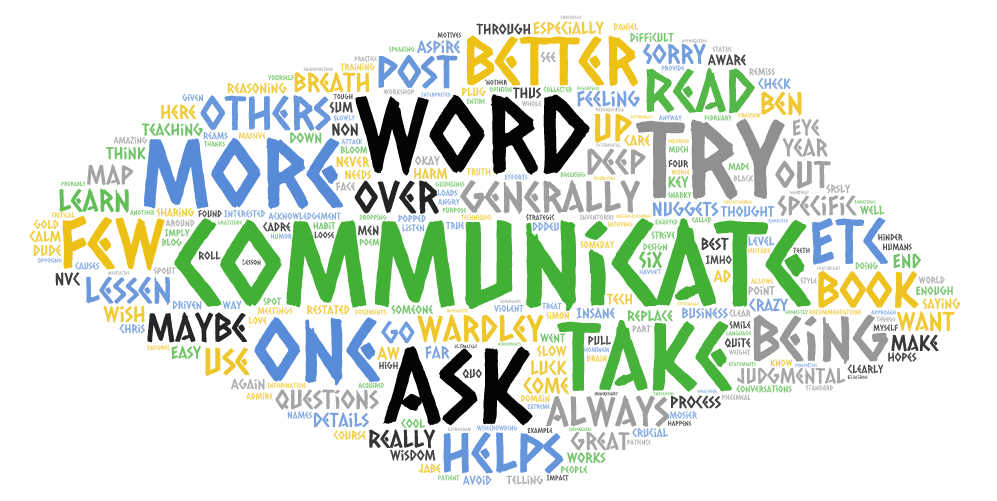

* * *

## People can be terrible at communicating truths.

Let’s make that statement a little less true today.

If you want to be a better communicator, a good start is to read a really great book on communication. Check out [**Crucial Conversations**](https://www.vitalsmarts.com/resource/crucial-conversations-book/)**.** *This is the best book I’ve read on the subject thus far.* (Thank you jocers!)

I also read [Non-Violent Communication](https://cnvc-bookstore.myshopify.com/collections/general-nvc/products/nonviolent-communication-a-language-of-life-3rd-edition-1) over and over at one point, before I found the above, and got some great nuggets:

- “Keep your 'but’ out of it” is a great reminder
- The [Feelings](https://www.cnvc.org/training/resource/feelings-inventory) and [Needs](https://www.cnvc.org/training/resource/needs-inventory) NVC Inventories are quite often useful— especially for [Wardley Mapping](https://t.co/w0643hymNB?amp=1).
- “I feel \_\_\_ because I \_\_\_\_” is genius for self-knowledge.

[Wardley Mapping](https://hiredthought.com/2018/09/01/intro-to-wardley-mapping/), as I see it, is a really useful communication and group leadership tool.

I’d be remiss if I didn’t plug [Ben Mosior](https://twitter.com/HiredThought) and [Chris Daniel](https://twitter.com/wardleymaps) for teaching me how to Wardley Map. [Simon Wardley](https://twitter.com/swardley) is a *really cool dude* as well. They and their cadre of amazing humans are trying to make business communication, especially at the strategic level, better.

When it comes to business communication techniques and reasoning about tech, the [Domain Driven Design](https://www.dddcommunity.org/) communities that have popped up around the world are the gold standard, IMHO.

[Ben and Jabe Bloom](https://training.dddeurope.com/wardley-mapping-ben-mosior-jabe-bloom/) will be at DDDEU in February this year, which is aw-sum.

These are all people who’s (whose?) thought and communication processes I admire and aspire to know better. There are lots of others. They’re great people to start learning from.

I’ll also be teaching a workshop on [Wisecrowding](https://labs.dddeurope.com/2021/program/47)(post to come) at [DDDEU](https://training.dddeurope.com/)as well. My hope/belief is that Wisecrowding is an empowering process of organizing, communicating, making better decisions, and taking action across large groups of people. Better than handing important decisions over to a single flawed individual like many current models of leadership.

So, anyway, WORDS. Because I’m feeling snarky as I go through the massive reams of documents I’ve collected over the years, I’m going to try to pull nuggets of acquired wisdom from them and piecemeal them out to you. Wish me luck. This here be sum.

* * *

### Here are a few words I’ve found that hinder my efforts to communicate truth.

> Take it for what you will. They are guidelines I’ve given myself.

## 1. Why

Asking why can imply a questioning of motives to yourself or others that can be, and often are, interpreted as being critical or judgmental. People shut down when they feel ashamed, criticized or judged. Not so good for communication.

I replace why questions with “who, what, how, when, and where” questions. e.g. “What is causing this to happen?”

Doing this often causes me to think my reasoning through and allows others to provide better information. Attempting to answer why often has similar issues. Questioning for context seems to work — to get the point across better, in all instances.

“Why” gives you the W of the DIKW pyramid from Russ Ackoff. It’s based on a lot of other thinking, no less the Socratic method.

I think *understanding why* is something that works and can help us learn, define, and understand systems, but being “Wise” they must be experienced rather than spoken out loud.

Let [other questions](/essays/life-is-weird-right-now/) build the why. That’s transformative — that’s where compassion and empathy happens.

(More on this and my own spin to come.)

## 2. Just

I’m talking about the kind of just used as a modifier, not Justice here. The modifier lessens the impact of statements made.

Don’t lessen what you’re saying. I think people use it to put a pillow around a statement they’re making. In my experience it actually creates distance and less clarity around what is being communicated. I strive to be aware of my purpose in speaking. I try to be clear and forthright.

This is aspirational for me and a difficult habit I am in the process of breaking. I know, I know I used it in the subtitle.

## 3. Crazy, insane, etc.

This is one example of a judgmental and pathological approach to language.

Generally telling someone WHAT they are is detrimental to understanding and communication. (That whole shame/shaming power dynamic again.)

If something seems crazy it means you don’t understand the series of causes and effects that led to the behavior.

Name-calling crazy and insane have been used to enforce a status quo, to lessen the weight of an opposing misunderstood opinion or perspective, and this kind of thing is an ad hominem attack.

It’s tiresome, rude, and reveals the ignorance of the speaker. I’ve witnessed and been called this by people (generally angry men) who haven’t been patient enough to listen.

I’ve learned to take a deep breath, try not to roll my eyes (sometimes rather difficult) and try again more slowly, then ask for a restated acknowledgement when this happens. Wash, rinse, repeat. Not easy, but more patience and slow deep breaths is key if you’re on either the giving or receiving end.

Wanting to call someone crazy? Don’t do it.

Try something else instead. Examine your intent and the situation. Either remove yourself or start asking questions.

Honestly, asking “Are you High?” with a smile on your face works better. Humor always helps in these situations, and just maybe you’ll be spot on. (See what I did there? Changing habit IS NOT EASY.)

## 4. Sorry

Either you don’t say it enough or you say it too much.

So, only say it when a genuinely hurtful mistake or misunderstanding or egregious harm has occurred.

Regardless, when saying *Sorry,* (1) Take Slow Deep Breaths (2) Be Specific (3) Ask for a *Restated Acknowledgement*.

Generally, try replacing your unnecessary “sorries” with specific and detailed expressions of appreciation, gratitude and thanks.

This is part of ***Being Impeccable With Your Word*** from [The Four Agreements](https://www.miguelruiz.com/the-four-agreements), which is another book I’ve enjoyed and learned from.

***Being your Word*** is a whole ‘nother blog post that I’d love to spout on about. Preview — ultimately when you treat your word like statements or compute commands you can reprogram your behavior and brain.

Being true to your word *internally* and externally is so important. THIS IS NOT EASY and takes loads of meditative-style awareness practice.

## 5. Always/Never

These encourage extreme and unrealistic judgmental thinking. It’s a subset of black and white thinking. See [this poem](https://jdcarlston.medium.com/puddling-df4494657b6d) for “wisdom.” Also maybe [this one](https://jdcarlston.medium.com/house-of-demons-1ca312e3abf6) or [this one](http://%20https://link.medium.com/xXqJPK9sFcb).

Humans use black and white thinking when they are feeling insecure and/or are being coercive, controlling and manipulative.

> **Pro-Tip**: someones using black and white words are in need of some compassion.

> Does this tie into racism, sexism, or other dualistic (DUEListic) binaries you might ask? The answer to that question is an unequivocal “YES."

If you’re using words like this, your scope and vision is distorted. Be more specific, accurate, and time-bounded.

## 6. Calm Down

Telling someone to calm down has the opposite effect. In my experience it’s never worked and often makes things worse.

(Tough lesson to learn in the way I did — I ended up with a black eye, loose teeth, and a concussion. )

If you’re tempted to tell someone to calm down, tend to yourself first.

* * *

All that said, Practice. We are what we repeatedly do.

* * *

*Helpful? Thoughts?* Share Below.

I wish YOU luck in whatever communicative endeavors you may have.

I’ll post more on all the unanswered questions and concepts I touch on here as we go along in 2021.

If you have any questions, feel free to reach out to me on [twitter.](https://twitter.com/jdcarlston)
