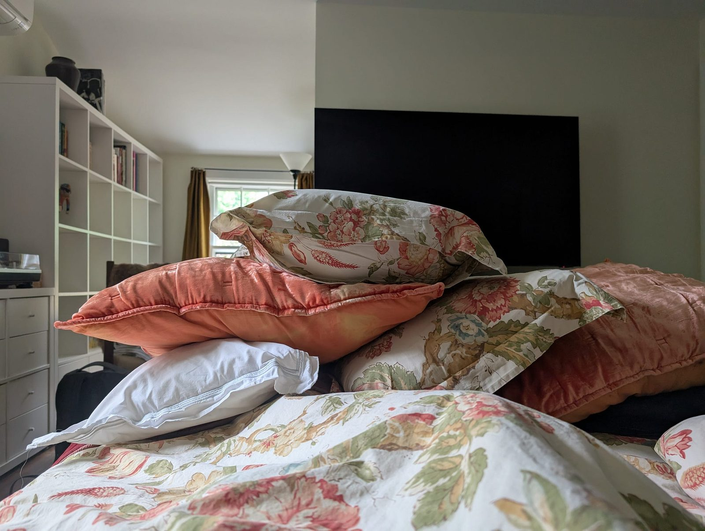
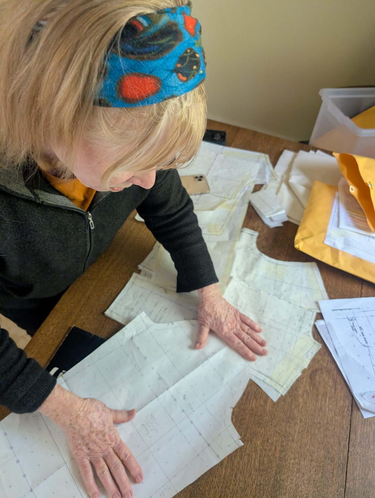
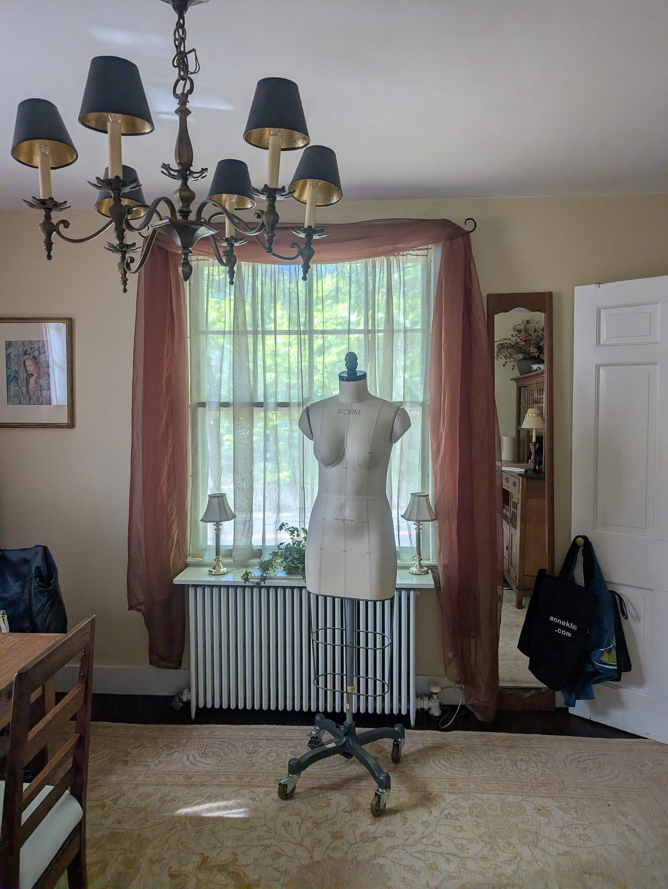
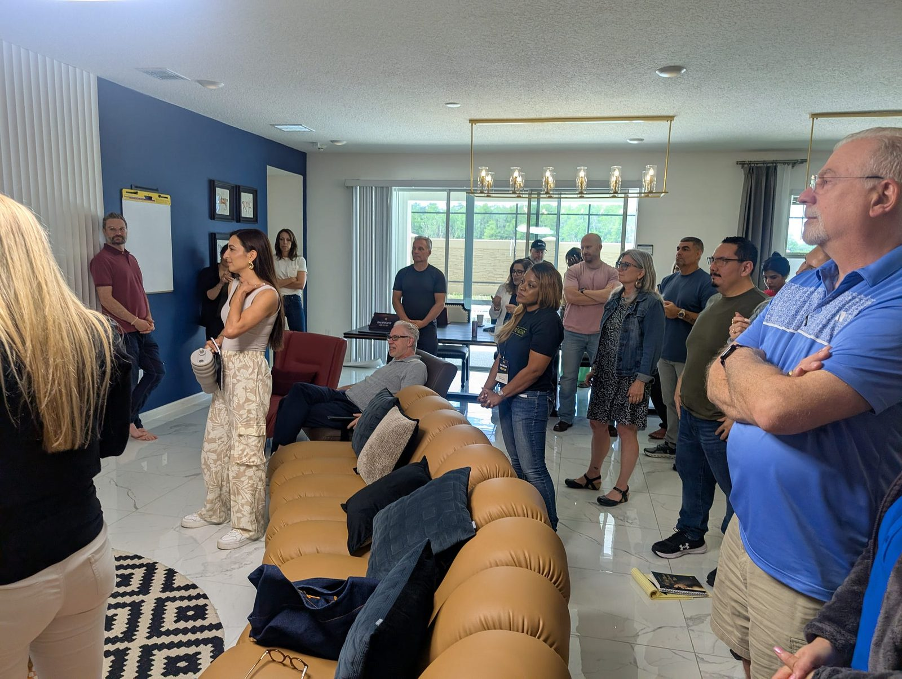
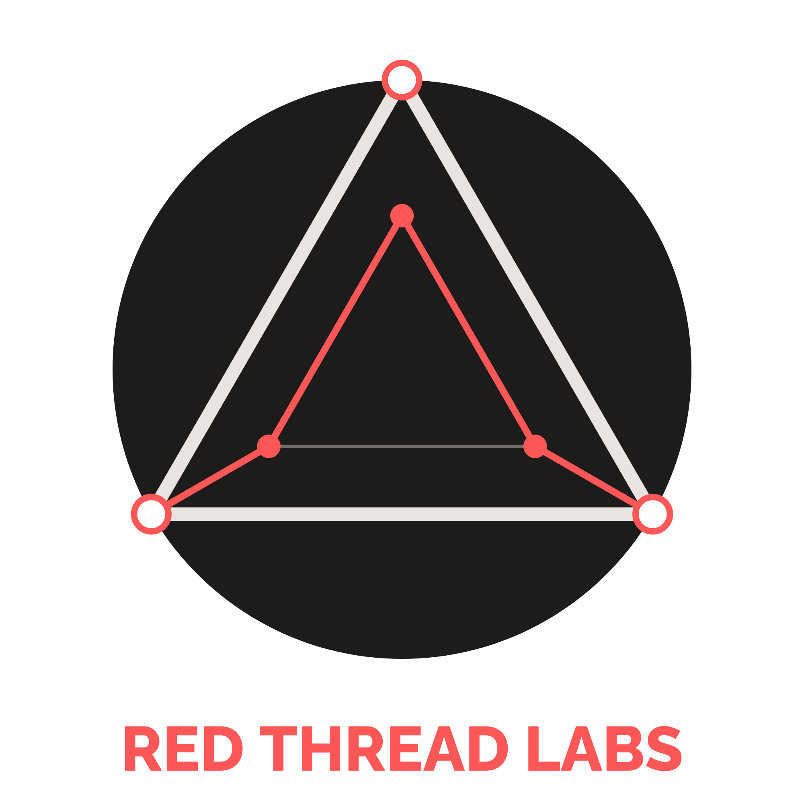
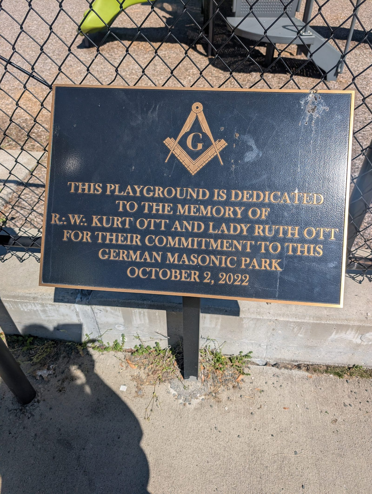
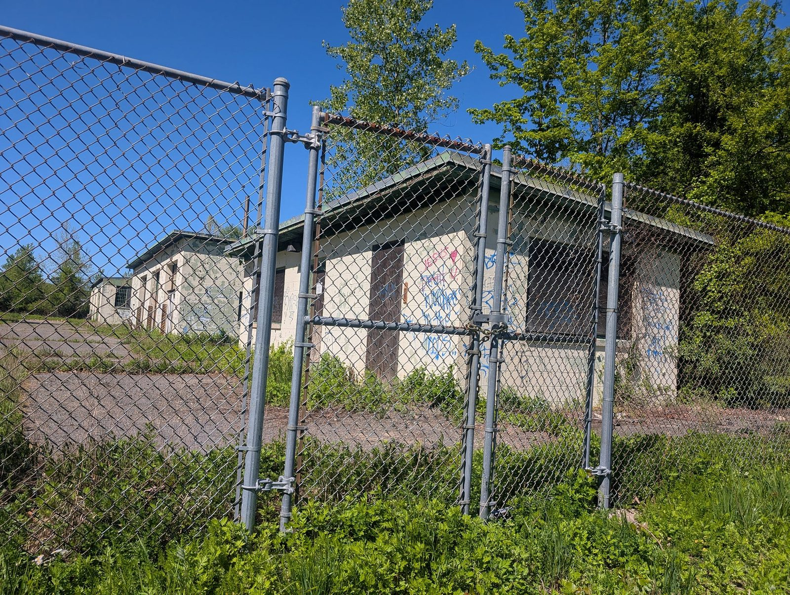
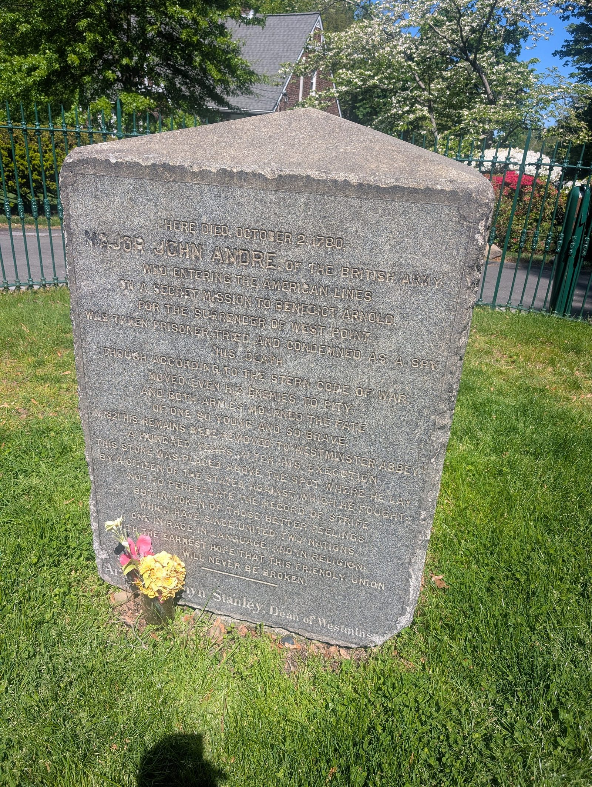
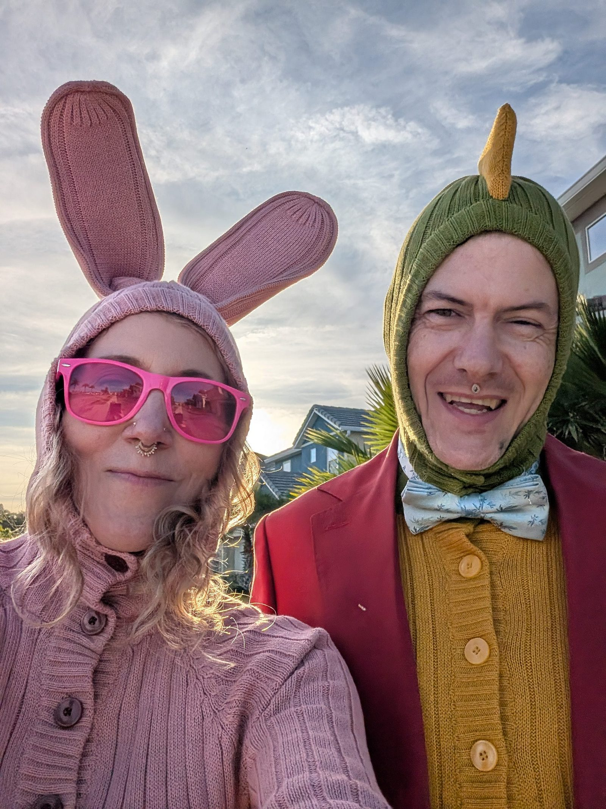

Last night was filled with interesting dreams at Sue’s home. I do a lot of fast, symbolic processing of context that way.

I woke up and journaled. I’m reverse engineering a few systems right now.

I am realizing how grateful I am to be able to slow down and think clearly after so much living to work — waking up to rise in the corporate world is like riding a different beast and being from what I seem to be settling into.

I’ve been an engineer and a leader for a long time. I do a lot of healing and peer support work as well, and am looking to expand my abilities in a number of ways.

While at [Eventpreneur](https://www.smalleventbigprofit.com/) in Orlando I met some amazing people that opened my eyes to so much of what has held me back from jumping in prior to now. I’m at an inflection point that feels exciting. My children are grown and I can take a few risks for our future.

As Sue says:

> “If you don’t like the news go out and make some of your own.” — Scoop Nisker

There are challenges with all of the paths in front of me. And I am realizing there’s a fourth way that I will be following to weave it all together.

My friends and co-founders at [Design Cycle Solutions](http://designcyclesolutions.com) have a compelling product that we need to be able to sell to some of the largest global apparel manufacturers out there. We all love how fashion encodes our decisions, literally, on our sleeves.

I’m still learning the lexicon and where our data, our systems and our A.I. fit in this space, but the ideal end-to-end process makes sense. That gives us a foundation to enhance our offer.

*Sue talking to me about preserving the curves as a pattern is graded as I go deep into the apparel production processes, flow efficiency, margin increase and cost reduction. Sue is wearing her favorite cashmere jacket by the way.*

*The wolf dress form. I’m learning how well-designed clothing can fit a wider variety of people out of the gate.*

* * *

My friends at [Speakpreneur](http://speakpreneur.com) are going to help me learn a deeper level of business savvy. I want their help to highlight the authority and impact we can have on the world.

*Eventpreneur, as part of a larger Speakpreneur product line was a powerful experience for me*

* * *

My husband and I are going to launch [Red Thread Labs](http://red-thread-labs.com) to help people reverse engineer healthy partnerships, dating, and self-awareness. We’re all reeling from so many meaningful shifts in how our daily lives and the lack of community organizing. I grew up in community and can teach what I learned. The traditions I was raised in were profoundly impactful upon my life.

### We need connection, compassion, and skills. We need skill building like this to be in-person. More than ever we need to connect to our most expanded sense of self and to create a more intentional world.

My body says that every time I get sucked into the black mirror I disconnect from what’s around me. I need more awareness to keep that from happening. Sue tells me that is training that can be taught and I’m learning a ton from her about it while I’m here. Last night’s dreams helped push that forward.

*We’ll be holding events helping people build better relationships and behavioral patterns*

In all this I’m taking a leap and trusting the triangle will connect in a spectacular way that I haven’t quite seen in its entirety. Re-architecting things can sometimes be like that. And I’m re-architecting my entire life.

Red Thread Labs will build community, tools, products, and an evolutionary path that will connect to the ecology of the planet somehow. With all of the people we know and love, that allows people to connect more directly with their foundational intentions and values.

We’ll help people build real meaningful relationships with themselves and others and help them move toward creating the lives that lets them engineer their path to loving in greater levels of coherence.

Community that helps people.

*One example of a community of practice and love that seeks to help people.*

* * *

On our walk today we ran into [Camp Shanks](https://en.wikipedia.org/wiki/Camp_Shanks). I know on a deep and viscerally felt level that ***war*** *is not what any decent folk need or want at this time.*

*Camp Shanks Buildings*

And we went to the top of a hill that held a memorial to a [young major](https://en.wikipedia.org/wiki/John_Andr%C3%A9) killed in another war.

*Yet another monument to the tragedy of war. History yo. On the other side it says “sunt lacrymae rerum et entem mortalia tangunt — [virgil aeneid 1.462](https://sites.uci.edu/humcoreblog/2017/10/16/sunt-lacrimae-rerum-et-mentem-mortalia-tangunt/)”*

* * *

I’d rather be walking around being ridiculous. Maybe you’ll run into us in the near future. Bravery dear heart.

Tell me what makes you light up today?

ad astra 93 93/93
