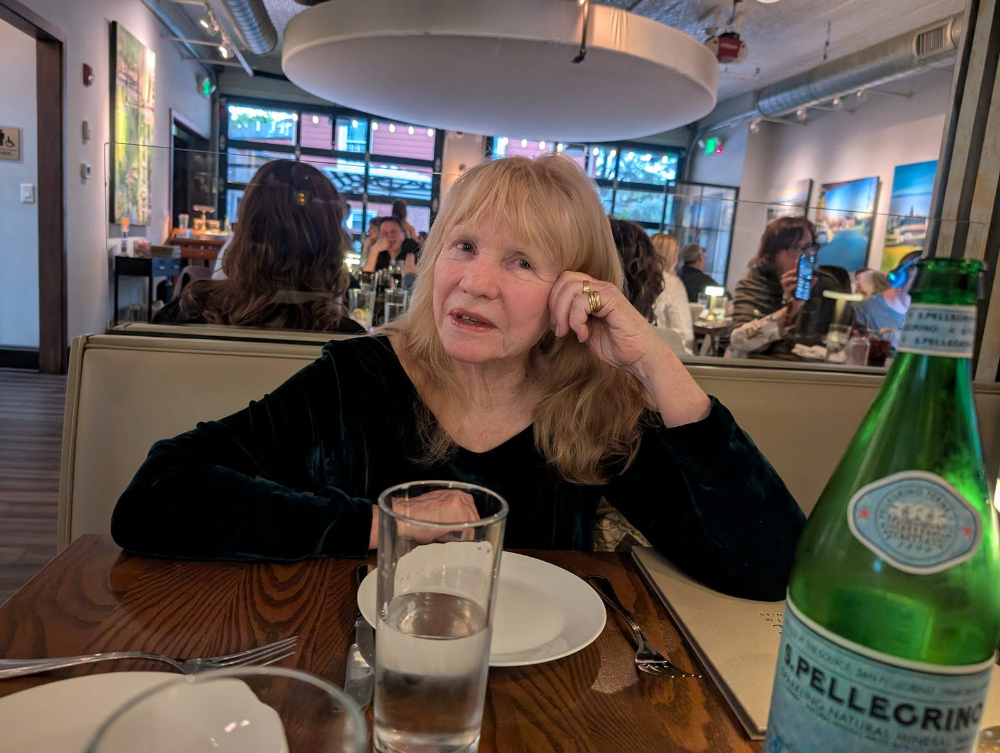
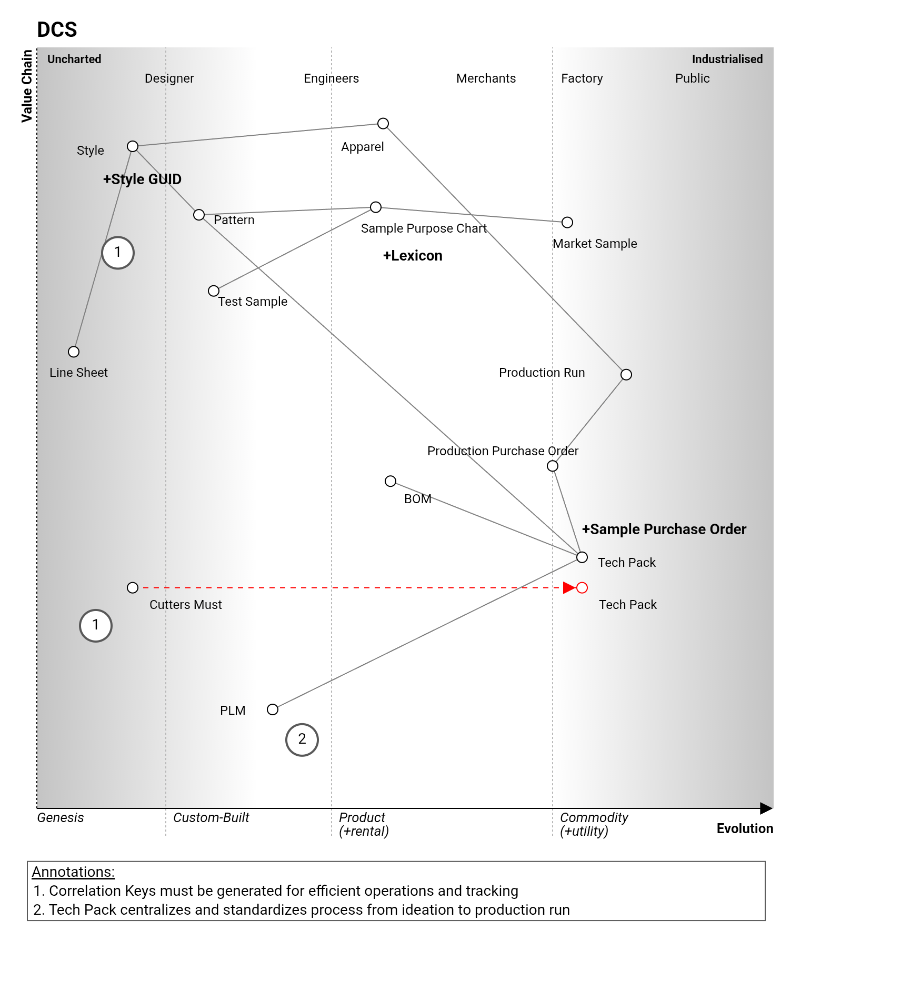
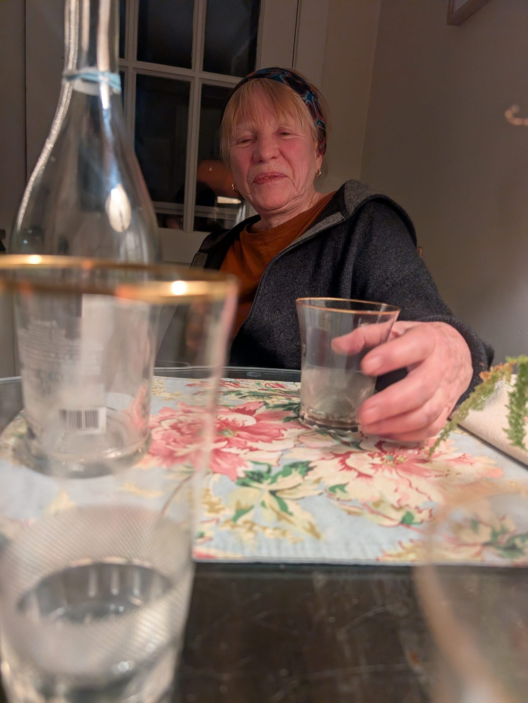
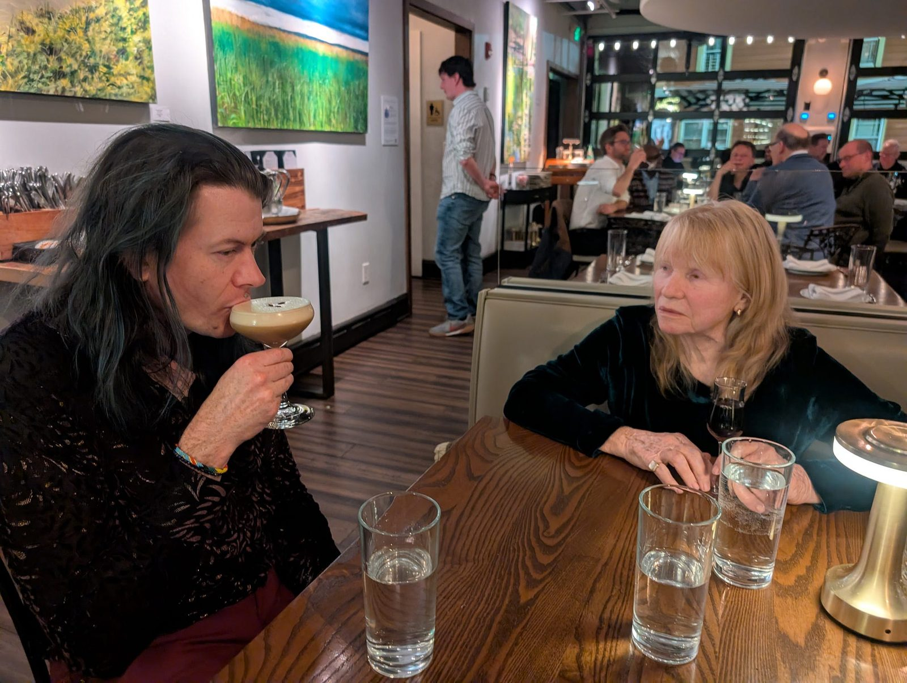
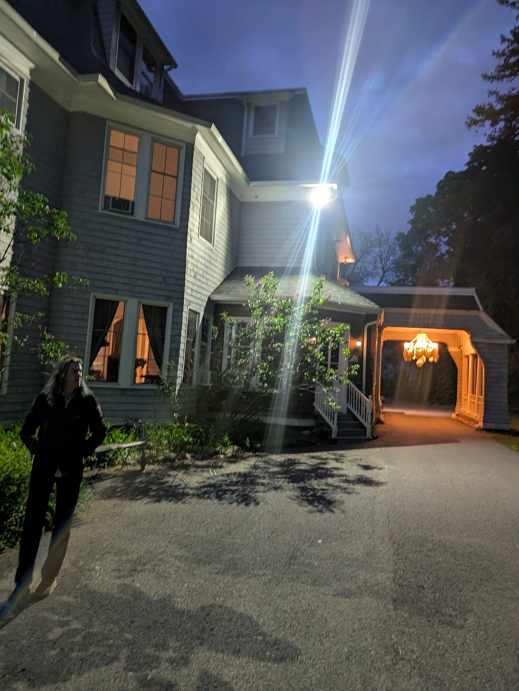
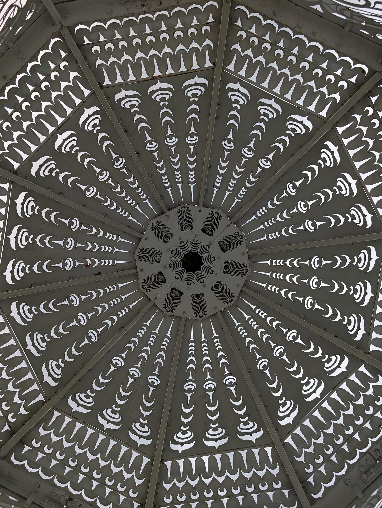

Today was the last day at Sue’s house. Sue has been a gracious host and was kind enough to demonstrate her amazing cooking during our visit. She even gifted some books to us today.

This morning I worked to identify gaps in my knowledge of the processes, found a few key documents and kept working on a first draft of an offer sheet for investors and a strategic Wardley Map of the high-level industry components we’re working with.

*Ideal Dev components and outputs*

Apart from that I’m populating my model and improving my AI prompts for what we’re working on. I want to have a solid architecture laid out before I start setting agents loose or start building the RAG.

I’ll post what I can as examples when I get time.

*After dinner discussions from the other night. Wish I’d gotten pics of her cooking. I’m learning how to document the important little moments.*

We went out to dinner last night and ate some amazing food at her favorite restaurant in the county instead of staying in.

*The discussions got pretty esoteric at times. Sue showed us how her logic connects to how she works and the framework for authentic fit they’ve built.*

Today we took the train to The Grey House at the Chapel of Sacred Mirrors and Alex and Allyson Grey’s former home.

*The Grey House*

On the way we discussed a bit of what we want to create with our local Love Labs and other opportunities we see with some of these business ventures.

Chick also managed to get a bunch of work done somehow as well. His co-workers call him the wizard for good reason.

I’m glad I got to explore the grounds before it got dark and am excited to more tomorrow.

I’m learning a lot about what I want to be doing and what I don’t and am starting to see different possibilities from going on this trip.

* * *

93 93/93
