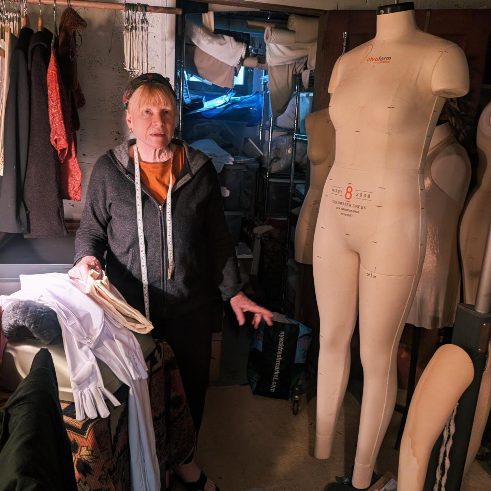
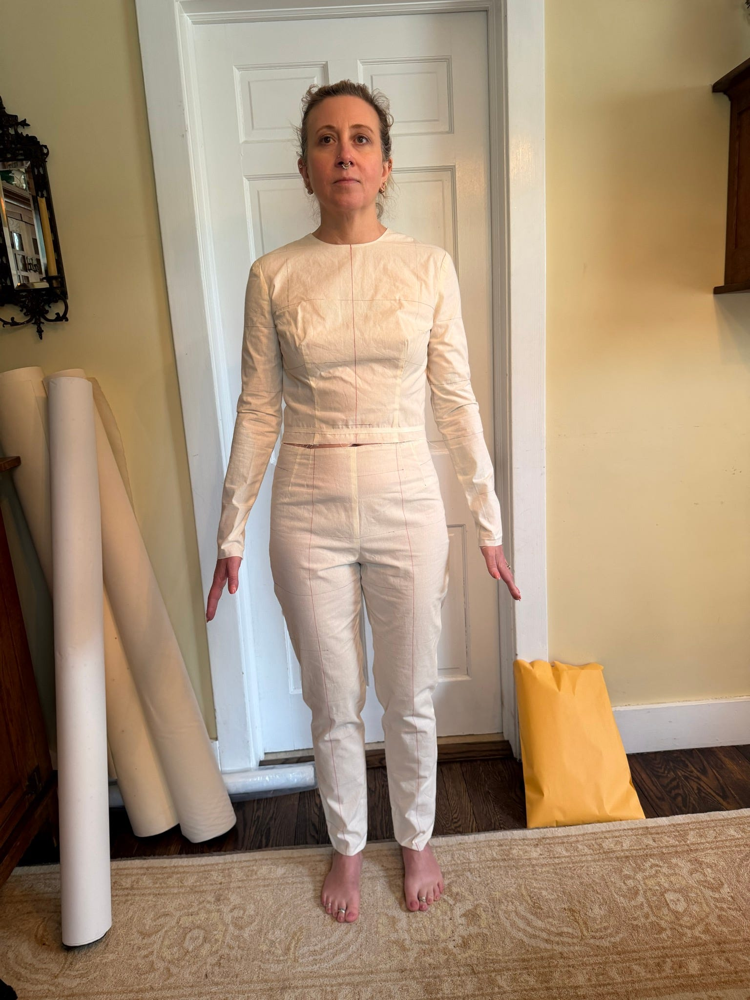
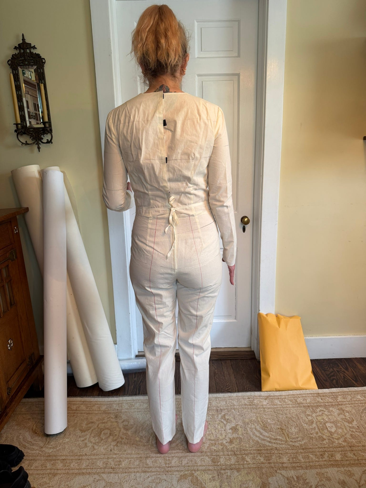
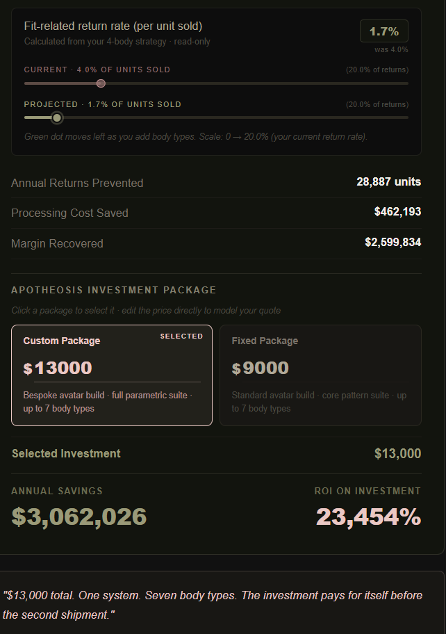
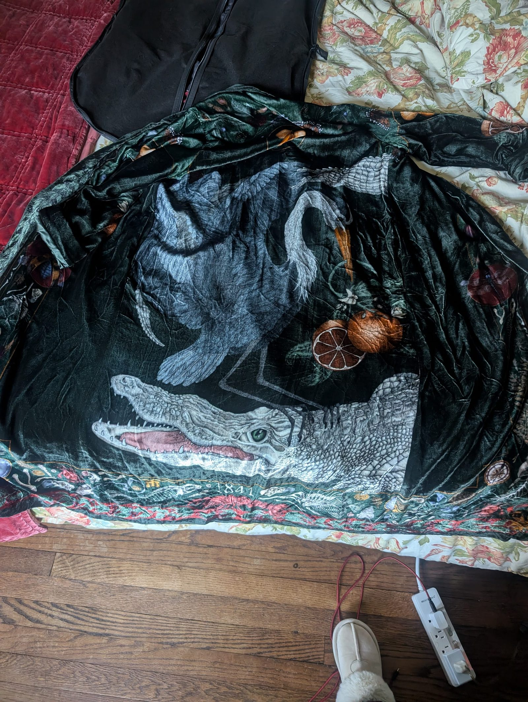
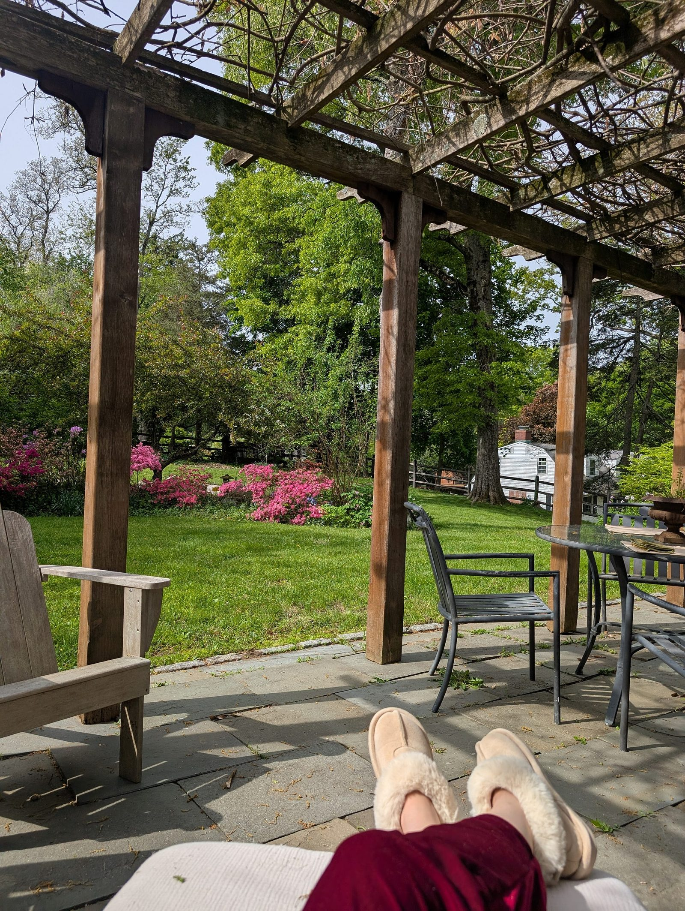
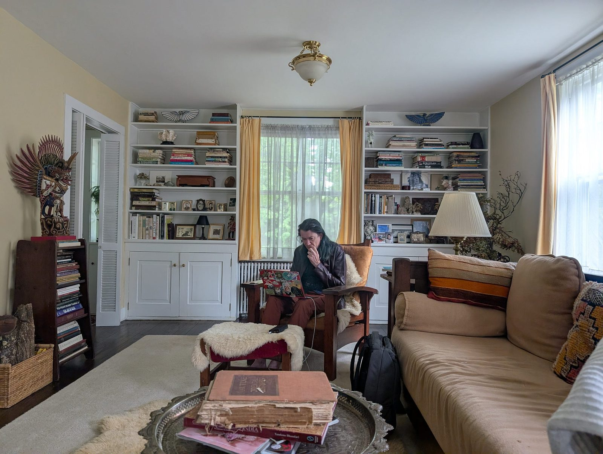

*Sue invited me into her home to help me learn this business*

### I'm curious...

What stories do your own clothes hold?

* * *

This week I'm learning from a master apparel engineer at [Design Cycle Solutions](http://www.designcyclesolutions.com) in New York about the math (and history) of what you love to wear. I'm very excited to share this journey with you as I learn.

Creating clothing is so much more complex than what I realized.

I’m loving being able to ask Sue all the questions and get real, detailed answers. Most people get overwhelmed by this, but she doesn’t. And it’s necessary for good engineering to occur.

## Apparel impacts everyone on the planet…

In ways most of us barely understand. I’ll be talking about this more. Apparel is surprisingly similar to software in so many ways.

Today I learned about fabric types and qualities, vanity sizing, truing fabric to build a pattern, slopers, blocks.... muslin, modal, ramie, elastane, rayon, batik…

I learned that clothing has (or should have) PRs and commit logs, only they have different words for it. Spec sheets, tech packs, etc.

*These are slopers she had made out of muslin that fit me nearly perfectly. Turns out I have a slightly longer waist than the ideal form for this fit model.*

Today I also learned I’m a standard missy curvy size 8 even though I’m often wearing anywhere from a 2 to a 12 in standard US sizes and a 28/38 in EU, which is a bit more strict on standards.

But clothing sizes are soo inaccurate these days, and they are not getting better. And DCS exists to address this (and more).

*What we’re building at Design Cycle Solutions for Apotheosis has major ROI*

Returns are up for most major manufacturers for a lot of reasons that I'm learning about as well. Profits and margins are dropping, but they do not need to be.

* * *

*Sabina Savage Green Velvet House Coat*

I call the jacket I’m wearing today my mage coat. I included a pic of the back with the white crocodile and the crane. It’s created by Sabina Savage and there’s more to that story...

*This back yard makes me want to cry with how beautiful it is.*

Sue also has one of the most beautifully curated and designed homes I’ve ever been invited into. I feel blessed to know this woman and to learn from her.

*My love working away at his DevOps Magick to help support our entrepreneurial adventures.*

I’m also glad I’m not working for [Stack Overflow](http://stackoverflow.com) anymore, even though I love the company, what they are trying to do, and the people I worked with as the leader of their Public Platform. The inertia was intense. The burnout of trying to shift that system inside the AI and Tech dancing landscape is real.

I know it’s similar in Fashion for the designers and the apparel engineers.

The answer to that pressure, for me, isn’t to move more quickly. It is to be more intentional and aware of the relationship between my attention, consciousness, and will — my time and directed efforts.

* * *

Please share your stories of your own clothing choices below. I’d really love to hear them as I’m going through this process. Every piece of clothing we have has some kind of story and a fascinating array of engineering process behind it.

I’m shifting domains and approaches, but I’m still applying DDD principles to my new life and will be speaking at [Explore DDD](https://exploreddd.com/) about some of this in September.

[Part 2](/essays/my-learning-journey-through-the-apparel-industry-part-2/)

* * *

[Launchmetrics Product Sneak Peek: Fashion Sample Tracking SoftwareMaximize the editorial and sales opportunities of your brand with Launchmetrics fashion sample tracking softwarewww.launchmetrics.com](https://www.launchmetrics.com/resources/blog/sample-tracking-software)

[Sample Trafficking Fashion: A CTOs Guide to Internal Process Optimization [+ Infographic]Discover throughout this blog post + infographic why internal tracking is important. Reduce operating costs and…www.launchmetrics.com](https://www.launchmetrics.com/resources/blog/sample-trafficking-fashion)

[Garment Costing: Calculating Costs for Fashion ProductsThis blog covers all the steps of garment costing, the importance of understanding your apparel costs and cost…www.worldfashionexchange.com](https://www.worldfashionexchange.com/blog/garment-costing-how-costs-are-calculated-in-the-fashion-industry/)
