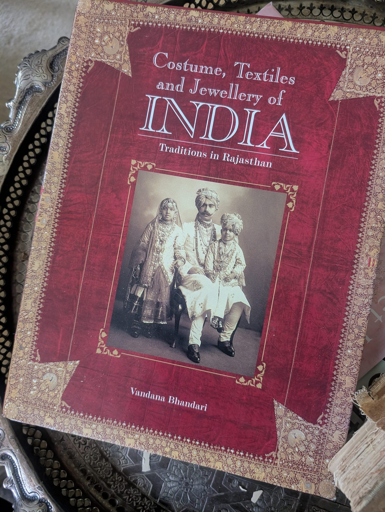
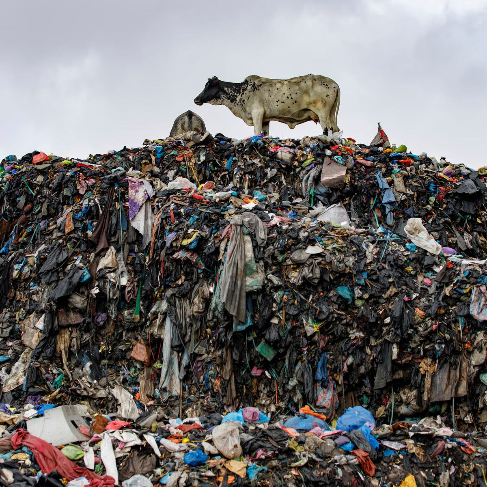
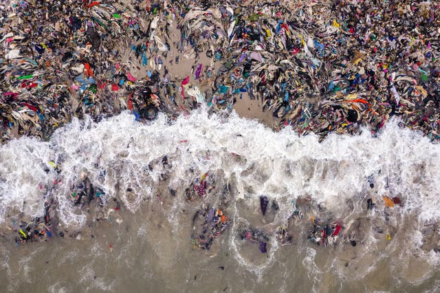
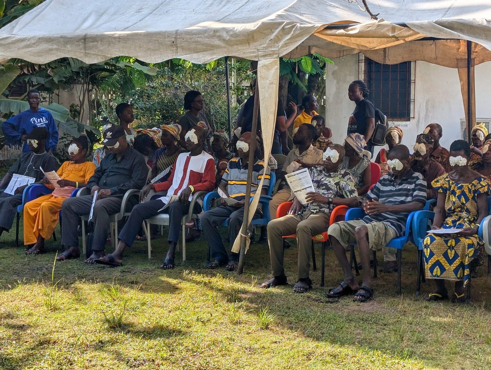

*We had a business lunch with an apparel manufacturing and logistics leader today*

Today Sue and I met with another person that’s interested in working with [DCS](http://www.designcyclesolutions.com).

Sue and I have been talking about the best ways I might be able to help things get company off the ground.

## What are the key questions we need to be asking?

What critical roles and responsibilities we need to fill. What the structure of decisions should look like. What we need to align around to stay true to ourselves and the people we organize for. What critical data points we will need to correlate and create observability. What needs to happen as soon as we get funding, in what order. What we can do to ensure integrity is kept as we grow and how we want to grow. Where we use AI and where we don’t. What kinds of agents, and other kinds of tech, are most helpful and which ones create too poor of a signal to noise ratio.

It’s the beginning of the kind of strategic and technology architecture I love to do. Things are being placed on the radar.

This and more. And at the same time I am trying to stay present, look at the current moment and what next steps are in front of me without over architecting. It’s good to pull on the threads a bit, to step into the next reality and see the forest from the trees and the trees from the forest in equal measure.

I’m doing a bit of future casting to understand the ontological relationships and teleological goals in front of me.

There’s a balance to all of this and the order of operations matters for us to build trust rather than disconnect from reality like so much of what we see happening around us.

Katy has been laying the groundwork on so many different parts for years. She’s in the frontier of this domain in ways people can barely connect the dots on. Sue and I are as well in our own fields. It’s important for us to do what we can to lay the groundwork of bringing others along with us.

Much of what I’m seeing immediately before us revolves around strengthening the language of our offer, the marketing copy, and really showing the [ROI](https://www.designcyclesolutions.com/impact) requires my help with marketing and getting the Apparel Intelligence system that acts as the connective tissue of the suite built out as much as we are able to right now.

I’ve been working on an [Offer Sheet](https://docs.google.com/document/d/1-PCXxZR_0GCQTef1PDkHCaE6mkt8-ghzZJCWwR7qYT8/edit?usp=sharing). Its a work in progress that I’ll share here. And I’ve been reading Alex Hormozi’s book [100 Million Dollar Offers](https://shop.acquisition.com/products/100m-offers-hardcover).

Today I worked to research and identify partnership opportunities as well as understand market dynamics, capabilities, components, and other potential funding strategies.

I am thinking at this point that a [Wardley Map](https://www.wardleymaps.com/) could help me visualize those dynamics, but need to work with the co-founders on that bit.

In the past few days I’ve learned about critical points of the entire apparel line lifecycle from ideation through to development, sourcing, production, distribution, purchasing via e-comm etc as well as the return cycle and the nature of the iterative virtuous cycles we are able to impact. I’ve learned where many of the current systems break down.

But ultimately it all comes down to POMs — points of measures…Surprise surprise…what gets measured gets done. And if you’re measuring the wrong things the wrong things get done.

Who are you optimizing for, if you’re not optimizing for your customers? The answer to that is usually the executive team, those who have budget, hiring, and firing control — particularly the CEO and CFO in traditionally organization structures

I want our system to constrain that impulse as much as possible, so I am hoping to help people understand how to organize our teams for [humanocratic](https://www.humanocracy.com/) structure based on the [principles of lean product development flow](https://www.pdma.org/page/review_principles_pr), when it happens.

I’m also seeing how lean principles are so foundational to any system of change and production. People use different words for them but the underlying system of production, the math, [Ashby’s law of requisite variety](https://pespmc1.vub.ac.be/REQVAR.html), [Conway’s](https://en.wikipedia.org/wiki/Conway%27s_law) etc still applies. As you’d expect.

*Source: [https://www.independent.co.uk/climate-change/news/fast-fashion-ghana-clothes-waste-b2132399.html](https://www.independent.co.uk/climate-change/news/fast-fashion-ghana-clothes-waste-b2132399.html)*

Fashion has a ton of waste at various levels, and is creating massive amounts of waste on the planet, from the water we drink and the [mountains of clothes](https://www.independent.co.uk/climate-change/news/fast-fashion-ghana-clothes-waste-b2132399.html) we offshore to “dispose.”

We can do better. And that’s only part of why I’m doing this right now.

*Ellembelle, Ghana [Daybreak Vision Project](https://www.daybreakvisionproject.org/post/ellembelle-outreach-report)*

93 93/93

[Part 1](/essays/my-learning-journey-through-the-apparel-industry/)

[Part 2](/essays/my-learning-journey-through-the-apparel-industry-part-2/)
