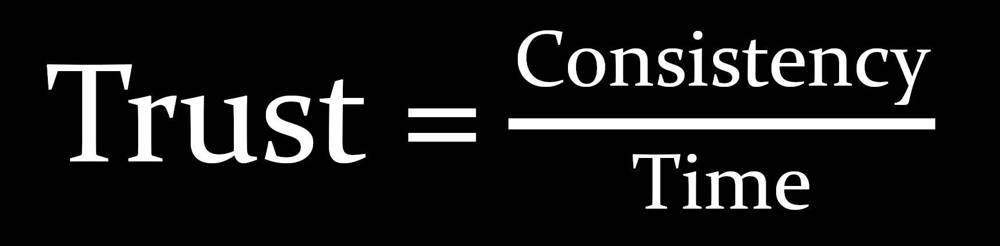
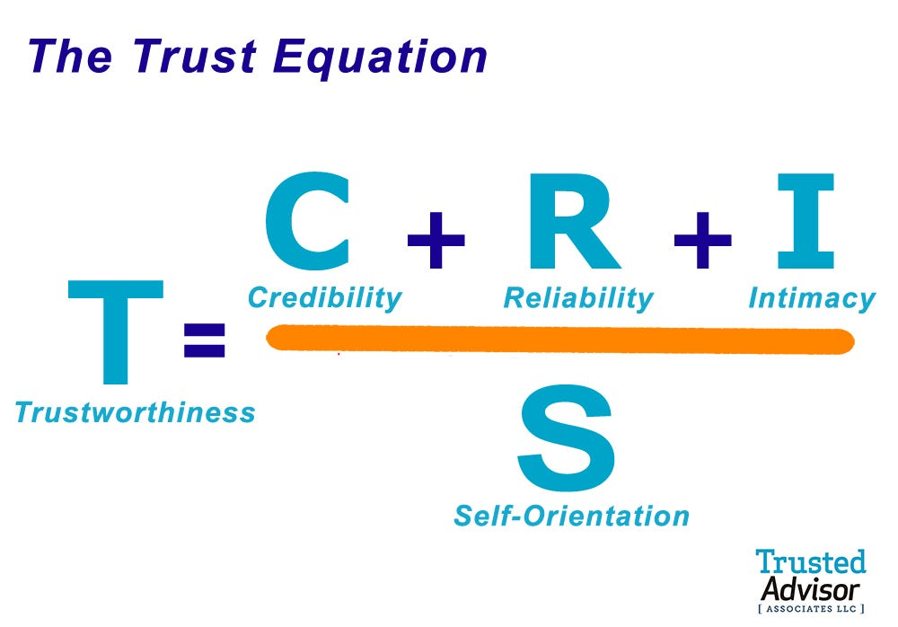

*Trust = Consistency / Time*

* * *

As I’ve been talking to friends about what goes into [World Class Engineering](/essays/what-in-the-world-is-world-class-engineering/) and sitting with some of the implications my mind has been spinning around [concepts of trust](https://www.youtube.com/watch?v=wz1vm0jae20). I’ve got some ideas and want to explore them.

I think that as humans we struggle with trust in a lot of different ways. We struggle to understand what trust is, how to build it, and what to do about it when it has been broken.

## We can break trust with ourselves.

When we break our own trust its usually through not listening to our own concerns, counter arguments, and thoughts that run through our minds and bodies in a situation. I’ve noticed that it happens to me most often when I feel rushed or stressed out about a decision.

> Trust is, at least partially, about your ability to predict and create a certain future outcome.

Like, golly, that’s really not easy for anything of consequence.

All these thoughts started a phrase rolling around in my head that says

> Cryptocurrencies are trying to calculate trust inside an anonymous and volatile global market

Strange random thought, but it got me thinking. I’m not sure it’s a true thought, but it is an interesting one with potentially great cost and an explanation for some of the behaviors in the market recently implied within it. There are areas of my mind that seem to have a few intriguing things to say. So, yay for that.

Part of my passion for programming and blogging and writing poetry and making music and art is to encourage and improve upon my ability to freely associate and connect new concepts — shaking the sorting box that is me to see what happens… *to create higher order connections.*

I want meaning in my life to be structured more like fiberglass and less like a crystal lattice. The lattice parts allow for knowledge that is more practical and transferrable though. Wisdom feels like it resides in the fiberglass.

Regardless of the weird ways I want to encourage my mind to grow, the fact that *Trust* seems to be so expensive is a problem we’ve been trying to deal with since, well, ever.

## So what is trust?

What makes me say it’s a state machine? What makes me think cryptocurrencies are trying to calculate it?

I’m honestly not sure, but I’d like to test those thoughts and statements somehow.

Trust seems to *start* with a choice to believe someone will do something or that something will happen in the future — a leap of faith from a certain point. Science helps us build trust with each other and with a shared reality and that allows us to do a lot of awesome things. *Repetition over time and across contexts and environments helps us build (or break) trust.*

The fact that trust has a start (and often an end) says to me that there’s nuance and potential tests of trust and changes in state as more information becomes available.

There’s a lifecycle to it. There’s inputs and outputs and outcomes that are built around it… All somewhat machine-ish.

## What are some attributes of trust?

*Another Equation*

We often talk about circles of trust. What attributes and properties do they have?

Trust also seems to be potentially tied up with ownership paradigms and security as well. Trust might have a contract, verbal or otherwise.

If someone does not do what they say they’re going to do, is it because of intention or unforeseeable circumstance? Does that even matter?

The dictionary definition of Trust centers on believing someone will do what they say they’ll do, or that something/one is what it appears to be.

Something tells me in all my years on earth that trust is something more than a belief — belief doesn’t have to be grounded in fact.

## Banking and Trust

Trust has been given to banks because people believed they had resources and facilities dedicated to protect their assets from would be thieves and manipulation.

They have protocols to reasonably verify identity and vaults to lock assets away. Banks calculate risk and insure assets as well, they provide a service with a very minimal return for lending them your money, and they’re backed by the federal government and our trust in it as well. Kinda tangential, but, interesting attributes all the same.

Banks and cryptocurrencies sometimes seem at odds, but not always. Blockchain seems to try to be an immutable ledger. Same thing as cuneiform clay tablets in Mesopotamia.

We might consider the current systems of Credit Scoring that gives us loans, an attempt to measure trust based on one’s ability and will to payback a loan.

## Governing and Trust

Governments ostensibly provide resources to protect a group of people from being attacked and annihilated by other governments/people.

Governments provide systems of redress such as the courts and the police as well as a military presence. Sometimes these are sham systems benefiting a powerful few.

That means there’s a some kind of testable trustworthiness across certain facets of care and choice and safety. Those facets may not be readily apparent because the system might be designed to hide them. *We need to be able to trust the public systems to have a functioning society.*

In a democratic or social system All of this is based on implicit [agreements we hold](https://youtu.be/QSyPy9vdA_s) with these various entities.

I think perhaps? a government that places value in the nodes of its network (its people) may be able to determine the level of trust in that system. *That, to my mind, implies that value is held within the knowledge (the specialized experience) and wisdom (the ability to predict and derive) of the members of the system.*

## Relationships and Trust

Trust is something that is necessary to create a relationship. Trust is the information necessary to connect a communication pathway between two nodes, or even two domains, in a system.

Trust is something like an agreement, or maybe a contract, with a certain reality — current or eventuality, either internal to or with other entities in a system. Hardware might have trust, but perhaps we call those tolerances?

In computing you might think about the ability to call an API or make a request from various zones of trust with various tokens, CRLs, OCSPs, and roles and levels of access. Those might be projections of state than can be turned into a true/false STATEment.

## State Machines and Trust

A state machine is something that can have multiple states at any one time. It’s something that we can use to model behavior. They can change from one state to another given certain conditions and are defined by what’s really essentially a ledger. Sounds blockchainish right?

> [Wikipedia:](https://en.m.wikipedia.org/wiki/Finite-state_machine) It is an abstract machine that can be in exactly one of a finite number of states at any given time...A state machine is defined by a list of its states, its initial state, and the inputs that trigger each transition.

## Humanity and Trust

Trust in relating with humans creates something like a mental leger of the mind. You might also have zones of trust and people you allow to “know” the onion that is you.

Someone is asking you to open a trust account when you start a new relationship. That account says you will believe that they will do what they say.

If you think of people as something that maintains a state and an identity — as entities of creation, with sentience, you can draw parallels that help you see that we all have certain functions and interfaces as we grow and move and love through time.

## Identity and Trust

Some people have their concept of trust tied up and linked to their concept of identity. If a person changes or if someone’s identity shifts their trust shifts with it. Other people assign different weight and characteristics to identity.

A person is found trustworthy when their statements can be confirmed. It opens a person (or an entity) up to greater levels of trust, possibly to different levels of access. They have proven a certain ability to create and predict a future involving themselves and others.

Boundaries in a relationship might be the gates and locks you’ve built to allow those people with certain amounts of trust access to aspects of your identity — acceptance tests of state. The boundaries and circles might shift as you learn. It’s a dynamic and complex system.

Boundaries are a tool that an entity might use to determine interface access to data, information, knowledge, and wisdom. The systems, or entities, building a partnership agreement might each have rulesets to determine what level of access to valuable assets can be agreed upon over time and within context.

## Conspiracies and Trust

Conspiracy theories always hold some element of a lack of trust in an institution or body of people. The people who propagate conspiracy theories don’t know how to verify their beliefs in a reasonable way. They don’t have enough information or are prioritizing information that causes errors in judgment. Conspiracy theories seem like an outcome of an environment where information is not as readily available, whether through ignorance or ability to weigh and prioritize. They might have had issues growing up with their family or community system that inform these weights. They might have not received adequate training in critical thinking or have access to better information. They might not understand their motivated reasoning or the logical fallacies they are prone to. Trust has to have been broken on multiple levels somehow for someone to believe in a conspiracy theory.

* * *

If you’re interested in having a conversation about trust let me know what you think. My thoughts are still pretty nascent.

* * *

*Trustworthy is being accountable, not perfect. Courtesy [https://www.meaningfullife.com/what-is-trust/](https://www.meaningfullife.com/what-is-trust/)*
