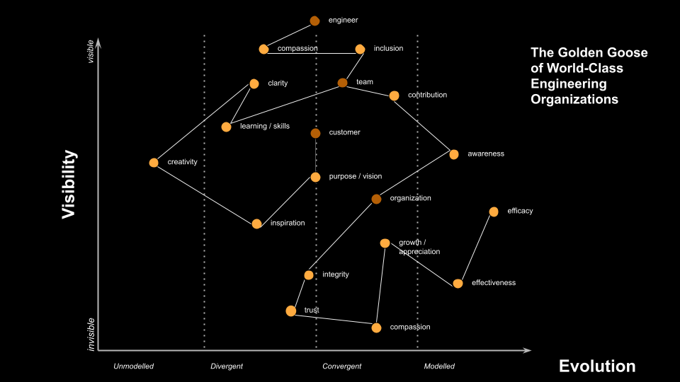
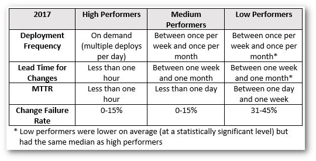
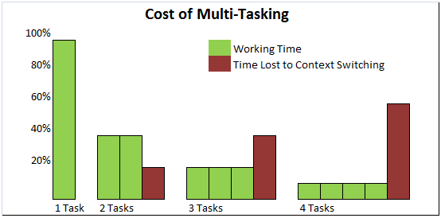
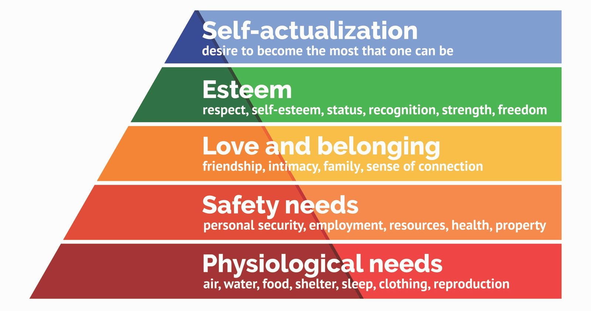
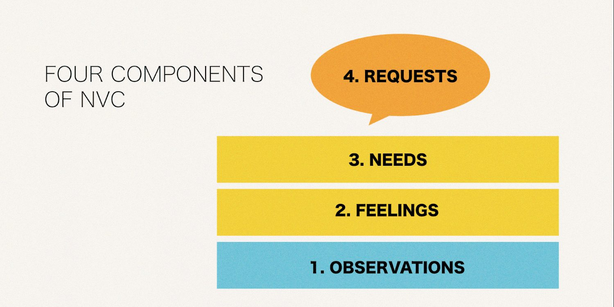
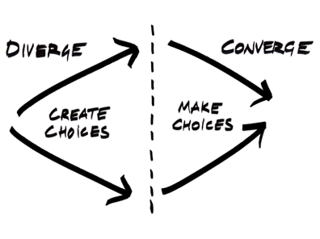
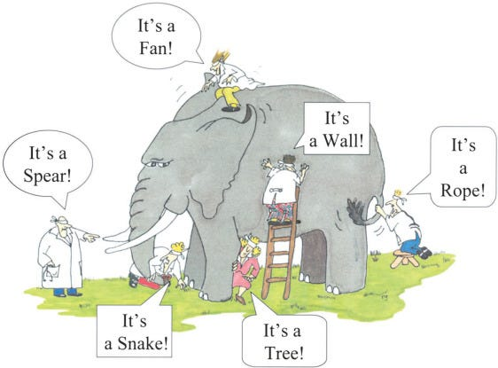
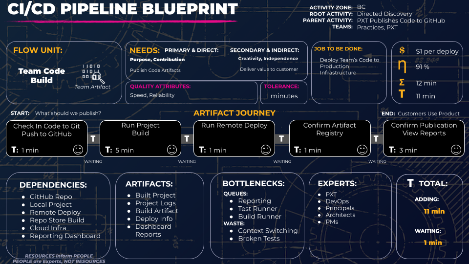
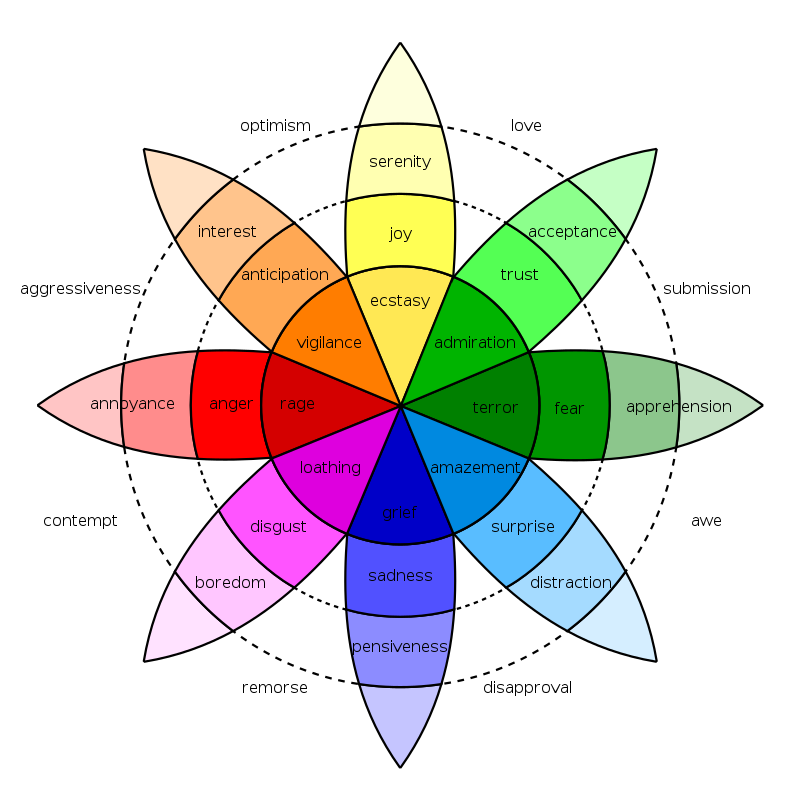
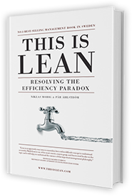

- [Read Part 1](/essays/what-in-the-world-is-world-class-engineering/)
- [Read Part 3](/essays/what-in-the-world-is-world-class-engineering-part-3/)

*Golden Goose of World-Class Engineering*

* * *

## Getting to the Measurables

In my [previous post](/essays/what-in-the-world-is-world-class-engineering/) I started to break down definitions, attributes, and statements that describe “world-classiness” in engineering.

Is world-class engineering as simple as measuring metrics from the research book [Accelerate](https://itrevolution.com/book/accelerate/)? I definitely think the evidence shows those measures put many engineers and organizations ahead of the game. (See chart below.)

*ACCELERATE The Science of Lean Software and DevOps: Building and Scaling High Performing Technology Organizations NICOLE FORSGREN JEZ HUMBLE GENE KIM*

- **Deployment Frequency**
- **Lead Time for Changes**
- **Mean Time To Recover**
- **Change Failure Rate**
- [**WIP limits**](https://en.wikipedia.org/wiki/Work_in_process) at a [**team**](https://agilevelocity.com/lean-economics-101-the-power-of-wip-limits/)and [**organization**](https://www.scaledagileframework.com/improving-strategic-investment-impact-by-limiting-portfolio-wip/) level also come to mind.

*WIP Limits reduce the cost of Multi-Tasking*

All of these metrics are key performance indicators in any system of engineering. (More on these later on in this post.)

That said, there are **qualities** that underpin the success of engineering organizations and teams that encourage exceptional behaviors.

Exceptionality is a moving goal post, but that doesn’t mean it isn’t worth striving for, even for it’s own sake.

The [Accelerate](https://medium.com/slashdeploy/book-review-accelerate-92ebc00f4354) metrics and WIP limits above get us to delivery, but their connection to value is only implied in the ***research the team has done*** to understand the customer’s journey, their jobs to be done, and the analysis of underlying ***needs*** that motivate iteration, behavior and events in the business domain.

> Need is the flipside of the Value coin

### Understand Need to deliver Value in a World-Class System.

* * *

## Where to Start Delivering Value?

When planning strategy or evaluating an initiative managers often start with Objectives and/or Jobs-To-Be-Done.

Based on the definitions from the [previous post](/essays/what-in-the-world-is-world-class-engineering/) I’d argue that a world-class organization is one that is highly ranked across the globe and effective for millions (if not billions) of people. In order to be that, we must connect directly with **Human Need** to deliver value**.**

> **There’s a limited set of needs tied to the human experience — Needs common to all humans.**

As I went through the exercise in [Part 1](/essays/what-in-the-world-is-world-class-engineering/), I realized that needs were some of the most important and interesting attributes I’d found.

One satisfying thing about the logic of need is that it can help us focus and organize our Objectives and [**Jobs-To Be-Done**](https://hbr.org/2016/09/know-your-customers-jobs-to-be-done) from a **Needs-To-Be-Met** perspective. It can simplify our view on on quality and prioritize what’s important to our business. In other words it helps us build in a ***lean***, coherent and cohesive way — [***Kaizen***](https://en.wikipedia.org/wiki/Kaizen) (change for better) actually has a lot to teach us about **Need.**

As humans we have a basic set of needs that we’re all trying to meet at any given time. Anyone familiar with [**Maslow’s Hierarchy**](https://www.simplypsychology.org/maslow.html) knows what I’m talking about. There are Five Basic Human Needs. Start here.

*[Maslow’s Hierarchy of Human Needs](https://medium.com/@kilianmarkert/the-ultimate-driver-of-human-motivation-on-the-quest-of-finding-meaning-fb6652e851f4)*

Slightly more nuanced needs can be specified to somewhere around 80–100 terms as mentioned in the [Non-Violent Communication Needs Inventory](https://www.cnvc.org/training/resource/needs-inventory) compiled by [Marshall Rosenberg](https://en.wikipedia.org/wiki/Marshall_Rosenberg) that I mentioned in my [last post](/essays/what-in-the-world-is-world-class-engineering/).

*[https://www.thelittleblackcoffeecup.com/journal/makecoffeebetter](https://www.thelittleblackcoffeecup.com/journal/makecoffeebetter)*

[*Viktor Frankl*](https://en.wikipedia.org/wiki/Viktor_Frankl) *also has a powerful book called* [*Man’s Search For Meaning*](https://www.brainpickings.org/2013/03/26/viktor-frankl-mans-search-for-meaning/) *if you’d like to explore foundational self-actualization and human need further.*

## Organizational Actualization

I’ll argue that an organization is a vehicle that humans can (and should) use to meet needs. In a nutshell:

**Humans** → use → [**Organizations**](https://www.humanocracy.com/)→ to meet → **Needs →** to deliver → **Value**

As opposed to hitching ourselves to the default mindset of a bureaucracy:

**Institutions** → use → **Humans →** to increase → **Profit / Impact**

Bureaucracy places the institution as the prime instigator and revenue rather than value delivery as the end goal. I personally think that creates many problems we see in cultures today. Bureaucracy is an impersonal and dehumanizing organizing principle upon which to build our business and actualization. (*Pink Floyd sung this song well.)*

[Embedded media](https://www.youtube.com/embed/YR5ApYxkU-U?feature=oembed)

Granted, bureaucracy has proven better for humans than the ownership and control paradigms that preceded certain imperial societies prior to the Industrial Revolution.

When business and the broader marketplace integrates more closely with *human need* the marketplace will become inherently more compassionate. What we measure as success matters. Tying revenue and org structure to needs being met is a practice that can fundamentally change the planet with a simple rule, much like changing the initial config in [Conway’s](https://en.wikipedia.org/wiki/John_Horton_Conway) [Game of Life](https://playgameoflife.com/).

Understanding and organizing institutions around *need* helps us make better better predictions about human behavior in a rapidly changing environment. It also helps us focus on and further integrate the [ethics of care](https://en.wikipedia.org/wiki/Ethics_of_care) in our everyday choices. It starts to shift our models from transactional to those that are transformational.

How we reason and respond to change matters for the planet. Need helps us more closely align with lifecycles that matter — for life to continue.

## We Can Learn and Do Better

[*Humanocracy*](https://www.humanocracy.com/)*is a book that comes to the top of my mind. I’ve pulled some examples from it while running a book club on it. In that book, the authors call out these operative questions:*

### Bureaucracies ask:

> How do we get human beings/teams to better serve the organization?

### Humanocracies ask:

> What sort of organization elicits and merits the best that human beings can give?

### Which do you think is the more sustainable question to be asking and why? What are the strengths and weaknesses of each?

I’ll leave that as an exercise for the reader.

Organizations need reasons for being as much as any single human.

**Humans** → use → [**Organizations**](https://www.humanocracy.com/)→ to meet → **Needs →** to deliver → **Value**

I’m not going out on too much of a limb in saying:

> ***Organizations exist in as much as they provide service to humans.***

They empower individuals. We can all ask ourselves how the organizations we align with empower us, and who they are enabling in reality.

How we distribute power and money changes which needs are being met. Revenue is a measure of fluidity of power within a broader organization. Where you distribute revenue shifts the decisions that get made. Both breadth and depth of knowledge must be reflected in our ledgers and in the distribution of power.

To think people exist to serve “organizations” is an objectifying and dangerous road to go down philosophically and practically, on an Existential level and in terms of unequal power dynamics like master-slave and lordship-bondage relationships. Businesses are generally still organized this way.

Again, I have a lot of thoughts here, and so does the [Agile Alliance,](https://www.agilealliance.org/) among many others.

We would all be well-served to study the driving forces and the “why” behind the original Agile Manifesto and all the work done since. Systems Theorists and Technologists have been talking about and researching it for a good long while.

With a bit of intention we can organize a more diverse marketplace of ideas and build more effective power structures into every organization we create.

### Get curious

Let’s open the black boxes to help business connect to fundamental human need and link it to our physical reality in practice with science, engineering, and technology. That gets us closer to an ideal of *“World-Class Engineering.”*

* * *

## Wardley Mapping Human Needs

All this starts to get us at the “why” behind my choice to map relevant Human Needs around Engineers, Teams, and Organizations in my last post.

Originally, I used the **Unmodeled-Divergent-Convergent-Modeled** axis. Divergence/Convergence is a really powerful practice when used well.

*[https://tutorial.math.lamar.edu/classes/calcii/convergenceofseries.aspx](https://tutorial.math.lamar.edu/classes/calcii/convergenceofseries.aspx)*

At any point in time each person involved in a conversation might only see one piece of [the elephant](https://www.peacecorps.gov/educators/resources/story-blind-men-and-elephant/) that is a problem. [Wardley Maps](https://www.youtube.com/watch?v=IJcLmoKR6v8) can help us see more sides and point out the emergent constraints in a system and in the market. *For more information go to* [*learnwardleymapping.com*](https://learnwardleymapping.com/) *or* [*here*](https://medium.com/wardleymaps/on-being-lost-2ef5f05eb1ec)*.*

*Himmelfarb, Jonathan et al. “The elephant in uremia: oxidant stress as a unifying concept of cardiovascular disease in uremia.” Kidney international 62 5 (2002): 1524–38. G. Renee Guzlas, artist*

I see the ideal of “teaming” and “organizing” and even “institutionalizing” as progressions of people that learn, model, predict, decide, and act collaboratively. And I think that’s why [The Golden Goose of World-Class Organizations](https://docs.google.com/presentation/d/1zturYs_IeqHXeEwFAxTkqpLq8BTU_YRlpkmhnlA-Fz0/edit#slide=id.g7956e7d49c_0_709) *(as well as my motivation for* [*Wisecrowding*](https://docs.google.com/presentation/d/12PiffUPPB_WqKdE8laLdAs1iQBE_OzLJRGwMslFIZ8M/edit#slide=id.gbb2fa27cf9_0_93)*, which I’ll get to in the next post)* turned out like it did*.*

*Golden Goose of World-Class Engineering Iteration*

### Reasoning about needs helped me see a larger story around teaming and organizing

> Understanding, modeling and mapping *needs* is recommended in lean methodologies.

> Wardley maps help me visualize the importance of Needs and dependencies in an organization that wants to sustain, constrain, and support itself — to stay nimble.

### I’d love to have further conversations about this.

What I created ended up looking a bit like a bird (a goose! no less), which was a happy surprise that told a larger story.

Disconnecting from any single part disconnects the needs of the engineer from the needs of the team, the organization, or the customer.

Businesses (and any kind of interconnected human relationship) hinge on compassion and [trust](/essays/trust-is-a-jenky-state-machine/). Communicating that in various ways seems like an important and worthwhile endeavor.

## All the Needs Play in to Each Other

If we were to slice this golden goose we won’t be able to make any more eggs (deliver value). The analogy seems appropriate and memorable. *It’s* [*mythopoeic*](https://en.wikipedia.org/wiki/Mythopoeia) *as well!*

I’ve now got a bigger “why” mapped around certain concepts and can tell stories about them in a more complete way.

I’m realizing at some point I may want to make sense of these components in relation to humans on an axis of evolution of Need. In going through this exercise I’ve developed a sense that this kind of mapping may also become a useful tool for self-actualization. I can see how [Maslow’s Hierarchy could be used on the map](https://docs.google.com/presentation/d/1zturYs_IeqHXeEwFAxTkqpLq8BTU_YRlpkmhnlA-Fz0/edit#slide=id.gc04f6bb24c_0_0) for personal development in self-help circles.

[Susan Almon](https://twitter.com/susanalmon?lang=en) has been doing work around concepts of *burnout* within the Agile community that tie into this. Hopefully we’ll be working together in the future to help others meet personal needs in a broader sense. I think burnout, anxiety, and depression are all results of long-term unmet needs.

[Cat Swetel](https://www.catswetel.com/) has a lot of well-thought-out opinions around business metrics, ethics and function. I feel really grateful to have met so many amazing people in my map-making journeys.

## Measuring Satisfied Needs

Some people measure engagement metrics or NPS and do behavior analysis. Others do interviews — or all of the above. I’m sure there are many approaches. At the same time, if you measure **flow efficiency** through a system of need you can get quite far with a few simple metrics.

I think flow efficiency might be one of the best ways to measure satisfied needs. But what your flow unit is and how you measure it matters.

## What Gets Measured Gets Done

Take a look at the blueprint below. On the upper right side there are metrics for value transfer (**$**), flow efficiency (**η**), total time(Σ), throughput(**T**), and time spent waiting (**τ**).

*CI/CD Pipeline Lean Blueprint*

## Accelerate metrics & WIP Limits

In the blueprint above the Accelerate metric **Deployment Frequency** is equivalent to [**flow efficiency**](https://jlcinternational.com/what-flow-units-do-you-want-to-use/).

*(Not pictured are the other Accelerate metrics.)*

[Accelerate](https://itrevolution.com/book/accelerate/) also includes how often a deploy has an issue (**Change Failure Rate**) and how long it takes to recover from failure (**MTTR**) as well, but these aren’t pictured. **Lead Time for Changes** measures up front throughput. The shorter the lead time, generally, the smaller the change. Small fast changes create more profit.

**WIP limits** help us focus on flow and reduce time spent context switching. Delivering on a pipeline might be your single work-in-progress until the cycle has completed.

In order to make small changes you have to know enough about what the customer wants to iterate into something that improves their level of satisfaction within their own pipelines of work.

## $: Value Transfer

> **$** Value Transfer **= Customer Expense per Flow Unit for one Cycle**

***Cost*:** Measure the value transfers. If you can tie a dollar amount to an activity and to a customer journey, do it. The more you can tie something back to financial value delivery the more nimble and responsive to market conditions your company will be. Understand how much you receive and how much it costs to move customers through your systems. Use dashboards to help you do this. Guesstimate on paper first. *(This often is not easy, but even trying to calculate it can enhance your business operations immensely).*

## Time spent listening and analyzing the customers actions

*(Customer Satisfaction for X Number of Customers over time)*

***Listening & Compassion*:** Compassion helps us act on the feelings of others. Measure the time you spend listening to the customer. Find a balance with the time spent engineering. Engineers who can place themselves in the customer’s shoes will move much more quickly.

## Building In and Around a Moment of Need

I’d be willing to bet that there’s a healthy ratio of time spent listening to others (directly or indirectly). Not sure what that is yet, but my gut says its one of the more important metrics of success. Having close connections with your customers and leaders can reduce other kinds of coupling.

You can use your senses and aggregate feelings (see [chart](https://martecgroup.com/using-plutchiks-wheel-of-emotions-in-market-research/)below) to determine how satisfied needs are at any given point in the process. Its possible to chart an emotional flow over a path and determine whether needs are met or unmet based on the vector of those feelings. I hope to explore this further as I build out my blog.

*[Robert Plutchik’s](https://en.wikipedia.org/wiki/Robert_Plutchik) [Wheel of Emotions](https://martecgroup.com/using-plutchiks-wheel-of-emotions-in-market-research/)*

## τ: Throughput = Flow Units \* Cycle Time

*(Flow Unit Avg Pace)*

Throughput is about how many flow units you’re able to move through a system to complete a cycle of value delivery.

Flow units can be almost anything. From a lean standpoint its generally good to start with a focus on people ([human-centered design](https://en.wikipedia.org/wiki/Human-centered_design)).

In the blueprint above, we started with engineering teams and realized they build artifacts each day. The teams are a flow unit, so are the artifacts.

Customers can be flow units. Feelings and needs could be flow units as well, or they could be a [temperature gauge on pipeline flow](https://jlcinternational.com/what-flow-units-do-you-want-to-use/). Met and unmet needs result in different feelings with a different temperature or vector —one thought I’ve had is that they might impede or stop flow by changing viscosity. I hope to work through the details as I explore this space further.

## Time spent waiting for value transfers

How long a flow unit waits between changes in status can affect flow efficiency. That time can have a positive or negative impact.

### Direct and indirect needs can constrain each other in context

e.g. If you’re at the hair stylist you might be the flow unit. You have a need for social interaction as well as for beauty. The stylist that meets both needs and doesn’t rush you out the door will be more likely to get your business. It’s not just throughput of people, it’s about throughput of satisfaction.

In contrast, at the DMV you might want to get in and out as quickly as possible.

## η: Flow Efficiency — Value Adding Time

- How much time do you spend adding value to the customer’s journey?
- How many steps are there?
- How much time do they have to wait in between steps?

> η = Σ $**VALUE /** τ THROUGHPUT

## Measure What Matters

When you empathize with people and lay out a [happy path](https://en.wikipedia.org/wiki/Happy_path) for them you can start to see what is getting in the way for them *in their day to day operations.* And you can begin to iterate and improve.

> Effectiveness = Efficiency x Human Need

When you get down to it, resource optimization can be much less efficient than flow optimization and can be even more costly in certain contexts. Iterating around and measuring *need* helps you see this.

The medical system in U.S. and elsewhere is a prime example of the pitfalls of resource efficiency where people’s lives are on the line. People are dying because of blind spots around resource optimization. This form of optimization even contributes to skyrocketing costs the world over. Don’t take my word for it, read [This Is Lean](https://thisislean.com/) to learn more about how to optimize for flow and keep costs low. Its a deceptively easy read, and its worth it.

*This Is Lean Book Cover*

* * *

In Part 3 I’ll examine some more examples of what World-Class Engineering might look like at an Organizational level.

I’m planning to provide some real-world examples and more practical ideas about how to organize for actualization and sustainable growth. If we want to be world-class, we must collaborate to make more integrated predictions and decisions going forward.

* * *

- [Read Part 1](/essays/what-in-the-world-is-world-class-engineering/)
- [Read Part 3](/essays/what-in-the-world-is-world-class-engineering-part-3/)

* * *

*Feel free to reach out to me if you have comment, corrections or thoughts on* [*twitter*](https://twitter.com/jdcarlston)*.*
