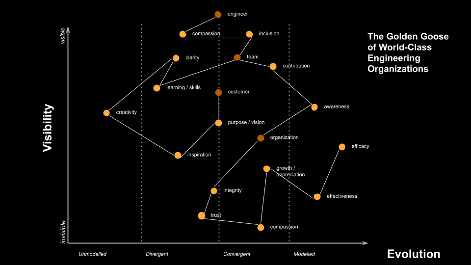
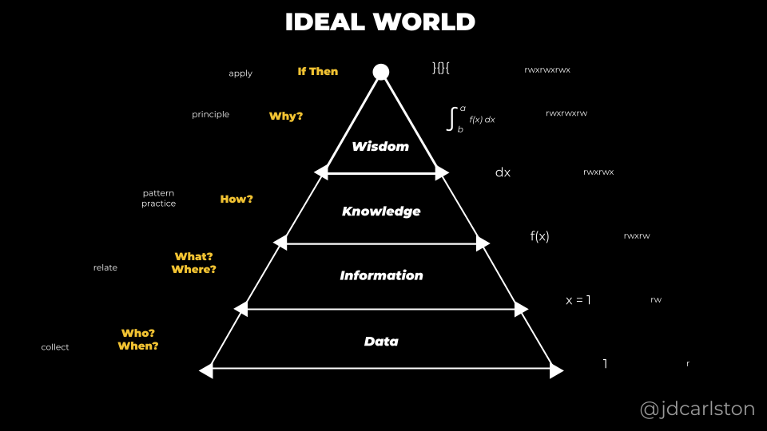
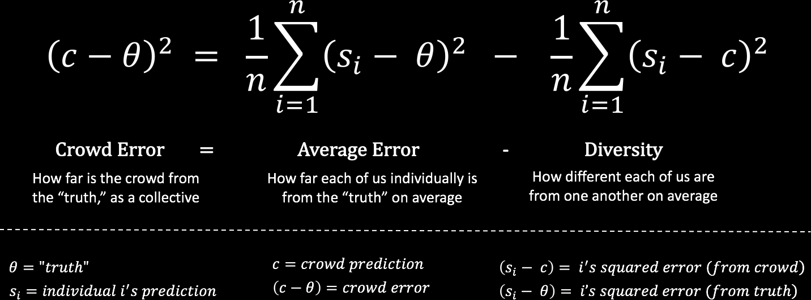
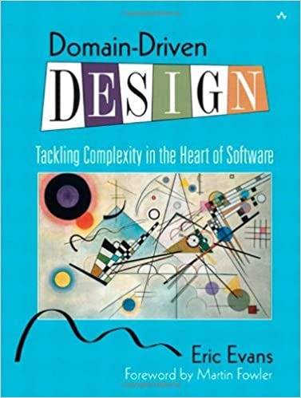
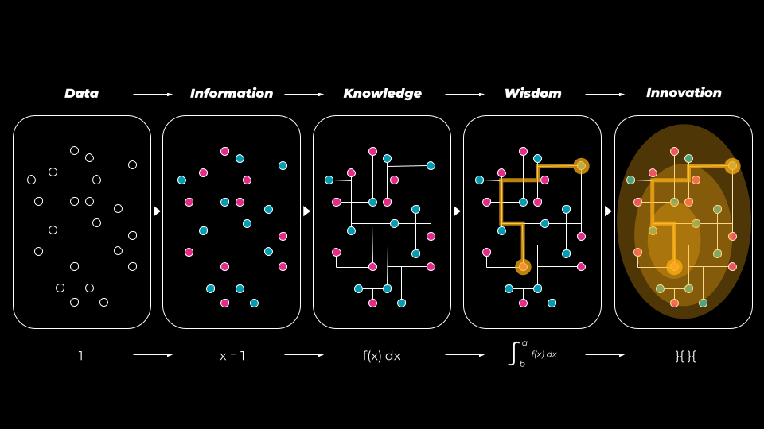

- [Read Part 1](/essays/what-in-the-world-is-world-class-engineering/)
- [Read Part 2](/essays/what-in-the-world-is-world-class-engineering-part-2/)

* * *

## Favor Ambitious Collaboration over Competition

Being world-class, ideally, is about striving to actualize within a global community setting. Something “world-class” brings balance and delivers value to large and diverse audiences of people.

Individuals and organizations must ask how they are supporting humankind to reach their goals and help them create a vision in a way that leads to appreciation and growth for all involved. In [Part 2](/essays/what-in-the-world-is-world-class-engineering-part-2/) I spoke about how:

> Need and Value are intimately linked.

They are two sides of the same coin. Need is what is met when Value is delivered. Value-chain delivery organized around the lens of need becomes about humanizing the system(s) you build, your production pipeline and your organization. The highest level flow unit in any system is need. There are needs common to all humans and needs common to all life.

Creating flow efficiency with this understanding has the potential to simplify value-chain design and change the focus of production in a direct way.

The availability of a product or service to meet certain Needs is the *Supply*, and the *Demand* is how well people are able to meet their Needs with the products they create in the world today.

Delivering tools and services to meet needs creates “profit” in a sense that people are willing to pay for things that help them actualize, give them esteem, a sense of belonging, of safety or of growth.

### Profit Models

The profit models we use for business have always bothered me. It bothered one of my favorite [SciFi authors](https://en.wikipedia.org/wiki/For_Us,_the_Living) growing up as well. **Profit** describes the financial benefit/surplus realized when revenue generated from a business activity exceeds the expenses, costs, and taxes involved in sustaining the activity in question. A market can create and exacerbate blind spots in a number of ways. (Someday I’ll write a post detailing more of my opinions.)

Profit models imply a surplus energy draw on the inputs of a system — an open loop, an unclosed circuit. It hides the law of thermodynamics in a layer called “the market.” Profit abstracts and disconnects the work needed to meet needs from the delivery of value. Once it is disbursed that money is no longer counted by the system.

Profit models assume that there’s something left over, rather than what’s actually going on — a redistribution of power and energy. I think this bothers a lot of people on a semi-unconscious level. It requires a certain amount of cognitive dissonance to accept — especially if you understand physics.

Profit dispersal pulls energy away from the system in the hopes that it will draw more direct investment down the line. In this then “profit” abstracts investment away from the mission of the company and puts it in the hands of the individual investors and profiters.

### Markets create a different breed of customer

It might be looked at as extending your investment in a system to more people and creating a different, secondary kind of customer (stockholders). I don’t think this is spoken about enough when we’re considering how this affects the goals of a business and how it can start diluting its mission and vision.

Taking a step back, as humans we’re still trying to figure out how to balance the forces of lower level physical need in our society and our marketplaces. Tie services to throughput metrics as discussed in the previous article to start understanding this. Profit could be seen as an energetic black hole in an internal market.

Profit models create blind spots. We often forgo many different dimensions of risk when we game for profits. Its wise to be aware of this as a contributor.

### Favor terms of Investment over Profit

Spend capital on keeping your utilization low. 10x your systems. Meet your employees needs to self-actualize. Stay competitive. Keep essential reserves, and pay any surplus after that back to the customer. Choose collaboration over competition, sharing over greed. Default toward open to reduce the temptation. And don’t slice that golden goose.

*The Needs of World-Class Engineering*

* * *

### Must needs go unmet for a market to exist?

I think a lot of people act like they think it does. To change that, ultimately, I want **the mindset** of the marketplace to shift, to iterate — to be more realistic, more connected, more [intertwingled](https://en.wikipedia.org/wiki/Intertwingularity), and less extractive.

Profit is a core belief in the religion that capitalism has become. I think its past time for revaluating some of those assumptions from an engineering standpoint. It’s time to measure what matters more accurately and replace them with a systems view at the lowest level.

We can iterate into better. Many already have. Its time to start questioning the fundamental assumptions around how we organize our business, who we distribute investments to and for, and how we define our goals.

I think this might be a useful construct to help us understand some of the reasons **Why** (remember the DIKW pyramid?) we might want to do this and start figuring out **How** it might work.

*Data, Information, Knowledge and Wisdom help us create iterations on a slightly more ideal world*

Having answered questions of Why will help us overlay this pattern in other areas of our lives.

## Real-World Example

e.g. The iPhone meets needs all along Maslow’s Hierarchy as well as the DIKW pyramid.

**Data**: it generates and sends data to and from the service towers built from a system of radio communication signals and across the globe using huge interoperable networked systems.

**Information**: it routes phone calls from people that matter to you and gives you specific information wherever, whenever

**Knowledge**: you hold the power of the internet, of music, of art, of human knowledge at the touch of a fingertip. You can get an education from a device not much bigger than a deck of cards.

**Wisdom:** you can download and build apps to learn, to innovate, to create and to change. The system itself is changeable and modifiable at multiple levels and has a market of innovation as part of its platform.

*Have an apple?*

The iPhone in particular help us maintain physiological safety, connects us to friends and exclusive communities, and gives us a certain kind of social status and is a tool for learning and growth. The iPhone created its own market as well as a model for marketing apps on mobile phones. It helped redefine how and when needs could be met.

This can help us see the why behind the broad impact and potential opportunities of this product.

> The iPhone is a tool that provides a jumping off point to meet physiological, safety, belonging, esteem, and actualization needs at every layer of creative learning.

(sidenote: [I recently learned some interesting things about Maslow’s Hierarchy that makes me want to think about its origin and impact and to turn it on its head](https://link.medium.com/l8wD79EOHfb).)

## Agile, DDD, & Wisecrowding

Wisecrowding is what I’m calling the practice of creating iteratively and intentionally improving dynamics within diverse groups of people. People are the operative side of technology. Groups can get better at making decisions, leadership can come from groups of people rather than single individuals. We place more trust in individual leaders than is wise.

Wisecrowds are groups learning to use and to make more fair, varied, informed decisions. Overall they make better predictions through collaborative processes (via the Diversity Prediction principle and [Wisdom of the Crowds](https://en.wikipedia.org/wiki/Wisdom_of_the_crowd)).

*The Diversity Prediction Principle*

I’ve started pulling together groups of people who are also interested in these kinds of things to see what we can learn, find more resources, and generally build practices around how to collaborate more effectively across large groups of people, beyond engineers, building upon Agile, Lean, and other proven principles.

Chat with me if you want more info before I get what I’ve learned written up more formally.

*Domain Driven Design: The Big Blue Book*

On a larger scale this is part of why I love the [Agile Alliance](https://www.agilealliance.org/) and [Domain Driven Design](https://www.dddcommunity.org/) communities. These groups push the envelope around things like:

- organizational design
- team dynamics
- iterative coding practices
- behavioral analysis
- game storming
- service blueprinting
- event modeling
- human-centered discovery and design
- test-driven development

Everything on this list feeds into every other thing. Ultimately, our practices give us the power to challenge the status quo to work in healthier and more effective and efficacious\* ways.

[* that a modicum of snuff can be most efficacious.The Adventures of Baron Munchausen (1988) clip with quote that a modicum of snuff can be most efficacious. Yarn is the…getyarn.io](https://getyarn.io/yarn-clip/5e517de9-e490-4159-8401-e37613a7be95)

\*Lolz. Silly big words.

* * *

### The Future of Technology

The future of technology (and, in all honesty, the world) depends on how well we can collaborate across large groups of people. Profits that measure what’s matters to the globe ultimately hinge on our kindness and compassion. And we can use the tools and patterns developed by mathematicians, scientists, engineers, and technologists to collaborate and build better models for the business world.

> The future depends on how well we collaborate.

That means to become a world-class organization we must iterate upon our social and technical skills across diverse groups of people to make better predictions about the future.

Being a [Learning Organization](https://hbr.org/1993/07/building-a-learning-organization) that values diversity in all its facets, that delivers value around need, and measures success by what matters on the “scale of Human” matters.

Learning and innovation that prolong and promote life within our interconnected web will make all of us more resilient and sustainable in the short-term and for the long-haul.

To be world-class we must translate those social and technical skills, those algorithms and communication patterns for a broader audience.

## Information Architecture is not an option.

We must concretely tie code, data models, and machine learning models to mathematical models using [Category Theory](https://www.youtube.com/watch?v=ho7oagHeqNc), [Information Architecture](https://en.wikipedia.org/wiki/Information_architecture), [Library Science](https://en.wikipedia.org/wiki/Library_science) and [Human-centered Design](https://en.wikipedia.org/wiki/Human-centered_design)to build robust and resilient systems.

*Connect wisdom to other systems to create innovation*

> Orgs that can’t connect across the grid of information and need won’t survive.

This is more common than you’d like to believe. There’s an entire underworld of schema and data modeling that most engineers and companies have little to no knowledge about. Its what makes fast integrations possible.

> Its the connective tissue of the Internet.

The mathematics of Information science helps you make faster connections between systems, it helps you translate and pattern information to understand the **Why** of your business. It also helps you make more concrete assessments, decisions, and predictions.

[Embedded media](https://www.youtube.com/embed/ho7oagHeqNc?feature=oembed)

## Ground Your Business to Reach Great Heights

We must ground ourselves in our humanity to build to greater (and more compassionate) heights of technology. Using iterative [scientific practices](https://docs.google.com/presentation/d/1hxUHkZvEV46LfZTSikAaDD8J8L_wkic7K9YL87sXUPM/edit), using data, using information to build a knowledge graph (an ontology).

In other words, don’t start building a graph before you understand the language of your business.

You can’t build a knowledge graph without an ontology. You can’t build an ontology without a taxonomy. You can’t build a taxonomy without a thesaurus. And you can’t build a thesaurus without a glossary — a controlled vocabulary of some kind.

When you finally build an ontology you can connect it to others using schema standards from around the world. You can begin to build a global community of collaborators.

This is the true meaning of stickiness. If your data model improves the human condition by linking itself innovatively to need, and if it’s discoverable by the rest of the world, it will become integral to other systems. You will become part of the chain of humanity pulling itself up by its bootstraps, growing its beanstalk to the sky.

This old fairy tale is really is a story about creativity, disconnected greed, hierarchical thinking, and innovation out of necessity.

*Jack and the Beanstalk*

### Listen to Your Senses

We can observe our senses, and understand them — give them names and map them in a mental space. We can collaborate to build common language, communicate models and make group decisions when we actualize ourselves and our organizations by placing our human physiology and qualitative experience first in the hierarchy of value.

In order to do that we have to identify human needs and tie them to our actions and our data models. We have to connect new information and build a system that increases knowledge in a certain space.

When we use neuropsychological and neurophysiological research around feelings and needs identification and improve upon collaborative decisioning and learning processes we can ultimately tie them to the success of our business.

> We’ll be more likely to survive and thrive amidst turmoil and a changing climate.

Again:

**Humans** → use → [**Organizations**](https://www.humanocracy.com/)→ to meet → **Needs →** to deliver → **Value**

* * *

## What might this look like in an organization?

At each stage of an initiative there need to be well defined practices and roles that align around learning and delivering on customer needs.

Teams are chartered based on these needs and tasked with experimenting and iterating on delivering value. The team hypothesizes about ways to meet a need and comes up with a falsifiable tests to validate their experiments which might turn into AB tests as a product is engineered through series of passing tests and tolerances —Investment TDD as well as engineering [TDD](http://agiledata.org/essays/tdd.html).

As work begins experiments are logged in a registry (could be as simple as a worksheet) to help communicate to the organization what needs are being worked upon and by whom. This can reduce duplicate work.

All members should act as scientists of their domain. They are made up of essential members to create a micro-enterprise style product delivery system. The business exists to help coordinate delivery of value in the form of products and innovations that have been tested by a robust experiment and innovation platform.

### Service-Oriented

In order to work in this way consider some new possibilities. Each category of need could have a multi-functional team dedicated to it (needs might be grouped logically), dedicated to being able to test and qualify data and link information in a service. Look at this [sample list of needs](https://www.cnvc.org/training/resource/needs-inventory) and organize services accordingly — as they align with your mission and vision.

User personas and journeys could be developed to create a more nuanced understanding around more complex needs and services, but generally inform high level direct need.

### Multi-Functional Teams

Multi-Functional teams might have data scientists, information scientists, designers, analysts, managers, engineers, support, sales, financial, and marketing representatives.

Identity-diverse and role-diverse teams pay dividends when they listen to each other.

The teams function independently and act as an ensemble team (inside a wise crowd / mob of mobs / smart mob / internal market) with different areas of expertise. They work and come together regularly to coordinate activities, to retrospect and reflect on the goals of the org, the team or services that they own. They have time to diverge and work on things solo, in pairs, as well as converge on ideas together.

Team Mobbing/Ensemble Work can help teams deliver more effectively. They work together toward common goals inside a value chain. Some companies even include customers in their ensemble — audience participation.

Teams can build a manifest or charter and enhance onboarding with their own process, they revisit it when new team members are added or goals shift. Teams can use matrices to spur discussions around needs, [unanswered questions](https://jamieschwandt.medium.com/question-matrix-how-to-develop-the-right-questions-ee21eb256c1), [skills](https://theitriskmanager.com/2013/11/24/introducing-staff-liquidity-1-of-n/), [ownership](https://www.pluralsight.com/tech-blog/what-is-a-data-owner-really), [technology](https://deseng.ryerson.ca/dokuwiki/design:weighted_decision_matrix), and responsibilities in occasional retros. Services are documented for high-level purpose, features, and lifecycle in an [SLA (Service Level Agreement)](https://stance.consulting/osom/) and key metrics are defined and then shared in dashboards and linked to in discussion channels.

### Data Science

The **data scientists** work with engineers, analysts, reps and managers to agree upon the relevant events, vocabulary, taxonomy and report dashboards for the domain. They work with the data in the datastore(s), run simulations, create ML and data models and work with the information scientists on the ontology to some extent.

### Information Science

The **information scientists** oversee the integration of the data and domain model into the information system at large. They help develop the taxonomy and ontology and link it to other external standards and internal graphs that have been built by other taxonomists using industry standard tools. They speak with marketing, sales, analysts, engineers and data scientists to understand the language common to the domain as well as the super domain backing the knowledge graph as well as the market schemas at large.

### UX Design

The **designers** take the results of a successful experiment, do a lot of discovery and design experiments, and integrate the system into the existing UI platform using design elements that have been built collaboratively by the design guild . They work with everyone to understand the customer and build a coherent user journey. They understand the customer and their hierarchy of needs. They create a coherent user experience that reinforces and melds with the mission and vision. They often fill several roles in translating needs to the engineers.

### Sales & Marketing

There should be at least one representative of Sales and Marketing on a team. Sometimes they might double as a UX Designer and interface with external sales and marketing services. They help engineers and customers understand the gap between customer need and service value. They can craft a story that helps people see things from new perspectives. Keep in mind that Sales and Marketing reps are driven by incentives, so incentivize what matters — poorly incentivized commissions can poison the heart and message of a company. **What gets measured gets done,** so find ways to measure customer satisfaction if you pay commissions. To enhance capabilities services can be purchased from generalist teams in the system.

### Management

**Managers** could be based a rotation of the different members of a team or could be an assigned role. Managers answer to the teams and to the metrics. They help the team coordinate measures of success and rewards and facilitate decisions. In a pinch they should be aware enough of what’s going on and should answer to the team and customers by fielding questions from outside the team to help shield members to get work done. They should have a collaborative/bottom up style of leadership. Responsibility Matrices and Dashboards can help leaders delegate and prioritize around experiments, initiatives and services.

### People & Finance

Financial analysts have strong accounting skills and work with the team to understand costs and help the team calculate risks and investments of the systems they’re building. Keeping people management separate from Project management has some tradeoffs, but can reduce imposter syndrome/empire-building power dynamics in managers.

### Support

The support reps are a direct line both to customers that actually use your products. They understand the problems with the system. A healthy support system will develop strong relationships with customers. Interview them. Build trust with them and help them build trust with customers. Make them a part of the team. If they’re happy, most likely your customers are as well. If they’re not, find out why. Approach their role with curiosity and compassion. Train them to become experts in the services your team builds and help them develop relationships with the engineers. Support escalation and triage might be a service that is maintained by one team, while another has a product support specialist that can field questions and issues from customers.

### Engineering

The **engineers** are the heart of a team. They translate what customers need into working models, systems, and practices — whether software, hardware or some other kind of construction. They take repeatable-on-paper processes and automate them. Every deploy they run delivers value to the customer in some way. Along with support, they are what makes the rubber meet the road when it comes to customer satisfaction. Help them actualize in their jobs and in their lives and they will deliver the world to your business.

* * *

Everyone on the team ultimately is (and should be) a learner, an expert, a maker, and a creator in their field. Roles might be shared and team members in a multi-functional team should share responsibilities. Production-facing activities are performed together or paired on. They all need to communicate well and work together.

Centralizing functions often creates management overhead so question decisions to centralize at every step. Distribute autonomy and help teams learn how to build fair incentives into their success metrics. There’s a lot of evidence that you’ll be able to do more with less overall.

You can put all of this together and support small Jack-like engineering teams to self-organize, to work together using the principles I’ve discussed— in service-oriented microenterprises.

Have them sell services to each other and to the world. Everyone becomes a customer and real needs will be met. Get good at experimenting, good at communicating, at supporting innovation, good at listening and lifting up voices in conflict. Conflict is where you want to mine value for your business. Conflict is where opportunities live and understanding can grow. Encourage teams to dive in with questions to increase understanding. Learn how to map mental models and systems. In a diverse system conflict is more likely as are opportunities for growth.

* * *

This is what world-class engineering looks like now for many companies — and these trends will only become stronger in the future.

* * *

As always, feel free to reach out to me here or on [twitter](https://twitter.com/jdcarlston). I’m open to questions and would like to hear and discuss thoughts you have.

* * *

## Related Links

- [Part One](/essays/what-in-the-world-is-world-class-engineering/)
- [Part Two](/essays/what-in-the-world-is-world-class-engineering-part-2/)

* * *

- [The Golden Goose of World-Class Organizations](https://docs.google.com/presentation/d/1zturYs_IeqHXeEwFAxTkqpLq8BTU_YRlpkmhnlA-Fz0/edit#slide=id.g7956e7d49c_0_709)
- [Self-Actualization](https://en.m.wikipedia.org/wiki/Self-actualization)
- [Non-Violent Communication Needs List](https://www.cnvc.org/training/resource/needs-inventory)
- [Agile Alliance](https://www.agilealliance.org/)
- [Domain Driven Design Communities](https://www.dddcommunity.org/)
- [Category Theory](https://en.wikipedia.org/wiki/Category_theory)
- [Diversity Prediction Theorem](https://depts.washington.edu/ctu/wordpress/wp-content/uploads/2019/07/Making-the-Difference_Applying-a-Logic-of-Diversity_Page_AcadMgtPerp-2011.pdf)
- [Wardley Mapping](https://learnwardleymapping.com/)
- [Service Blueprints](https://docs.google.com/presentation/d/1Ysm6K0d2R0tjW2aVUqyqvgzisd9z707SMPz2L25L_Ps/edit#slide=id.g7cbc176d6e_0_3)
- [Test Driven Development](https://en.wikipedia.org/wiki/Test-driven_development)
- [Event Storming](https://www.eventstorming.com/)
- [Event Modeling](https://www.eventmodeling.org/)
