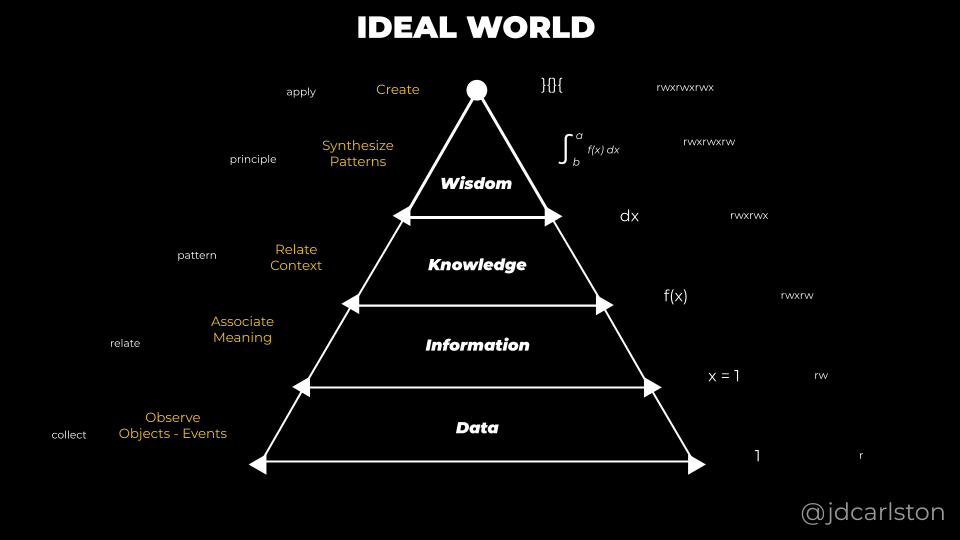
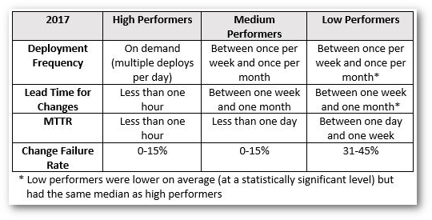
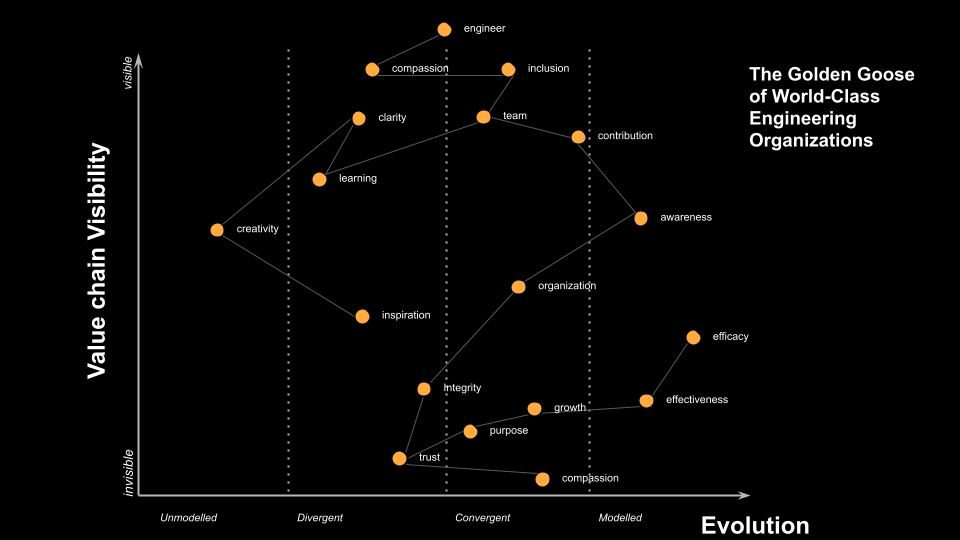

- [Read Part 2](/essays/what-in-the-world-is-world-class-engineering-part-2/)

Right before the new year the company I work for made an announcement about a shift in ownership. As my friends and I run through what might change as things move forward I wanted to gain clarity about a particular idiom that has been mentioned.

How might we get down to brass tacks and define what a “world-class engineering organization” is? How might we begin to measure something that, at first glance, is imprecise and qualitative?

> What attributes make something world-class?

## I want to understand the language of “world-class engineering” on a deeper level.

I see meaning and understanding as a structure of relational operators in our language and in our minds.

To assign meaning I need **Data**, the first stage of meaning-making is to sort values and objects into potentially relevant buckets. Research and scientific inquiry starts at the **data** stage — but it isn’t the end.

Data helps me understand the lay of the land. It becomes **Information** when I assign properties within it. Positioning many properties inside a bucket or mental space through process helps me turn it into **Knowledge.** Being able to apply and overlay that space elsewhere builds **Wisdom**.

*My own version of the DIKW Pyramid*

This is what [Russ Ackoff](https://www.leancompetency.org/video/russell-ackoff-on-systems-thinking/) (among others) referred to as the DIKW pyramid. Its a handy mental map often used in Systems Theory to build greater understanding and inquiry. Its not a perfect model, but I’ve found it useful in turning the abstract into practice.

In [my own conception](https://docs.google.com/presentation/d/1hxUHkZvEV46LfZTSikAaDD8J8L_wkic7K9YL87sXUPM/edit?usp=sharing)I’ve added **Create** at the top as the be-all-end-all purpose of the pyramid. This allows us to approximate and measure some form of effectiveness in any goal-oriented process. I’ve also added mathematical relations and [eventing](https://en.wikipedia.org/wiki/Event-driven_architecture) language to help me visualize the process and the learning space.

In this instance, we want to be able to create engineers and engineering orgs with specific characteristics, but we don’t know what those are yet.

## Start by Defining Terms

As I begin to research a new subject I often start by defining terms. I look to break down concepts into smaller pieces, things that are as concrete, demonstrable, and falsifiable as possible. I try to go deep in a rational way first. Keep in mind that in mathematical terms, rationalization is reducing something to its lowest terms.

In practical terms, I go to the dictionary look up the terms “world-class” and “engineering.” I try for at least three definitions of each.

### world-class /ˈˌwərld ˈˌklas/ adjective

> (1) (of a person, thing, or activity) of or among the best in the world. (2) being of the highest caliber in the world (3) ranking among the world’s best; outstanding; notorious.

### en·gi·neer·ing /ˌenjəˈniriNG/ noun

> (1) the branch of science and technology concerned with the design, building, and use of engines, machines, and structures. (2) the work done by, or the occupation of, an engineer. (3) the action of working artfully to bring something about. (4) the application of scientific knowledge for the practical purposes of designing, building, and using engines, machines, and structures

## Synthesize Definitions and Senses

I synthesized the fourth definition for engineering. I note how I’m feeling about each.

My first impressions of “world-class” is that its a saying and that feels a bit slippery. The term “class” in this context could also be misunderstood in a noblesse oblige way and has some problematic implications and social history in certain directions, even if not all. I think its important to be aware of this.

It all makes me want to find better terms and to iterate and deeply define more characteristics.

I also notice that I very much identify with the third definition of “engineering” (*the action of working artfully to bring something about*) It strikes me as elegant. I realize my synthesized version is more accurate. I strive for language that can lead me to more measurable quantities or methodologies. I think it is important to note that engineering includes both technology and the scientific process.

## Take Notes for Reference

I take note of a bunch of relevant related words and do a bit of personal Natural Language Processing. I can formalize this later if I want to build a system to automate the process of evaluating world-class engineering in some way. I look a bit deeper until I feel more satisfied in my definitions. I find words like:

- effective, useful, quality, outstanding, highly ranked, award-winning, five-star
- design, built, engine, machine, create, apply, science, technology, structure

Once I’ve done that I jot down and refine the words and definitions in a [doc](https://docs.google.com/document/d/1GAgNXSBIPvvusEaTJRVEBNZCJxi55YVuWDrtc8xSRz8/edit?usp=sharing).

## Get an External Perspective

The definitions are starting to feel somewhat interesting — *Outstanding* might be measurable. *Useful* and *effective* could possibly be as well — that speaks to someone/thing accomplishing a purpose or achieving a result. That could be measurable, with a stated goal. *Highly-ranked* is definitely quantitative on some level.

I quickly browse some links that seem useful. I keep some that seem the most relevant:

- **12 Principles of Agile **[https://www.agilealliance.org/agile101/12-principles-behind-the-agile-manifesto/](https://www.agilealliance.org/agile101/12-principles-behind-the-agile-manifesto/)
- **The Path to Becoming a World-Class Engineer** [https://www.engr.psu.edu/worldclass/](https://www.engr.psu.edu/worldclass/)
- **What Makes a World Class Engineer** [https://medium.com/building-creative-market/what-makes-a-world-class-engineer-557cc6d717cc](https://medium.com/building-creative-market/what-makes-a-world-class-engineer-557cc6d717cc)

## Create Discussion and Listen Carefully

I branch out to my friends and colleagues. The discussions we have bring in a lot of different ideas.

## Identify Points of Interest:

- Its possible to define world-class engineering through **negative induction and anti-patterns**:

*Waterfall, Siloed Knowledge, Low Fault Tolerance, Low Psychological Safety*

- **Fast and effective at coding and deploying iterations:**

Small, fast, and frequent Iterations and Retros (Agile). Iterative change can be measured using the [Accelerate](https://itrevolution.com/book/accelerate/) metrics in the software space.

*ACCELERATE The Science of Lean Software and DevOps: Building and Scaling High Performing Technology Organizations NICOLE FORSGREN JEZ HUMBLE GENE KIM*

### Passionate About People

Amazing engineers understand people’s needs, their strengths, and their limitations. They have compassion and empathy and have an unbridled curiosity for life in general.

### Economical Focus

Low WIP, robust prioritization methods (Lean). [Deep Work](https://www.calnewport.com/books/deep-work/) and [This is Lean](https://thisislean.com/) are great book recommendations for this. Has an understanding of business and cashflow concerns in development.

### Data Driven

Similar qualities to any scientific endeavor — reproducible, falsifiable. Uses the principles of [Chaos Engineering](https://www.oreilly.com/library/view/chaos-engineering/9781491988459/). (Scientific)

### Deep understanding of the tools necessary for the job

Awareness of the new and builds to the leading rather than the laggard edge. Cautiously adopts new technology.

### Broad understanding of the problems at hand

High-level of domain knowledge and awareness. [Domain Driven Design](https://www.domainlanguage.com/ddd/).

### A solid Learner’s mindset

Passionate, principled, open to change, ethical. I think I’ll probably have to write at least an entire post about the Learner’s Mindset. There’s a lot there. A great book on the subject is [The Fifth Discipline](https://en.wikipedia.org/wiki/The_Fifth_Discipline).

### Inclusive and able to work well with others — a Team Player

A team player reduces shame responses and values diverse input. They seek common interests and seek different viewpoints of everyone — from the least experienced to the most experienced members of a team and across industries and disciplines. They are high in empathy and compassion. [Dare to Lead](https://daretolead.brenebrown.com/) has a lot of good advice for team players.

* * *

## Define Underlying Needs

From there I identify related human needs (from the Non-Violent Communication Feelings & Needs Inventories) that I think any engineer or engineering org worth it’s salt should be able to address.

I use the [Needs list](https://www.cnvc.org/training/resource/needs-inventory) to help me understand the stories and feelings across broad swaths of people. These needs are common among humans. They help me generalize and find common threads and feelings that “world-class” engineering might elicit.

- compassion, trust, integrity, inclusion, contribution, inspiration, awareness, growth, learning, creativity, efficacy, effectiveness, participation, clarity, purpose. (That’s a lot but I can narrow down later.)

## Define Important Qualities (Quality Attributes)

In defining needs I gain a greater understanding of important qualities of success. I use Q[uality Attributes](https://en.wikipedia.org/wiki/List_of_system_quality_attributes) (the “ilities”) for understanding and starting to measure the overall goals of a system. Quality Attributes (and [Quality Attribute Scenarios](https://docs.google.com/presentation/d/1GgyaDnXs6LK0AYD9IWZRrOCnWkJMQTsYtMd0Eg2groo/edit)) are an important tool in my architecture tool chest. They allow me to understand what I might look for behaviorally, build out heuristics that might be noteworthy, and even begin to understand ways I might begin to measure and, most importantly, falsify “world-classiness.”

I usually try to pick 3–5 quality attributes to measure any given system.

- adaptability, autonomy, credibility, stability, resilience

## Reflect

This process helps me record, break down terms, conceptualize the thoughts I have, analyze the linguistics around values, and identify foundational principles in the space.

The process of breaking something down into component pieces might get us to the **information** stage of learning, possibly dip our toes into **knowledge**, but won’t take us as far as the domain of “whys” (**wisdom**).

* * *

As I start to flesh out my ideas, *World-class* as a model behavior is beginning to look like something that would be useful to multitudes of people regardless of country, class, or creed — an application that people all over the world would recognize and rank as highly useful.

Often, as I go through this process thoughts start to swirl around my mind. I jot down some that keep coming up for me.

## Model Behavior

Some world-famous people I admire came to mind. Margaret Hamilton, Grace Hopper, Steve Wozniak, Nikola Tesla, Ada Lovelace, Rembrandt, Da Vinci, Hildegaard of Bingen, Archimedes. A common theme of **Strong Identity and Diversity of Thought** made its way forward in my mind.

These are all people solid and confident in who they are and what they stand for. They all are polymaths who had effects in a number of subjects. I look for other ways to think about engineering from different cultures and disciplines around the world. Their value systems may differ significantly and world-class, in its highest ideal form, would mean being able to account for and translate that.

## Retrospect

I start relating everything conceptually — experiences and people.

The link that I included above from Pennsylvania State defined [**seven quintessential attributes**](https://www.engr.psu.edu/worldclass/):

> solidly grounded, technically broad, globally engaged, ethical, innovative, excellent collaborator, and visionary leader

My previous research with my colleagues gave me a deeper understanding around these seven attributes. And yet they still seem far from measurable. I have combined them into a more complete understanding though, and I have models in mind that I can to look to as examples of World-Class Engineers both historically and in my every day colleagues.

I decide to write a one-line IAM story about each attribute as an Individual Engineer:

- I **practice my skills** on a daily basis using the tools necessary for the job
- I stay abreast of **new tech**nology
- I employ **data-driven** methods to evaluate
- I am aware of **global concerns**, challenges and differences as I build systems and **increase awareness** of my place in the world
- I chose to do something based on its **merit in a broader ethical context** over what might benefit or reward me personally
- I **think innovatively** outside the box and reduce technical debt in novel ways
- I am passionate about understanding other viewpoints and **mental models**
- I pay attention to **feelings and senses** in myself and others.
- I address the needs of myself and others and feel compelled to **appreciate their individualities** as well as their commonalities
- I **embrace dissent** and examine mistakes **without shame** or blame
- I am solidly **grounded in principle** and gain perspective by practicing **deep and broad examinations** of subjects. (*My knowledge and skills are “M"-shaped.*)
- I have a **strong vision and identity** of who I am and where I am headed

## Define Next Steps

In my next post I’ll start extrapolating attributes at a team and an organizational level. Stay tuned for Part II.

I will use my [Quality Attribute Scenario Canvas](https://docs.google.com/presentation/d/1fpSdvbO8toVzJJIsENNb5pV9Uk-dypV3MrNbByz0l4M/edit#slide=id.ga85e345a72_0_0) to come up with metrics to quantify the qualities of world-class engineers and ways we might measure them in an organization.

I have started building a [Wardley Map](https://docs.google.com/presentation/d/1zturYs_IeqHXeEwFAxTkqpLq8BTU_YRlpkmhnlA-Fz0/edit#slide=id.g7956e7d49c_0_112) to help me understand and visualize the linguistic and evolution space in the broader marketplace of ideas. We’ll see if anything comes of it.

From there I can begin working out potential system tests based on the scenarios I’ve outlined. Those system tests will help us determine an MVP for successful measurements of “World-Class Engineering” as we go along.

## Planning

Please note, that all this prelim/planning work shouldn’t take more than couple days. Building an input, evaluation and reporting system will take a bit longer.

Hopefully we can come up with some measurables or heuristics. By the time we’re done we’ll definitely have a more cohesive understanding of the world-class engineering idiom.

## Related Links

- [What in the World is World Class Engineering? - Part 2](/essays/what-in-the-world-is-world-class-engineering-part-2/)
- [Characteristics of Self-Actualized People](https://www.verywellmind.com/characteristics-of-self-actualized-people-2795963)
- [Self-actualization](https://en.m.wikipedia.org/wiki/Self-actualization)
- [Trust is a Jenky State Machine](/essays/trust-is-a-jenky-state-machine/)

As always, let me know what you think here or on [twitter](https://twitter.com/jdcarlston).
