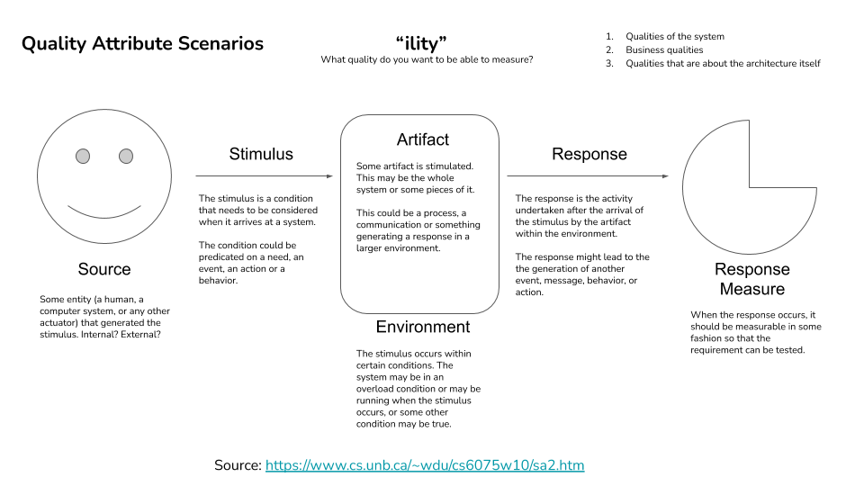
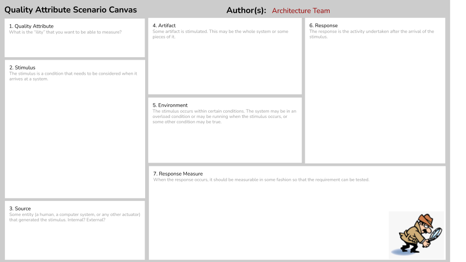

* * *

Back in 2014 I was working as a Software Architect at a bank overseeing the public facing sites they made available to clients and other partners.

We had a pretty decent training budget and I was able to fly out and take a number of architecture courses from the Software Engineering Institute at Carnegie Mellon.

While I was there the professors taught us about Quality Attribute Scenarios, among other things.

In my current job, my team has been implementing chaos engineering practices and patterns as well as getting closer to implementing fitness functions for our system.

As we’ve talked about it I realized there is quite a bit of value in running Quality Attribute Scenarios for these endeavors.

I pulled out my notes and put them to work for my team in our last off-site.

In synthesizing the notes I ended up creating a [**Quality Attribute Scenario Canvas**](https://docs.google.com/presentation/d/1GgyaDnXs6LK0AYD9IWZRrOCnWkJMQTsYtMd0Eg2groo/edit?usp=drivesdk) group exercise for the team.

Overall, I think it went well and was an engaging activity for all of us.

We discussed aspects of the initiatives in ways we wouldn’t have otherwise and went a bit deeper into important measurables this way.

It brought some great insights to the forefront and helped us determine ranges of success for some of the factors we want to account.

I think we all learned from it. And it is acting as a record we can refer to as we build our experiments and tests and has helped me figure out and focus on what we determined to be most important.

> I think something like this could be adapted to determine service contracts, and even OKRs and KPIs, and I might try to prove that eventually.

To use it, basically, start at one, fill it out and move to the next numbered section. I’ve provided some explanation and example slides as well to get you going.

Go ahead, give it a try and let me know what you think. Does it help you break down your ‘ilities’ and understand what’s most important for your system or initiatives?

[**Link to Slides**](https://docs.google.com/presentation/u/1/d/1GgyaDnXs6LK0AYD9IWZRrOCnWkJMQTsYtMd0Eg2groo/edit?usp=drivesdk)

*[https://docs.google.com/presentation/u/1/d/1GgyaDnXs6LK0AYD9IWZRrOCnWkJMQTsYtMd0Eg2groo/edit?usp=drivesdk](https://docs.google.com/presentation/u/1/d/1GgyaDnXs6LK0AYD9IWZRrOCnWkJMQTsYtMd0Eg2groo/edit?usp=drivesdk)*
